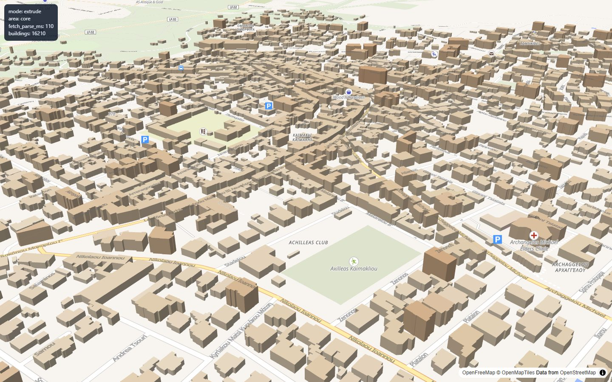
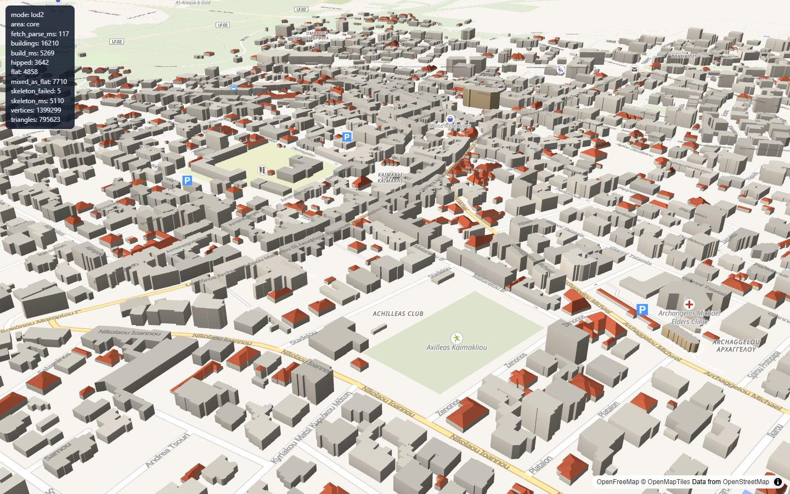
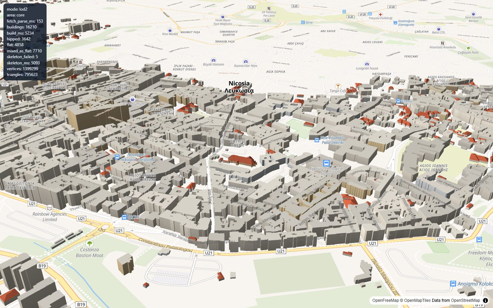
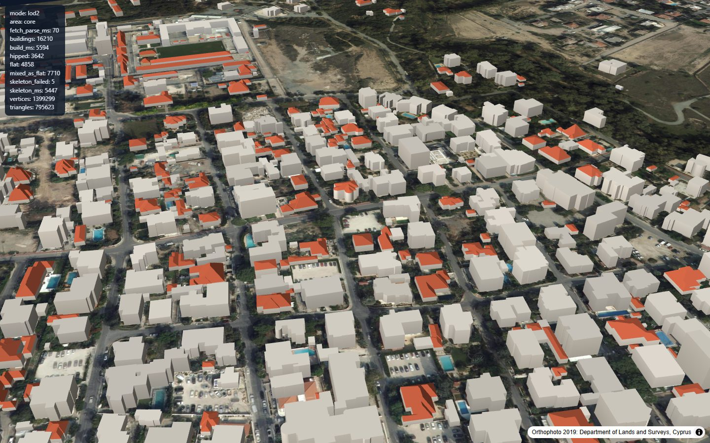
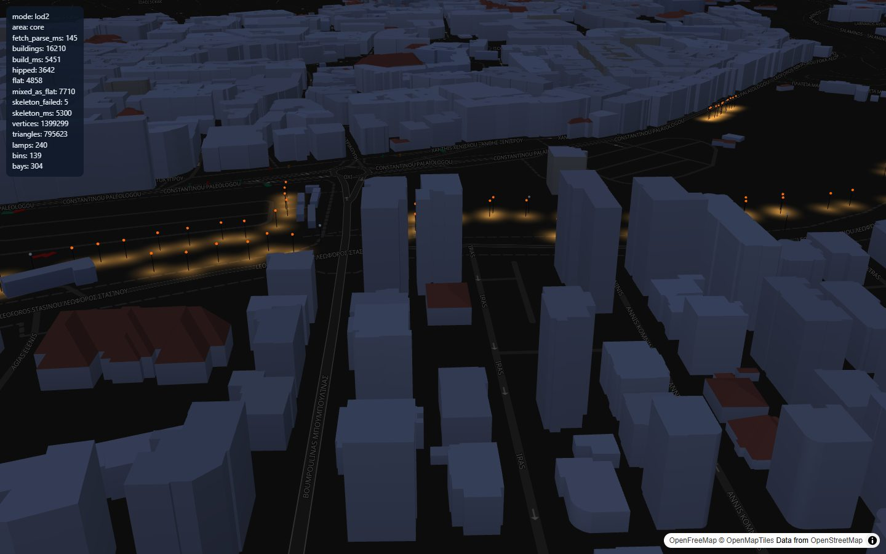
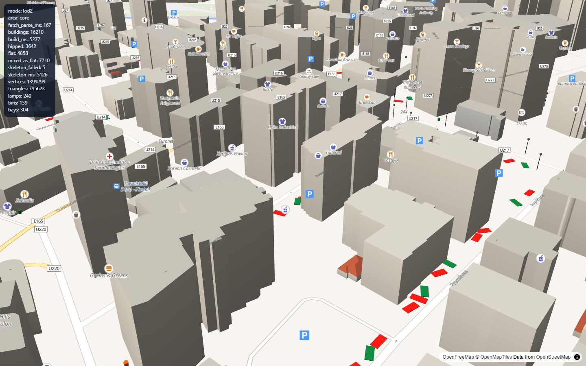
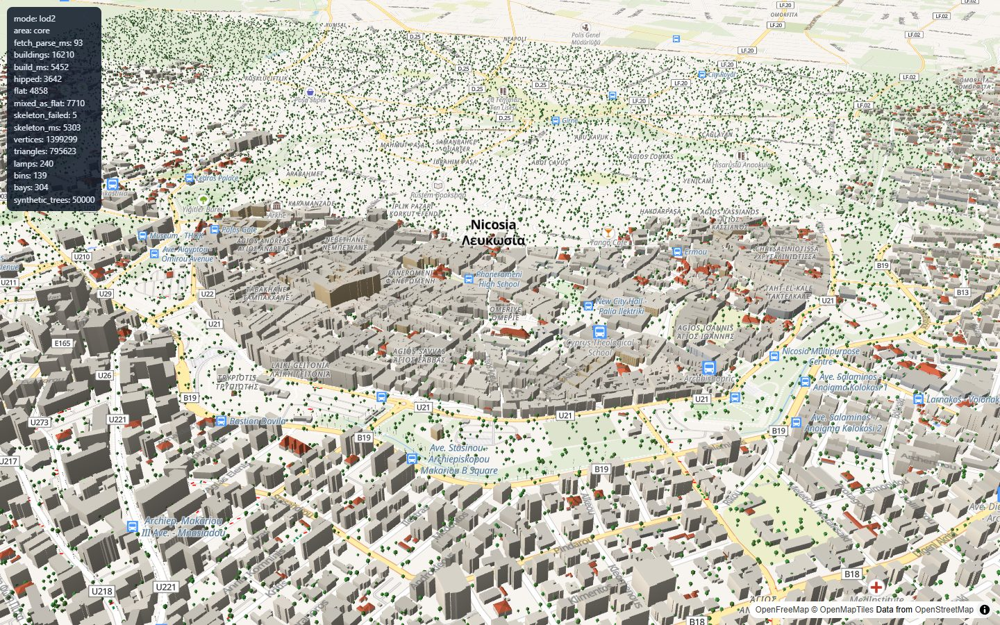

# How far Nicosia's map can go as a 3D twin: research and plan

Status: research and plan, 27 November 2026. Nothing in here is built on `main`; the only code
run for it is the throwaway spike in section 6. It follows
[digital-twin-roadmap.md](digital-twin-roadmap.md) and
[dangerous-buildings-and-3d.md](dangerous-buildings-and-3d.md), and it treats the draft pull
request [#31, "Realistic 3D Nicosia"](https://github.com/CYENS/smart-nicosia-api-exploration/pull/31),
as the step in progress: the plan says what comes after it, where it falls short, and the licence
question it raises.

The question: from extruded footprints, how far can the map go towards the most realistic and
useful 3D city that the data, the licences and a browser allow, and in what order?

How to read the evidence: "probed" means a request this research made itself on 26 or 27
November 2026 and the number is what came back. Everything else carries a link. Where a source
could only be read as a search result summary, the text says "unconfirmed".

## Executive summary

**What the evidence says, in six sentences.** Nicosia can go much further than extrusions without
buying anything: the Department of Lands and Surveys (DLS) flew LiDAR in 2019, and since 29
January 2026 gives away the resulting 1 m terrain model, a 50 cm surface model of the cities and
10 cm orthophotos through its portal, which is the raw material for measured roofs, real heights
for the old town's houses and real tree canopy. The two things everybody reaches for first are
closed: Google's Photorealistic 3D Tiles do not cover Cyprus and are refused to projects billed
in the European Economic Area, and no openly licensed 3D model of any Nicosia monument exists.
The one city-scale photogrammetric model, CYENS's iNicosia, is already tiled as 3D Tiles and
needs an agreement, not a survey. The rendering stack does not need to change: on the integrated
graphics of an ordinary desktop a frame costs 16 ms with today's extrusions and 21 ms with
generated roofs, every device as a 3D model and 10,000 trees, of which the flat base map alone is
11.5 ms; so MapLibre with custom layers holds, and a move to CesiumJS would rewrite every data
layer for a mesh the twin does not yet have. What makes this a twin and not a city model is the
step no dataset provides: the lamps, bins, bays and buses as 3D things that show their live state
on the city clock. The honest ceiling without new capture is a city with measured shapes and
photographed ground but painted walls: no real facades, nothing measured north of the buffer
zone, and a model frozen at 2014 (buildings) and 2019 (surface).

**Update, 27 November 2026.** Rung 3 is built ([#38](https://github.com/CYENS/smart-nicosia-api-exploration/pull/38)): the page's terrain and the server's
ground heights read the 1 m model. Building it turned up a shorter road to rung 4. DLS publishes
the 2019 surface and terrain models as plain files in its INSPIRE download folder, which
data.gov.cy lists under CC BY 4.0, so no CY Login is needed and the licence is stated (section
3.1, "The open folder"). The first slice of rung 4 is built on them ([#41](https://github.com/CYENS/smart-nicosia-api-exploration/pull/41)): the 54 sheets for
greater Nicosia were fetched with the owner's go-ahead, every DLS building was measured on
them, and the twin shows the measured heights and what changed since the 2014 survey
([lidar-2019.md](lidar-2019.md)).

### The ladder

Effort: S is part of a session, M one feature session, L more than one.

| Rung | What someone sees | Data and licence | Stack change | Effort | State |
| --- | --- | --- | --- | --- | --- |
| 0. Blocks under a real sun | Every DLS building at its height, lit by the sun and moon, casting shadows, on terrain; a view from any roof | DLS 3D model of 2014 (LoD1); AWS Terrarium terrain | None | Done | On `main` (#13, #26) |
| 1. A city that looks like Nicosia | The 2019 aerial photo on the ground, roofs shaped from the DLS roof type, the old town split into houses, OpenStreetMap's trees, the 1963 and 1993 photos to compare | DLS services (terms not stated), OSM (ODbL) | A raw WebGL custom layer for roofs and trees | In progress | Draft [#31](https://github.com/CYENS/smart-nicosia-api-exploration/pull/31) |
| 2. The twin's own things in 3D | Lamps that glow when the twin says they are lit, bins coloured by fill, bays by occupancy, buses moving, all on the clock; click one and the inspector opens | The twin's own data; CC0 model kits | Instancing in the same custom layer | M | Proposed, no blockers |
| 3. Measured ground | Terrain from the 1 m DLS model: the Pedieos valley, the moat and the bastions read as shapes; views and shade use it | DLS DTM 2019, CC BY 4.0 on data.gov.cy, served open by Mapterhorn | A tile URL and a decoder | S | Built, [#38](https://github.com/CYENS/smart-nicosia-api-exploration/pull/38) |
| 4. A measured city | Roofs with their real pitch and ridge, each old-town house at its own height, trees where they stand at their real size, buildings as they were in 2019 | DLS DSM and DTM of 2019: open files in DLS's INSPIRE download folder, CC BY 4.0 by its data.gov.cy record (about 1.2 GB for greater Nicosia) | An offline pipeline; the page draws its output | L | First slice built, [#41](https://github.com/CYENS/smart-nicosia-api-exploration/pull/41): measured heights and what changed since 2014. Roof shapes, the old town's houses and trees are still to come |
| 5. The whole city | North of the buffer zone gets buildings too, drawn as estimates | Overture footprints (ODbL), modelled heights (3D-GloBFP, CC BY 4.0), canopy (Meta and WRI, CC BY 4.0) | None | M | Proposed |
| 6. The old town as a photo-real mesh | The walled city as it looks, walls, bastions and squares in texture, with the clickable twin underneath | CYENS iNicosia, 3D Tiles on Cesium ion; licence not stated, by agreement | three.js with 3DTilesRendererJS in a custom layer | M to L | Needs an agreement |
| 7. Faces on the buildings | Windows by floor count; later, real facade textures on main streets | DLS floors; Panoramax photos (CC BY-SA 4.0, share-alike) | Texture atlas in the mesh layer | M, then research | Proposed |
| 8. Monuments you can walk up to | Famagusta Gate, a bastion, a square as Gaussian splats | New capture, or iNicosia's photos | A splat renderer in three.js | L | Needs capture and permits |
| Out of reach | Interiors; measured buildings north of the line; a mesh of the whole city; facades everywhere | Nothing public | | | See section 8 |

### The next three steps after #31, ranked

1. **The twin's own things in 3D, with live state on the clock (M).** Lamps, bins, bays, cameras
   and buses as instanced models that glow, fill and move with the twin's memory, pickable into
   the inspector. No data to wait for, no licence question, and it is the step that only a twin
   can take.
2. **Measured ground, and two letters (S).** Switch the terrain to the open 1 m DLS model (built,
   [#38](https://github.com/CYENS/smart-nicosia-api-exploration/pull/38)); in the same week the 2019 surface and terrain models are fetched (from DLS's open
   folder, not through the portal as first thought) and the owner writes to DLS about terms.
   This unblocks step 3 and settles the licence question #31 raises.
3. **A measured city from the 2019 LiDAR surface model (L).** An offline pipeline that turns the
   50 cm surface model into roof shapes, per-house heights in the old town and a tree canopy
   layer, replacing #31's estimates with measurements building by building.

After those: the north (rung 5), then the iNicosia mesh (rung 6) once CYENS agrees.

## 1. Where the map stands

### 1.1 On `main`

- **Buildings**: the DLS 3D model as GeoJSON in z16 tiles from `/api/buildings3d`
  (`chatbot/dls.py`), drawn as MapLibre fill-extrusions coloured by height (`city3d::fill` in
  `chatbot/web/src/lib/map/engine.ts`), with register buildings redrawn in red.
- **Light**: the real sun and moon drive MapLibre's light and sky (`lib/map/sky.ts`); the
  environment twin draws building shadows and sun hours (#13, `lib/environment/`).
- **Ground**: one shared terrain source (`lib/map/terrain.ts`, AWS Terrarium tiles), off on the
  everyday map, on in a view; the server reads the same tiles (`chatbot/terrain.py`).
- **Views**: "View from here" (#26, `lib/view.ts`) puts the camera at eye level on any roof or
  hill, with line of sight over terrain and buildings.
- **The twin's devices**: circles, columns and glows. Nothing is a 3D object.
- **MapLibre GL JS 5.24.0.** The 5.x line now gets patches only; the current release is 6.19.0
  ([releases](https://github.com/maplibre/maplibre-gl-js/releases),
  [April 2026 newsletter](https://maplibre.org/news/2026-05-02-maplibre-newsletter-april-2026/)).

### 1.2 The step in progress: #31, "Realistic 3D Nicosia"

Read from its branch `claude/realistic-3d-city-9fb9fb` on 27 November 2026 (six commits, draft).

| What it adds | How | Where it falls short |
| --- | --- | --- |
| The 2019 aerial photo on the ground | `chatbot/imagery.py`: a throttled proxy that fetches each DLS tile once and keeps it on disk; `lib/map/ground.ts` | The photo is DLS's cached set, read to level 19 of 21. It covers both halves of the walled city, stops just north of the walls, and ends inside Kaimakli (probed: no tiles past level 17 there). DLS states no terms for it (section 3.8) |
| Roofs from the DLS roof type and heights | `lib/city3d/roofs.ts`: hipped, gabled or flat by `ROOF_TYPE`, ridge along the footprint's longest side, a stair head on flat roofs; drawn by a raw WebGL custom layer (`mesh-layer.ts`) lit like MapLibre's extrusions | The shape is inferred. DLS gives one eave and one top height and a label with about five values; ridge direction, the stair head and the whole "mixed" class are guesses, and "mixed" is 49% of Nicosia's buildings (probed, section 3.2) |
| Old-town blocks split into houses | `chatbot/oldtown.py`: the cadastre's outlines inside each DLS block, each at the block's mean height (volume over area) | Every house in a block gets the same height, so the old town's skyline is flat by construction, and 170 register buildings there keep an estimated height |
| Trees | `chatbot/trees.py`: OSM `natural=tree` and tree rows where mapped; parks, woods and orchards planted on a grid as estimates; sizes by kind | OSM has 4,328 mapped trees and 95 rows in greater Nicosia (probed). Street trees OSM lacks are missing, and no tree has a measured height |
| The 1963 and 1993 photos in the clock's compare swipe | `lib/map/past-photo.ts`, reprojected per tile on the server | Fine as it is; the 1963 one is the only DLS photo that data.gov.cy lists under CC BY 4.0 |

What #31 does not attempt, and so what comes after it:

- **The twin's devices** stay flat. That is rung 2.
- **The ground** stays the 30 m SRTM terrain of the AWS tiles
  ([Tilezen sources](https://github.com/tilezen/joerd/blob/master/docs/data-sources.md)), while
  the 1 m DLS model is open. That is rung 3.
- **Measurement**: everything #31 adds to the shape of the city is inferred from attributes. The
  2019 surface model would measure it. That is rung 4.
- **The north**: DLS has no footprints there, so north of the buffer zone stays the base map's
  flat outlines. That is rung 5.
- **Age**: the building model is the city of 2014; anything built since is missing or wrong.
- **Walls** are plain colour: no windows, no texture.

The licence question it raises is in section 3.8, with the letter that would settle it.

## 2. Levels of a 3D twin

### 2.1 The levels, what each is for and what each costs

| Level | Looks like | Made from | Serves | Limits | Cost evidence |
| --- | --- | --- | --- | --- | --- |
| LOD1 | Extruded blocks | Footprints and one height | Massing, volume, district heat demand, inputs to noise and wind models, anything clicked and queried | Volume error 9% to 56% depending on where the top is referenced; no roof faces ([Biljecki 2016](https://doi.org/10.1016/j.isprsjprs.2016.03.003)) | Estonia: 917,882 buildings in 315 MB ([Land Board](https://geoportaal.maaruum.ee/eng/Download-3D-data-p837.html)) |
| LOD2 | Roof shapes, with roof, wall and ground surfaces told apart | Footprints and LiDAR (the Dutch 3DBAG) or stereo or oblique photos (Luxembourg, Zurich) | Solar per roof face, shade, envelope area, energy per building | Automatic models lack overhangs and small dormers; tied to the date of the inputs | 3DBAG: 10 million buildings, fully automatic, CC BY 4.0 ([paper](https://arxiv.org/abs/2201.01191)) |
| LOD3 | Windows, doors, detailed roofs | Mostly by hand, from street or oblique imagery | Facade solar, heritage, street-level simulation | "Has traditionally required manual modeling" ([ISPRS 2025](https://isprs-annals.copernicus.org/articles/X-4-W6-2025/225/2025/)) | Hand-modelled Dublin tiles sell at EUR 1,000 to 2,000 per 0.25 km2 ([AccuCities](https://accucities.com/3d-model-of-dublin/), unconfirmed) |
| Textured mesh | One continuous photo-real surface | Aerial nadir and oblique photos, or a drone | Engagement, design in context, visibility with trees and clutter | No semantics: one frozen surface that cannot be queried per building and goes stale ([Willenborg 2018](https://isprs-archives.copernicus.org/articles/XLII-4-W10/223/2018/)) | Helsinki: about EUR 1 million for the semantic model and the mesh together ([geoengineer.org](https://geoengineer.org/news/city-planners-generate-3d-mesh-representation-of-helsinki-as-part-of-a-3-year-smart-city-initiative)) |
| Mobile mapping | Street-level points and panoramas | A vehicle with LiDAR and cameras | Asset inventory, facades for LOD3 | Huge and street-side only: Vienna, 30 TB for 4,600 km ([Wien](https://digitales.wien.gv.at/wp-content/uploads/sites/47/2023/04/MA-41-Mobile-Mapping-Download-OGD-Abgabe-Kappazunder.pdf)) | AUD 400 to 1,500 per km ([Swyvl 2026](https://swyvl.io/blog/3d-mapping-cost-guide/), a vendor guide) |
| Interiors | Rooms and storeys | BIM or indoor scans | Evacuation, facility management | Per building, by its owner | Not a city product |
| Gaussian splats | View-dependent photo-realism | The same photos as a mesh | Demos, inspection, look and feel | "A visual rather than a metrical representation": no surfaces, no semantics ([AEC Magazine](https://aecmag.com/technology/introducing-gaussian-splats-for-aec/)) | About 30 million splats per km2 at 3 cm capture ([Cesium, April 2026](https://cesium.com/blog/2026/04/27/3d-gaussian-splats-lod/)) |

The level names follow CityGML and the finer LOD1.0 to LOD2.3 scheme of
[Biljecki, Ledoux and Stoter](https://3d.bk.tudelft.nl/hledoux/pdfs/16_ceus_lod_specs.pdf).
CityGML 3.0 drops LOD4: interiors can sit inside any level
([OGC 20-010](https://docs.ogc.org/is/20-010/20-010.html)).

### 2.2 How much a higher level buys, measured

| Analysis | LOD1 error | LOD2 error | Source |
| --- | --- | --- | --- |
| Envelope area | 7% to 26% | under 1% to 12% | [Biljecki 2016](https://doi.org/10.1016/j.isprsjprs.2016.03.003) |
| Gross volume | 9% to 56% | 10% to 38% | same |
| Shadow | 13% to 31% | 1% to 14% | same |
| Heat demand | Differs from LOD2 by under 10% at district level | Preferred per building | [KU Leuven review](https://lirias.kuleuven.be/retrieve/512557) |

Two findings in that work matter more than the table. Buildings with flat roofs and no overhangs
give the same answers at every level, and where the top of a block is referenced (eave, half
roof or ridge) moves the result as much as the level does. For Nicosia, where 20% of roofs are
flat and 49% "mixed" (a flat body with a pitched or raised part), that means: publish the height
reference, keep LOD1 as the working surface for analysis, and spend LOD2 effort where roofs are
pitched (31%) and where the answer is per roof face, which is rooftop solar.

### 2.3 What needs realism and what needs semantics

| Use | Needs | Minimum level |
| --- | --- | --- |
| Massing, zoning, floor area, any per-building answer | A building you can click and query | LOD1 with attributes |
| Rooftop solar, shade, energy per building | Roof geometry and identity | LOD2 (LOD1 on flat roofs) |
| Noise, wind, flood, urban heat | Clean simple geometry and terrain | LOD1 to LOD2 |
| Line of sight, views | Geometry; trees and clutter help | LOD2 or a mesh |
| Heritage record | Realism and metric detail | A mesh or scan per monument |
| Public engagement, demos | Realism | A mesh or splats over a clickable model |

The mature pattern is both, linked: Helsinki runs its energy atlas on the semantic model and uses
the mesh for design and games
([Helsinki 3D](https://www.hel.fi/en/decision-making/information-on-helsinki/maps-and-geospatial-data/helsinki-3d)).
For this twin, whose answers are layers and charts tied to building ids, the semantic layer is
the working surface and any mesh or splat is a presentation layer over it, picked through to the
building underneath.

### 2.4 What new capture costs

| Capture | Evidence | Per unit |
| --- | --- | --- |
| Airborne LiDAR | France LiDAR HD: EUR 57 million, 10 points per m2, whole country ([ActuIA](https://www.actuia.com/en/news/the-first-digital-models-from-the-lidar-hd-program-are-available/)); a vendor quote of EUR 94,500 for 215 km2 at 15 points per m2 ([Airborne LiDAR Mapping](http://www.airbornelidarmapping.com/)) | About EUR 100 to 450 per km2 in large blocks; a one-off block the size of Nicosia sits above that, because mobilisation dominates |
| Drone photogrammetry | AUD 30 to 120 per hectare above 50 ha ([Swyvl 2026](https://swyvl.io/blog/3d-mapping-cost-guide/)) | The walled city (about 180 ha): in the order of AUD 5,000 to 21,000 before permits and processing |
| Oblique aerial mesh | No public price per km2 was found; oblique flights cost more than nadir ([GIM](https://www.gim-international.com/article/growing-use-of-oblique-imagery-by-municipalities)) | Needs quotes |
| Terrestrial scan of a monument | AUD 1,800 to 3,500 a day ([Swyvl 2026](https://swyvl.io/blog/3d-mapping-cost-guide/)) | |

## 3. Data for Nicosia

### 3.1 What DLS holds and gives

| Product | Year | What it is | Access | Source |
| --- | --- | --- | --- | --- |
| 3D buildings (INSPIRE BU3) | 2014 flight, finished August 2015 | 564,454 footprints with roof, eave and ground heights, floors, use and a roof type; from stereo photogrammetry, not LiDAR; LoD1; no CityGML or LOD2 edition; no accuracy figure published | Anonymous ArcGIS query service (what the twin reads today) | [DLS metadata](https://eservices.dls.moi.gov.cy/portal_geocatalog/opensearch?q=buildings&f=json&size=20), [project page](https://portal.dls.moi.gov.cy/anaptixiako_program/aerofotografisi/) |
| LiDAR flight | 2019 | Contract targets: 10 points per m2 urban, 5 rural; orthophotos at 10 cm | The point cloud is offered nowhere | [EuroGeographics 2019](https://eurogeographics.org/app/uploads/2024/12/eurogeographics-annualreview2019-cyprus.pdf) |
| Terrain model (DTM) | 2019 | 1 m grid of the government-controlled area | Open files in DLS's INSPIRE download folder (below), CC BY 4.0 on data.gov.cy; also through Mapterhorn (section 3.3) and the portal | [ICA national report 2023](https://icaci.org/files/documents/national_reports/2019-2023/Cyprus-2023.pdf) |
| Surface model (DSM) | 2019 | 50 cm grid of the city areas, "(Lidar Survey 2019)" | Open files in the same folder; also free through the portal | same |
| Orthophotos | 1963, 1993, 2008, 2014, 2019 | 2014 and 2019 at 10 cm; six anonymous map services | Map services; 2019 at 10 cm as files through the portal | [BASEMAPS folder](https://eservices.dls.moi.gov.cy/arcgis/rest/services/BASEMAPS?f=json) |
| Cadastral building outlines | current | Every building outline, no heights; covers the north with pre-1974 outlines | Anonymous query service | `National/CadastralMap_EN/MapServer/28` |

**The free route.** DLS announced on 27 January 2026: "from 29/01/2026, the new e-service
'Photogrammetry Data Availability' will be available on the Dls Portal, which includes
orthophoto maps, digital terrain models (DTM), digital surface models (DSM), contour lines and
building data", "free of charge, with a specific daily download limit of up to 1GB", for "users
with an identified profile"
([announcement](https://portal.dls.moi.gov.cy/en/nea-e-ypiresia-diathesis-dedomenon-fotogrammetrias-sti-pyli-ktimatologiou/),
[manual](https://helpfiles.dls.moi.gov.cy/en-us/Application48.pdf)). The page was read for this
research; the service itself sits behind CY Login and was not opened, so the exact product list,
tile size and formats are not confirmed. The paid route, by application, is EUR 17 per km2 for a
DTM or a DSM plus VAT, with areas over 50 km2 needing the Director's approval
([service page](https://portal.dls.moi.gov.cy/application_forms/fotogrammetrika-dedomena/)).

**The open folder** (found on 27 November 2026, while building rung 3). The data.gov.cy record
for DLS elevation, licensed CC BY 4.0, lists an "Elevation Directory" resource
([record](https://www.data.gov.cy/el/dataset/ypsometria-inspire),
[resource](https://www.data.gov.cy/el/resource/elevation-directory-gml)) that points at
`eservices.dls.moi.gov.cy/inspire_downloads/EL/`. Mapterhorn built its Cyprus terrain from the
`rasters/2019_DTM` folder there
([its recipe](https://github.com/mapterhorn/mapterhorn/tree/main/source-catalog/cy)). With the
owner's go-ahead the folder's listings were read (five requests, nothing downloaded):

| Folder | What the listing shows |
| --- | --- |
| `rasters/2019_DSM` | 1,068 GeoTIFF sheets of 2.5 km, each with a world file and overviews; 64 GB in all. The sheet sizes (median 50 MB against 14 MB for the terrain) fit a 50 cm grid, which is not confirmed until a file is opened |
| `rasters/2019_DTM` | 1,070 sheets, 18 GB in all |
| `rasters/2014_DSM`, `2014_DTM`, `1993_DTM`, `1963_DTM` | Earlier models, not listed further |
| `Pancyprian_Index_2500X2500_ETRS89` | The sheet index, one 83 kB zip |

Sheets are named `ETRS89_<x>_<y>.tif` after their south-west corner on the national grid
(EPSG:6312), in hundreds of metres. Greater Nicosia is 27 sheets: 0.95 GB of surface model and
0.22 GB of terrain model. The walled city is three (`2300_3925`, `2325_3925` and a part sheet
`2325_3950` north of the line): 83 MB and 16 MB. The surface model has a sheet wherever the
terrain model has one, so it is not limited to "the city areas"; whether it is 50 cm everywhere
is for the files to say. This folder is plain files behind a public record, not the WFS download
service that the house rule keeps away from; the rule's wording should say so.

**What is planned.** DLS has announced no 3D cadastre and no national twin. It plans to update
the 2014 buildings database from the 2019 flight
([Photogrammetry sector](https://portal.dls.moi.gov.cy/en/to-tmima/kladoi/geodaisias-ydografias-fotogrammetrias/tomeas-fotogrammetrias-kai-tilepiskopisis-2/));
nothing is served yet, so the twin should treat its building source as swappable. A 2026
EuroGeographics presentation is reported to list a 2027 flight with 5 cm photography and
nationwide LiDAR; the file could not be opened, so this is unconfirmed, but it is worth asking
DLS before anyone pays for a flight.

### 3.2 What the probes found

All probed on 26 and 27 November 2026. "Greater Nicosia" is the box 33.28 to 33.44 E, 35.10 to
35.22 N unless stated.

| Question | Result |
| --- | --- |
| DLS 3D footprints in greater Nicosia | 74,192 |
| DLS 3D footprints in the walled city, south of the buffer zone (35.166 to 35.1765 N) | 1,792 |
| The same, north (35.179 to 35.186 N) | 345, along the line; in the suburbs beyond (35.19 to 35.23 N) 865 in 28 km2, so in practice none |
| Roof types, 41,817 buildings in the twin's tile cache | Mixed 49%, inclined 31%, flat 20% |
| What the two heights mean | Inclined: the top is the ridge and the eave sits at about three quarters of it. Mixed: the top matches the floor count (about 3.1 m a floor) and the eave is the lowest part, about half. 75% of footprints have more than 0.5 m between eave and top |
| Heights | Median 6.0 m, 90th percentile 14.3 m, tallest in the cache 66.9 m; 45% of buildings have one floor |
| Cadastral outlines in the walled city (both sides) | 10,935, no floors or heights |
| OSM buildings (both sides) | 71,074; with `height` 809 (1.1%), with `building:levels` 4,423 (6.2%), with `roof:shape` 57, `building:part` 65 |
| OSM trees | 4,328 `natural=tree`, 95 tree rows; 30 street lamps |
| Overture 2026-11-18.0 buildings | 102,803: 71,147 from OSM and 31,656 from Microsoft; 810 with a height, 4,422 with floors, 58 with a roof shape |
| Overture north of the line | Walled city north: 2,436 footprints, 6 heights. Northern suburbs box: 14,159 footprints, 26 heights |
| DLS 2019 photo tiles | Levels 0 to 21 (7.5 cm) over the old town on both sides of the line, Strovolos and Engomi; at Kaimakli nothing past level 17; a missing tile answers 404 with no CORS header, so a browser reports it as blocked |
| Street photos in the walled city (Panoramax) | 9,923 pictures, 9,599 of them 360 degree, 2018 to June 2026, all CC BY-SA 4.0 ([query](https://api.panoramax.xyz/api/search?bbox=33.352,35.166,33.376,35.184&limit=10000)); KartaView returned none |
| Open 1 m terrain tiles (Mapterhorn) | Answer at levels 16 and 17 over the old town and over north Nicosia |
| Google Photorealistic 3D Tiles | Not probed: there is no Google key in the project, and the documents settle it (section 3.4) |

### 3.3 Open global and European data

**Terrain.** The best open ground is DLS's own: Mapterhorn serves the "Cyprus DTM 2019" at 1 m
as Terrarium tiles to level 17, credited to DLS under CC BY 4.0 through data.gov.cy
([attribution](https://download.mapterhorn.com/attribution.json),
[data access](https://mapterhorn.com/data-access/),
[dataset](https://www.data.gov.cy/el/dataset/ypsometria-inspire)). The AWS tiles the twin uses
now are SRTM at 30 m over Cyprus
([Tilezen](https://github.com/tilezen/joerd/blob/master/docs/data-sources.md)). Copernicus
GLO-30 (free, with its notice) is the fallback and the only certain ground north of the line; it
is a surface model with a 2 to 4 m error, which in a city with 70 m of relief is a large part of
the signal ([Copernicus DEM](https://dataspace.copernicus.eu/explore-data/data-collections/copernicus-contributing-missions/collections-description/COP-DEM)).
The 10 m EEA-10 can only be downloaded by public authorities and EU-funded research.

**Building heights.** Nothing global comes close to a measured height per footprint.

| Source | How the height is obtained | Reported error | Licence |
| --- | --- | --- | --- |
| DLS 3D model | Measured, stereo photos of 2014 | Not published | Section 3.8 |
| OSM tags, through Overture | Surveyed or estimated by volunteers, 1% of buildings | Not quantified | ODbL |
| Microsoft footprints | Modelled from imagery; none on its Nicosia footprints in Overture (probed) | Not published | CDLA Permissive 2.0 per its [README](https://github.com/microsoft/GlobalMLBuildingFootprints); ODbL inside Overture |
| GlobalBuildingAtlas LoD1 | Modelled from single 3 m satellite images | RMSE 4.1 m in Europe ([paper](https://essd.copernicus.org/articles/17/6647/2025/)) | Heights CC BY-NC 4.0: not for a public twin with any commercial use |
| 3D-GloBFP | Modelled, a height for every Microsoft footprint | RMSE 1.9 to 14.6 m by region, weakest fit in Europe ([paper](https://essd.copernicus.org/articles/16/5357/2024/)) | CC BY 4.0 |
| Google Open Buildings and 2.5D | | Does not cover Cyprus ([Google](https://sites.research.google/gr/open-buildings/)) | |
| Urban Atlas Building Height 2012 | Measured, satellite stereo, 10 m cells, capital cities | Below 3 m by specification | Copernicus open; Lefkosia's package unconfirmed (the servers refused connections) |

An error of 4 to 6 m is one to two storeys. In a city where the median building is 6 m tall,
modelled heights can sort buildings into low, mid and tall and cannot give a roofline. They are
a flagged fallback for the north and nothing more.

**Trees.** Only two open sources resolve a single tree: OSM's mapped trees (sparse) and the Meta
and World Resources Institute canopy height maps at about 1 m (version 2 of March 2026, CC BY
4.0, [registry](https://registry.opendata.aws/dataforgood-fb-forestsv2/),
[paper](https://arxiv.org/abs/2603.06382)). Copernicus's Street Tree Layer maps patches of at
least 500 m2 and its Tree Cover Density is a 10 m percentage; both are masks, not trees.

**Imagery to drape.** ESA WorldCover (CC BY 4.0) and the EOX Sentinel-2 mosaics of 2016 and 2017
(CC BY 4.0; later years are non-commercial) are free to redistribute at 10 m. Nothing open comes
near the DLS photos.

### 3.4 Photorealistic and commercial services

| Service | Over Nicosia | Terms and cost | Verdict |
| --- | --- | --- | --- |
| Google Photorealistic 3D Tiles | Not covered: Google's country table gives Cyprus 2D tiles only ([coverage](https://developers.google.com/maps/coverage), updated 10 November 2026) | Projects created after 8 July 2025 and billed in the EEA, which includes Cyprus, get HTTP 403 for 3D and satellite tiles ([EEA guide](https://developers.google.com/maps/comms/eea/map-tiles)); elsewhere, no caching, no analysis, no deriving geometry, USD 6 per 1,000 root requests ([policies](https://developers.google.com/maps/documentation/tile/policies)) | Closed on two independent grounds |
| Cesium ion | 30 m terrain, OSM-derived buildings, Bing aerial; its value is hosting your own tiles | A government or funded research project needs a paid plan, from USD 149 a month; the ion logo must show ([pricing](https://cesium.com/platform/cesium-ion/pricing/), [terms](https://cesium.com/legal/terms-of-service/)) | Only as the host of iNicosia's tiles |
| Esri World Imagery | 0.5 m Vantor imagery of 23 May 2025 ([identify](https://services.arcgisonline.com/arcgis/rest/services/World_Imagery/MapServer/identify?f=json&geometry=33.3642,35.1746&geometryType=esriGeometryPoint&sr=4326&layers=all&tolerance=1&mapExtent=33.36,35.17,33.37,35.18&imageDisplay=400,400,96&returnGeometry=false)) | Usable in MapLibre with a key and "Powered by Esri"; 2 million tiles a month free, then USD 0.15 per 1,000 ([pricing](https://location.arcgis.com/pricing/)) | The lawful recent photo, and the only recent one that shows the north: coarser than DLS but six years newer |
| Mapbox GL JS v3 | Shadows, models and trees built in | Proprietary, tied to Mapbox services, billed per map load ([licence](https://github.com/mapbox/mapbox-gl-js/blob/main/LICENSE.txt)) | Not a data source; see section 4 |
| Airbus Pleiades Neo 30 cm | Archive or tasking | About USD 22.50 per km2 through a reseller (unconfirmed), before a display licence | Only if a newer licensed photo is wanted |

### 3.5 Street-level imagery

Panoramax holds dense, recent, open 360 degree coverage of the walled city, almost all from one
contributor, under CC BY-SA 4.0, with no key. Facade textures or reconstructions made from those
photos are adaptations: lawful, with credit, and the result must itself be shared under CC BY-SA
4.0 ([deed](https://creativecommons.org/licenses/by-sa/4.0/)). Mapillary could not be counted
without a token; its images are CC BY-SA and its terms ask for a client id and its logo
([terms](https://www.mapillary.com/terms)). Google captured Nicosia in autumn 2024 without the
north ([VirtualStreets](https://virtualstreets.org/index.php/2025/11/04/google-street-view-cyprus-bosnia-and-herzegovina/));
its terms forbid tracing or building models from Street View, and for EEA projects forbid
showing Street View tiles next to any map
([terms](https://cloud.google.com/terms/maps-platform/eea/maps-service-terms)).

### 3.6 3D captures of Nicosia that already exist

| Asset | Holder | What | Terms |
| --- | --- | --- | --- |
| iNicosia | CYENS, since 2018 | Terrestrial and aerial photogrammetry and laser scans of buildings, monuments, the walls and Eleftheria Square; already 3D Tiles on Cesium ion, shown in CesiumJS ([Cesium, 2023](https://cesium.com/blog/2023/03/30/smart-city-infrastructure-in-cesiumjs-connecting-nicosia), [project](https://inicosia.cyens.org.cy/)) | No extent, download or licence published; 264 view-only models on [Sketchfab](https://sketchfab.com/inicosia_cyens). Shared with a University of Cyprus team for an evacuation study ([Aristidou](https://andreasaristidou.com/DisasterEvacuation)) |
| Interactive Visualisation of Historic Nicosia | The Cyprus Institute, 2016 to 2023 | 33 photogrammetric monuments and the walls, in a Unity application at the Leventis Municipal Museum ([Time Machine](https://www.timemachine.eu/ltm-projects/interactive-visualisation-of-historic-nicosia-2/)) | Not published; by request |
| Survey of the walls | ITABC-CNR with the municipality and the Cyprus Institute, 2016 | Photogrammetry of the southern side ([record](https://iris.cnr.it/handle/20.500.14243/357317), unconfirmed) | Not public |
| Mobile mapping vehicle | ERATOSTHENES Centre of Excellence, 2026 | A LiDAR and camera vehicle with an open access policy for outside users ([ERATOSTHENES](https://eratosthenes.org.cy/presentation-of-the-pioneering-mobile-3d-mapping-system-by-the-eratosthenes-centre-of-excellence-2/)) | No streets listed as mapped; a pass of the old town could be asked for |

No openly licensed 3D model of any named Nicosia monument was found in Sketchfab, Europeana,
Zenodo or the heritage repositories. iNicosia is the shortest route to a real mesh of the old
town. It is CYENS's own project and this repository lives in CYENS's GitHub organisation, so
this may be a conversation inside one building, not a licence negotiation; the owner knows
which.

### 3.7 North of the buffer zone

- DLS: no 3D footprints, no LiDAR products, no 2019 photo beyond the walled city. Parcels and
  pre-1974 building outlines do exist in the cadastre.
- Footprints: OSM and Microsoft, both through Overture (ODbL), about 14,000 in the northern
  suburbs box, with heights on 26.
- Heights: modelled only (section 3.3).
- Photos: Esri World Imagery, and DLS's 1963 and 2009 to 2013 mosaics.
- Mesh: none. "There is currently no 3D model of the northern part of the capital"
  ([Cyprus Mail, November 2025](https://cyprus-mail.com/2025/11/10/how-far-can-tech-go-to-keep-us-safe)).
  A separate twin of the north was tendered by Turkey's environment ministry in June 2025
  ([Cyprus Mail](https://cyprus-mail.com/2025/06/10/work-to-begin-to-create-digital-twin-of-north));
  its outcome is unknown and it would not be open to this project.

### 3.8 Licences, and the question #31 raises

| Source | Licence as stated | What the twin must do |
| --- | --- | --- |
| DLS data listed on data.gov.cy (3D buildings, elevation, the 1963 photo) | "Creative Commons Attribution 4.0 International (CC BY 4.0)" ([FAQ](https://www.data.gov.cy/en/faq), [buildings](https://www.data.gov.cy/el/dataset/ktiria-inspire)) | Credit DLS, mark changes |
| DLS INSPIRE dataset metadata | "Use limitation: CC BY-SA 4.0", "no limitations" ([elevation record](https://eservices.dls.moi.gov.cy/portal_geocatalog/rest/metadata/item/e1898e980ef8414497943f7b0fce542b/html)) | As above, and share derived datasets alike |
| DLS `BASEMAPS` photo services (2014, 2019, 1993) | Nothing: empty copyright fields, empty WMS fees and constraints; only 1963 is on data.gov.cy | Unknown; #31 credits DLS and keeps every tile on disk |
| DLS `National` map services (parcels, cadastral buildings) | The portal's API catalogue: "please contact the Portal Administrator", "All rights reserved" ([catalogue](https://portal.dls.moi.gov.cy/en/alles-ypiresies/katalogos-apis/)) | Unknown; the registers (on `main`) read parcels and #31 reads the building outlines |
| DLS elevation files in the INSPIRE download folder (DTM, DSM) | CC BY 4.0, through the data.gov.cy record that links the folder | Credit DLS, mark changes; the letter still asks DLS to confirm it for the surface model |
| DLS portal downloads (10 cm orthophoto, and the same DTM and DSM) | "Free of charge"; no licence text found | Ask before redistributing tiles cut from them |
| OSM, Overture | ODbL | Credit; share the derived database alike |
| Mapterhorn terrain | Per source: the Cyprus DTM is CC BY 4.0, GLO-30 carries the Copernicus notice | Credit both |
| Panoramax photos | CC BY-SA 4.0 | Credit; derived textures are share-alike |
| Meta and WRI canopy, 3D-GloBFP, WorldCover | CC BY 4.0 | Credit |
| GlobalBuildingAtlas heights, FABDEM, EOX mosaics from 2018 | Non-commercial | Avoid |

**The question.** Three statements coexist for DLS data: CC BY 4.0 on data.gov.cy, CC BY-SA 4.0
in DLS's own metadata, and "All rights reserved" in the portal footer and API catalogue. The
services #31 leans on hardest, the aerial photo tiles and the cadastral outlines, are the ones
with no open statement at all. Reading them from a browser or a throttled proxy is tolerated
use, not a licence, and keeping every tile on disk for good is the part most likely to need
consent. This research also found that the premise in this repository's notes, that DLS's
INSPIRE download services are the paid ones, is not supported by DLS's own documents: its
metadata marks the Buildings and Addresses downloads "Free of charge" and its INSPIRE page says
the services carry no charge
([INSPIRE page](https://portal.dls.moi.gov.cy/en/enimerosi/odigia-inspire/diadikasia-ylopoiisis-odigias-inspire-sto-dls-portal/)).
No WFS download service was called to test it. The plain file folder for elevation was listed
on 27 November 2026 with the owner's go-ahead (section 3.1, "The open folder").

**The letter that settles it** (to `INSPIRE@dls.moi.gov.cy` and the portal administrator), in
four questions:

1. May a public, non-commercial web application show the `BASEMAPS` orthophotos with the credit
   "Department of Lands and Surveys, Republic of Cyprus", through a server-side cache that keeps
   tiles?
2. May it read the `National/CadastralMap_EN` parcel and building layers the same way?
3. Under which licence are the files from the Photogrammetry Data Availability e-service, and
   may tiles and 3D models derived from the DSM and DTM be served to the public?
4. Can the 2019 LiDAR point cloud of Nicosia be obtained, and is a flight planned for 2027?

Until DLS answers, #31's proxy should keep its credit, stay behind the twin's password, and be
easy to switch off; the 1963 photo and the 3D model are the parts with a clear open licence.

## 4. Rendering stacks

### 4.1 The options

| Stack | State | Adds | Costs or breaks |
| --- | --- | --- | --- |
| MapLibre GL JS alone | 6.19.0 (17 November 2026); the twin is on 5.24.0 | Nothing lost. Version 6 adds experimental hooks for custom layers on terrain and `symbol-height-offset` ([changelog](https://raw.githubusercontent.com/maplibre/maplibre-gl-js/main/CHANGELOG.md)) | No shadows, no model layer, no 3D Tiles in core, and none on the [roadmap](https://maplibre.org/roadmap/maplibre-gl-js/); one light, for extrusions only; a flat roof per extrusion |
| MapLibre and a custom layer (raw WebGL, as #31, or three.js) | The official docs draw 3D Tiles with three.js and 3DTilesRendererJS on 6.19.0 ([example](https://maplibre.org/maplibre-gl-js/docs/examples/add-3d-tiles-3d-objects-and-models-using-threejs/)) | Roof meshes, instanced models, 3D Tiles meshes, splats, own shadow passes, in the map's GL context and depth buffer | The map's light, picking and labels do not reach the custom geometry: each needs a counterpart |
| MapLibre and deck.gl | 9.4 with a MapLibre module ([docs](https://deck.gl/docs/api-reference/maplibre/overview)) | Tile3DLayer, instanced glTF, colour picking | Layers are not draped on MapLibre terrain; shadows are experimental; picking a 3D Tiles mesh returns the tile, not a building; a second layer system beside the engine's |
| CesiumJS | 1.147 | The best 3D Tiles, terrain, shadows and splat streaming | Vector tiles are a 2026 preview styled by line width and colour only, with no label engine ([Cesium](https://cesium.com/blog/2026/09/02/vector-tiles-technology-preview-cesium-and-3d-tiles/)): the base map, every data layer, the callouts and the inspector's picking are rewritten |
| Mapbox GL JS v3 | 3.36 | Shadows, ambient occlusion, models, trees and weather built in | Proprietary and tied to Mapbox services; undoes the keyless stack |
| Babylon.js, plain WebGPU, Giro3D | | Full engine lighting | The map, labels, layers and inspector rebuilt from nothing; MapLibre's own WebGPU backend is in progress with nothing released ([roadmap](https://maplibre.org/roadmap/maplibre-gl-js/graphics-modernization)) |

### 4.2 How each keeps the twin working

| | Data layers and legends | Chips and hover links | Inspector on click | City clock | Sun, shadows, weather |
| --- | --- | --- | --- | --- | --- |
| MapLibre with custom layers | Unchanged | Unchanged for layers; a 3D object needs a highlight of its own | `queryRenderedFeatures` for layers; an invisible extrusion keeps buildings pickable under a mesh (measured, section 6); a ray for instanced objects | Unchanged; instanced objects take per-instance state from the same clock data | The custom layer reads the same sun as `sky.ts`; #31 already lights roofs to match |
| deck.gl overlay | Kept, but new 3D layers live in a second system | Rebuilt for deck layers | deck picking for its layers, MapLibre's for the rest | Kept | deck's own lighting, apart from the map's |
| CesiumJS | Rewritten | Rewritten | Rewritten on Cesium picking | Could map onto Cesium's clock | Built in |

### 4.3 Recommendation

Stay on MapLibre and put all new 3D in custom layers. The reasons, in order:

1. **The frame budget is not the problem.** Section 6 measures it: on integrated graphics the
   base vector map alone costs 11.5 ms, and roofs, devices and 10,000 trees add 9 ms.
2. **The data that would justify CesiumJS is not there.** Google's tiles are closed; the one
   mesh (iNicosia, the old town) can be drawn inside MapLibre the way MapLibre's own example
   does. People who tried to run MapLibre inside Cesium report it "extremely laggy" and settled
   on MapLibre with three.js in one context
   ([Cesium forum, May 2026](https://community.cesium.com/t/best-practices-for-hybrid-maplibre-cesium-architecture-handling-mvt-terrain-and-complex-styling-in-production/46031)).
3. **One custom layer, not three systems.** #31's `mesh-layer.ts` is raw WebGL with instancing
   and one small dependency (earcut); rungs 2, 4 and 5 fit it. three.js earns its place in the bundle only at
   rung 6, where 3D Tiles and later splats need a loader and a renderer that someone else
   maintains. deck.gl would add a second layer system for nothing the first cannot do.
4. **If a photo-real mode ever needs CesiumJS** (city-scale splats with level of detail are
   Cesium's lead), make it a second view with a shared camera, not one engine drawn into the
   other.

**MapLibre 6 is its own step (M).** Version 5 gets patches only. Version 6 is ESM only, removes
the internal `transform` and changes how light positions interpolate, all of which touch
`engine.ts`, `sky.ts` and `view.ts`. It brings the terrain hooks a custom layer needs to sit on
raised ground without the per-vertex ground heights #31 carries. Do it before rung 6, on its own
pull request, with the views and the clock replayed in Playwright.

## 5. The twin's own objects in 3D

**Drawing.** MapLibre has no model layer, so the routes are an instanced custom layer or
deck.gl's ScenegraphLayer ([docs](https://deck.gl/docs/api-reference/mesh-layers/scenegraph-layer)).
Shipped examples reach tens of thousands of instances directly. The only published model budget
is Mapbox's: under 15,000 vertices a model for small instance counts
([guide](https://docs.mapbox.com/style-spec/guides/using-3d-models/)); street furniture drawn by
the thousand should be a few hundred triangles. Section 6 measured 683 devices as free and
10,000 trees of 30 triangles each at 3 ms on integrated graphics.

**Models.** Low-poly kits under CC0: Kenney ([terms](https://kenney.nl/support)), Poly Haven
([licence](https://polyhaven.com/license)), Quaternius (CC0 or its own licence per kit,
[FAQ](https://quaternius.com/faq.html)). A lamp, a bin and a bay are simple enough to model by
hand in code, which keeps the control-room look and avoids a loader.

**Live state.** The patterns shipped products use: colour for state, emissive for "on", a halo
for an alarm, a blinking outline for the selected thing. Mini Tokyo 3D draws delay as an
instanced sphere per car, additive after dark, and outlines the tracked train
([source](https://raw.githubusercontent.com/nagix/mini-tokyo-3d/master/src/mesh-set/index.js));
Mapbox's model layer drives colour and emissive strength from feature state
([example](https://docs.mapbox.com/mapbox-gl-js/example/add-3d-model-with-interactions-style-driven/)).
For Nicosia: a lamp head that glows sodium when `collector/interpret.py` says it is lit, with
the pool of light the engine already draws under it; a bin whose inner cylinder rises with its
fill and turns signal red past 80%; a bay slab coloured by occupancy; a camera that turns grey
when its connection drops; buses as boxes in their line colour gliding on the positions the
mobility module already interpolates. No shipped example of a fill level on a 3D bin was found;
that one would be the twin's own.

**Picking and highlight.** For a few thousand objects a ray against instance bounds on the CPU
is enough (0.1 ms in the spike). Colour picking on the GPU pays off when positions are animated
in the shader. Buildings inside a merged mesh stay pickable through an invisible extrusion of
the same footprints (4 ms). An outline post-process mishandles instanced meshes in three.js; the
simple way is a second draw of the one selected instance, slightly larger, in sodium.

**Labels.** Today's callouts are screen-space and keep working. A label that sits on top of a
lamp head needs `symbol-height-offset`, which is MapLibre 6.

**Level of detail.** Below about zoom 16 a lamp is two pixels: keep today's circles and glows
there and fade the models in above it, as deck.gl does with pixel size clamps.

**Shadows.** Every engine uses shadow maps and none publishes a cost; the model is one extra
geometry pass per cascade. Small objects should stay out of the shadow pass. The environment
twin's shadows are drawn from footprints, so trees and roofs join them only if that layer learns
to read the mesh layer's geometry; canopy transmits 3% to 28% of light, so a tree's shade is not
a building's ([EGU 2026](https://meetingorganizer.copernicus.org/EGU26/EGU26-13264.html),
unconfirmed).

## 6. The spike: what was measured

**Why.** Two questions decide the stack: what do roofs and thousands of 3D objects cost per frame
beside today's extrusions, and does picking survive when buildings become one mesh?

**What.** One throwaway page (not in the repository) that draws the twin's cached DLS buildings
either as MapLibre 5.24 fill-extrusions, as `main` does, or as one three.js 0.187 mesh in a
custom layer: walls to the eave, a hipped roof by straight skeleton where DLS says the roof is
inclined and gives both heights, a flat top otherwise. On top: the 683 lamps, bins and parking
bays at their real positions as instanced models (their states are placeholders), and synthetic
trees at random positions as a load test. It is not #31's code; #31 builds roofs by rectangle
rules in raw WebGL, which costs less to generate.

**How it was timed.** Headless Chromium through the Playwright MCP. One full turn of the camera
in 120 steps; each step redraws synchronously and then reads one pixel back, which waits for the
GPU (Chrome's `finish()` does not, and first gave numbers several times too low). Three settings:

- **iGPU**: the AMD Radeon integrated graphics of a Ryzen 7 7800X3D, chosen with
  `--use-angle=d3d11 --force_low_power_gpu`. This is the stand-in for an ordinary laptop.
- **Phone canvas**: the same iGPU at 390 by 844 CSS pixels and device pixel ratio 3 (a canvas of
  1170 by 2532). A proxy for a phone's pixel load, not a phone: no phone was measured.
- **RTX 4090**: the discrete card, as the best case.

Frame cost in ms, median and 95th percentile. The 60 frames a second budget is 16.7 ms.

| Case | iGPU, 1440 x 900 | iGPU, phone canvas | RTX 4090, 1440 x 900 |
| --- | --- | --- | --- |
| Base vector map only, city view (zoom 14.4) | 11.5 / 13.8 | | |
| Extrusions as today, 16,210 buildings, city view | 16.4 / 18.9 | 19.1 / 22.1 | 5.0 / 8.6 |
| Extrusions, street view (zoom 17.2) | 11.6 / 14.2 | 14.5 / 17.4 | |
| Mesh with roofs, 16,210 buildings, 796,000 triangles, city view | 17.9 / 20.3 | 20.1 / 21.8 | 2.8 / 6.1 |
| Mesh with roofs, street view | 14.4 / 17.0 | 15.9 / 18.7 | |
| Mesh, roofs and 683 device models | 18.3 / 19.8 | | |
| The same and 10,000 trees (1.14 million triangles) | 20.9 / 22.4 | 22.8 / 24.5 | |
| The same and 50,000 trees (2.34 million) | 31.8 / 34.0 | | 3.6 / 6.1 |
| The same and 200,000 trees (6.84 million) | 71.2 / 73.5 | | 5.6 / 7.6 |
| Extrusions, 41,817 buildings, whole city in view (zoom 12.9) | 13.1 / 14.5 | | |
| Mesh with roofs, 41,817 buildings, 2.02 million triangles, one unculled mesh | 25.8 / 27.1 | | 2.4 / 10.9 |
| 2019 photo, terrain and extrusions, city view | 19.5 / 22.7 | | |

**What the numbers say.**

1. **The base map is two thirds of the frame.** On integrated graphics the vector base map alone
   is 11.5 ms; the whole 3D city adds 5 ms as extrusions and 6.4 ms as a mesh with roofs.
2. **Roofs are nearly free to draw**: 1.5 ms over extrusions in the city view, 2.8 ms at street
   level.
3. **Devices as 3D models are free**: 683 instances add 0.4 ms. The budget for trees is about
   10,000 in view (3 ms); 50,000 breaks the frame on integrated graphics, so trees need tiles
   and a distance limit.
4. **One mesh for the whole city does not scale**: 41,817 buildings in one unculled mesh cost
   twice the extrusions. Meshes must be per tile, culled, and drawn only from the zoom where a
   roof is visible, as the 3D city already is.
5. **Building roofs with an exact straight skeleton is slow**: 1.4 ms a roof with CGAL in
   WebAssembly, 5.1 to 5.6 s for the 3,642 pitched roofs of 16,210 buildings and 30 to 36 s for
   41,817, on the main thread. Do it in a worker per tile or ahead of time on the server; #31's
   rectangle rules avoid the cost and lose only the exact hip lines on L-shaped houses. 5 of
   3,647 footprints failed and fell back to a flat top.
6. **Picking holds.** A ray against the 683 device instances found the right lamp and bin in 0.1
   ms (1.1 ms at worst). With buildings drawn as one mesh, an invisible fill-extrusion of the
   same data (opacity 0) still answered `queryRenderedFeatures` with the building's id and
   properties in 4 ms and cost nothing to draw.
7. **Three traps for whoever builds it.** MapLibre's Mercator frame mirrors three.js's, so faces
   cull inside out until the scene is flipped once and culled from the back. A 3D layer must be
   added above every flat layer of the base style, not before the first label: the dark style
   puts labels before its roads and buildings, which then paint over the mesh. And DLS's photo
   tiles answer 404 without a CORS header past the photo's edge, which a browser reports as
   blocked: one more reason for #31's proxy.

**What they do not say.** Nothing here was measured on a phone or an old laptop, in a visible
window, or with the twin's real page around the map. No published frame rates for city models on
integrated graphics or phones were found to compare with. Treat the table as ratios between
options on one machine, and repeat the two city-view rows on the owner's laptop and phone before
relying on the absolute numbers.

**Screenshots** (the panel in the corner is the spike's own readout).

| | |
| --- | --- |
|  Kaimakli as `main` draws it: one flat top per footprint |  The same view with hipped roofs from the roof type and the two heights |
|  The walled city: DLS models whole blocks, so there are few roofs to shape and the northern half is empty |  Engomi with the DLS 2019 photo as the ground |
|  Stasinou Avenue at night: the twin's lamps as 3D objects with lit heads and pools of light |  Parking bays and lamps as instanced models (placeholder states and bay directions) |
|  The load test: 50,000 synthetic trees | |

## 7. The plan

Each step says what someone can see and do, the decision or use it serves, the data and its
licence, the stack, the effort, how it plugs into the code, and the risks. The paths that start
with `lib/city3d/` are #31's; the plan assumes it lands first.

### Step 1. The twin's own things in 3D (rung 2)

- **See and do**: zoom into a street and the lamps stand there as poles. Drag the clock to 21:00
  on Friday and the ones the twin remembers as lit glow, with their light on the ground; the
  broken ones stay dark and the offline ones show signal red. Bins show their fill, bays their
  occupancy, cameras their connection; buses move along their routes in their line colours.
  Click any of them and the inspector opens; hover a chip in an answer and its object lights up.
- **Serves**: operations and demos. "Which lamps on this street are out" becomes something you
  see at eye level, in a view from #26, at the moment in question.
- **Data and licence**: the twin's own entities and memory; models made in code or CC0 kits.
- **Stack**: instanced batches in #31's `mesh-layer.ts`, one per kind, with a per-instance state
  buffer (colour, glow, fill) that the clock rewrites without rebuilding geometry.
- **Effort**: M.
- **Plugs in**: a `lib/city3d/things.ts` that takes positions from the same sources as the
  device layers and states from the clock's `kind@moment` reads in `engine.ts` (`CLOCK_KINDS`),
  so it follows `useClock` like every layer; the existing circles stay below zoom 16 and stay
  the pick target at any zoom, so `registries/map-clicks.ts` and the inspector need no new
  route; the engine's highlight (`syncHighlight`) gains a 3D counterpart; a row in the Layers
  sheet through `registries/layers.ts`; lamps reuse the night pools already in the engine. No
  new chat tool: the existing device layers and `view_from` gain the look.
- **Risks**: bay directions are unknown (the sensors are points), so bays are drawn as discs or
  aligned to the nearest street; 2D and 3D must never show different states, which is why both
  read the same clock data.

### Step 2. Measured ground, and two letters (rung 3)

- **See and do**: turn on terrain and the Pedieos valley, the moat and the eleven bastions have
  shape; the view from a roof and the shade on a street use the real ground.
- **Serves**: the lines of sight in #26, the shade studies of #13, and later any flood question,
  all of which are only as good as the ground.
- **Data and licence**: DLS DTM 2019 at 1 m, CC BY 4.0, through Mapterhorn's open tiles
  (`https://tiles.mapterhorn.com/{z}/{x}/{y}.webp`, Terrarium, 512 px) or cut from the DLS files
  into the twin's own tiles.
- **Stack**: a tile URL, tile size and credit in `lib/map/terrain.ts`.
- **Effort**: S for the page. The server (`chatbot/terrain.py`) decodes PNG with the standard
  library and cannot read WebP, so either it keeps the 30 m tiles for now (page and server would
  then disagree by a few metres) or the step adds a small PNG pyramid of Nicosia cut from the
  DLS model, which also removes the dependency on a third party's server. The second is the
  right end state.
- **As built** ([#38](https://github.com/CYENS/smart-nicosia-api-exploration/pull/38)): the server reads the same WebP tiles with Pillow, at two levels: about
  16 m a pixel for far views and about 2 m within 600 m of where someone stands. On the page
  the tiles are declared at 256 px for terrain, because MapLibre 5 draws the ground in pieces
  twice the declared size and a 512 px declaration cost 83 ms a frame on integrated graphics
  against 52 ms; declared at 256 it is 54 ms. The twin still leans on Mapterhorn's server; its
  own tiles cut from the DLS files remain the right end state. The 1 m model stops at the
  buffer zone: checked tile by tile, the ground north of about 35.174 N in the old town is the
  smooth 30 m fill.
- **Plugs in**: `TERRAIN_TILES` and the `terrain_tiles` entry in `chatbot/sources.py`; a
  freshness probe is not needed.
- **Risks**: north of the line the 1 m model may be filled from GLO-30 (tiles answer there, but
  their source was not checked); the DLS ground heights on buildings (`H_MSL_m_1`) and the new
  terrain should agree better than today, which is worth a test.
- **The letters, the same week**: the DSM and DTM sheets for greater Nicosia are fetched from
  DLS's open folder (27 sheets each, about 1.2 GB together; the walled city alone is three,
  about 100 MB), with no login, and the owner sends the letter in section 3.8.

### Step 3. A measured city from the 2019 surface model (rung 4)

- **See and do**: roofs with their real pitch and ridge direction. In the old town each house
  stands at its own height, so the skyline has its towers and its low courtyards. Trees stand
  where they are, at their real height and crown. A building finished between 2014 and 2019
  appears; one demolished goes.
- **Serves**: rooftop solar by roof face (roadmap feature 12), shade with trees in it, the
  dangerous-building registers (170 records in the old town carry an estimated height today),
  heritage views of the walled city, and every demo.
- **Data and licence**: DLS DSM at 50 cm and DTM at 1 m, 2019, as GeoTIFF sheets in DLS's open
  INSPIRE download folder; CC BY 4.0 by the data.gov.cy record that links it, which the letter
  asks DLS to confirm.
- **Stack**: an offline pipeline in `tools/` (Python, run once per download), not in the page:
  1. Height above ground = DSM minus DTM.
  2. Per footprint (DLS 3D outside the walls, cadastral outlines inside): robust statistics of
     the heights inside it give the measured top, eave and volume.
  3. Per footprint: fit one to four planes to its cells (at 50 cm a 100 m2 roof has 400 cells);
     keep the fit only where it explains the cells, otherwise keep #31's rule. The published
     pipelines (roofer, the tool behind 3DBAG, GPL-3.0) want a classified point cloud at about
     10 points per m2 ([requirements](http://innovation.3dbag.nl/roofer/data_requirements.html));
     with only a raster this is plane fitting, simpler and coarser, and the point cloud is
     question 4 of the letter.
  4. Outside footprints: local maxima of the height above 3 m give trees with a height and a
     crown radius. Treetop detection of this kind is right about 93% of the time in open canopy
     and 68% in closed canopy ([Wu 2023](https://www.mdpi.com/2072-4292/15/15/3779),
     unconfirmed), and a city's street trees are mostly open.
  5. Footprints with nothing standing on them, and tall cells with no footprint, are the change
     list between 2014 and 2019.
- **Effort**: L. The first pull request should be the old town's house heights alone (M): it is
  the most visible gain and needs no plane fitting.
- **Plugs in**: the pipeline writes measured properties into the same z16 tiles
  (`chatbot/dls.py`: a measured top and eave beside `h` and `e`, a flag saying which is which,
  roof planes as a compact list); `chatbot/oldtown.py` takes house heights from it and drops the
  block mean; `lib/city3d/roofs.ts` draws planes where given and its rules elsewhere;
  `chatbot/trees.py` gains a "measured" kind above "mapped"; a `dls_lidar_2019` entry in
  `chatbot/sources.py` and in `TOOL_SOURCES`; the inspector says for each building whether its
  shape is measured (2019), surveyed (2014) or estimated.
- **Risks**: the DSM is of 2019 and the footprints of 2014, so a new tower has heights and no
  outline; and nothing is measured north of the buffer zone, where the sheets stop.
- **As built, first slice** ([#41](https://github.com/CYENS/smart-nicosia-api-exploration/pull/41), [lidar-2019.md](lidar-2019.md)): `chatbot/lidar.py` fetches
  the sheets and measures every DLS building on them (items 1 and 2 above, and the footprint
  half of item 5). The sheets are on a longitude and latitude grid of about half a metre, so no
  reprojection is needed. The measured top (95th percentile) is the survey's roof height to a
  median 0.1 m. Of 74,550 buildings measured in greater Nicosia, 1,167 are taller by a floor or
  more, 1,500 are gone and 44 are lower. The twin reads two small files in git, not the
  sheets. Still to do: roof planes (item 3), trees (item 4), buildings that are new since 2014
  (the other half of item 5), the old town's houses once #31's outlines are in, and drawing
  the 3D city from the measured shapes.

### Step 4. The whole city (rung 5)

- **See and do**: north of the buffer zone the city no longer stops: buildings stand there too,
  drawn in a quieter style that says "estimated", with a note in the inspector and in the map's
  credits.
- **Serves**: a twin of Nicosia, not of half of it; views across the line from #26 stop looking
  at an empty plain; honest about what is measured and what is not.
- **Data and licence**: Overture footprints (ODbL); heights from OSM levels where tagged, then
  3D-GloBFP (CC BY 4.0), with a storey-count default last; canopy from the Meta and WRI map (CC
  BY 4.0); ground from the open terrain; the photo from Esri World Imagery if a key is taken.
- **Stack**: none. The server fills `/api/buildings3d` tiles that DLS leaves empty.
- **Effort**: M.
- **Plugs in**: a reader beside `chatbot/dls.py` that answers the same tile shape with an `est`
  flag, cached on disk and never fetched per request; `lib/city3d/look.ts` gains the estimated
  look; sources entries for Overture buildings and the height dataset.
- **Risks**: modelled heights are wrong by a storey or two; Microsoft's footprints are coarse;
  and the place is politically sensitive, so the wording and the look need the owner's eye
  before anything is shown.

### Step 5. The old town as a photo-real mesh (rung 6)

- **See and do**: a switch in the Layers sheet, "The old town as photographed", swaps the walled
  city's generated houses for iNicosia's textured mesh: the walls, the bastions, Eleftheria
  Square, the cathedral. Clicking a building still opens the inspector, because the semantic
  buildings stay underneath, invisible and pickable.
- **Serves**: demos, public engagement, heritage. Not analysis: a mesh cannot be queried.
- **Data and licence**: CYENS iNicosia 3D Tiles; an agreement with CYENS; an ion token or an
  export served from the twin.
- **Stack**: three.js and 3DTilesRendererJS in a custom layer, as in MapLibre's example; this is
  where three.js enters the bundle, loaded on demand. Do the MapLibre 6 step first.
- **Effort**: M once the data is in hand; L if the tiles need re-exporting, a height datum
  correction (MapLibre's own example carries an unexplained 234 m offset) or decimation for
  phones.
- **Plugs in**: a `lib/city3d/tiles3d.ts` custom layer registered like the mesh layer; a Layers
  sheet row; `city3d` hides its own meshes inside the mesh's footprint and keeps the invisible
  pick extrusion; the mesh takes the sun from `sky.ts` as a tint, since baked photo light cannot
  follow the clock.
- **Risks**: the mesh's extent, date and size are unpublished; a photographed city has one
  fixed time of day in its textures, which fights the city clock at night; a tile cache that
  fills up stops loading tiles.

### Later steps

- **Faces on the buildings (rung 7).** First, windows by floor count as a repeating texture on
  the walls, lit at night in proportion to nothing measured, so kept subtle (M; OSM renderers
  do this from `building:levels`). Later, real facade textures on Ledra, Onasagorou and Makariou
  streets from Panoramax panoramas projected onto the wall planes: published as research
  ([Texture2LoD3](https://arxiv.org/html/2504.05249v1), unconfirmed), no maintained open tool,
  and the textures would be CC BY-SA 4.0.
- **Monuments as splats (rung 8).** Famagusta Gate or a bastion as a Gaussian splat of 1 to 5
  million splats is roughly 20 to 125 MB in the compressed SPZ format and runs in three.js with
  Spark ([World Labs](https://worldlabs.ai/blog/spark-2.0)). It needs photos: iNicosia's, or a
  new drone flight with the permits in section 8.
- **MapLibre 6 (M)**, before rung 6, as section 4.3 says.

### How the steps depend on each other

- #31 lands first. Steps 1 (things in 3D), 2 (measured ground) and 4 (the north) can each start
  then; they do not touch the same files.
- Step 3 (the measured city) waits for step 2's download from DLS.
- Step 5 (the iNicosia mesh) waits for the MapLibre 6 step and for CYENS; splats come after it.

## 8. The ceiling, and what would lift it

With everything above done, Nicosia has a twin whose shapes are measured (2019), whose ground is
photographed (2019), whose old town can be shown as a photo-real mesh, and whose devices live in
it. What it still cannot have from available data:

| Out of reach | Why | What it would take |
| --- | --- | --- |
| Real facades city-wide (LOD3) | Windows and doors are still modelled by hand everywhere; no oblique photos are served (the 2014 project lists them, DLS serves none) | A commissioned oblique flight and mesh, or the DLS oblique photos if they exist; hand modelling for key streets at about EUR 4,000 to 8,000 per km2 (one vendor's list price, unconfirmed) |
| A photo-real mesh of the whole city | Google's tiles are closed to Cyprus; iNicosia covers the old town | An oblique aerial survey of about 50 km2 (no public price; quotes needed), or waiting for the national flight reported for 2027 |
| Anything measured north of the buffer zone | DLS's flights cover the government-controlled area; the Turkish Cypriot twin is separate and closed | Nothing this project can commission: the area is outside the Republic's effective control. Estimates stay estimates |
| A current city | Buildings are of 2014, the surface of 2019 | DLS's planned buildings update from the 2019 flight; then the next flight |
| The LiDAR point cloud | Offered nowhere | Question 4 of the letter; with it, roofs could be rebuilt with the 3DBAG tools to a published standard |
| Interiors | No public source; one cathedral has a heritage BIM at the Cyprus Institute | Building by building, from owners |
| A drone capture of the old town | The walled city straddles the buffer zone beside National Guard and UN positions | The Department of Civil Aviation's authorisation for flight over a dense area, the National Guard's consent in restricted zones ([geo-zones](https://drones.gov.cy/geo-zones-about/)) and UNFICYP's approval in the buffer zone; a decree also banned civil drone flights for a time in March 2026 ([Cyprus Mail](https://cyprus-mail.com/2026/03/04/drone-flights-over-cyprus-banned-until-further-notice), unconfirmed) |

The cheapest lifts are conversations, not surveys: DLS (terms, the point cloud, the 2027
flight), CYENS (iNicosia), and ERATOSTHENES (a mobile mapping pass of the old town's streets,
which would also give facades).

## 9. Open questions

1. **DLS terms** for the photo and cadastre services and for portal downloads: the letter in
   section 3.8. Until then #31's photo is a private-use feature.
2. **What the surface model's sheets hold**: answered. Longitude and latitude on ETRS89, about
   half a metre a cell, heights above sea level that agree with the survey's ground to 0.2 m,
   and the lowest 32-bit float where nobody measured ([lidar-2019.md](lidar-2019.md)). The
   e-service behind CY Login is no longer on the path.
3. **Is the "2019" tile cache the 2019 photo?** Its own description says "Cached OI 2014". A
   building finished between the two flights would show which; the 10 cm 2019 orthophoto from
   the portal settles it either way.
4. **iNicosia's extent, date, size and terms**: one question to CYENS.
5. **Frame times on the owner's laptop and phone**: the spike's method (redraw, read one pixel)
   can be run against the real page in ten minutes.
6. **How DLS's download services are charged**: this repository's notes call them paid; DLS's
   documents say free. No WFS download was called to test it, and the house rule stands until
   DLS says otherwise. The plain file folders under `inspire_downloads/` are a different thing
   (linked from data.gov.cy under CC BY 4.0), and the rule should name them as allowed.

## Sources

Standards and levels: [OGC CityGML 3.0](https://docs.ogc.org/is/20-010/20-010.html),
[Biljecki, Ledoux, Stoter 2016 (LOD scheme)](https://3d.bk.tudelft.nl/hledoux/pdfs/16_ceus_lod_specs.pdf),
[Biljecki et al. 2016 (LOD and analysis)](https://doi.org/10.1016/j.isprsjprs.2016.03.003),
[3DBAG](https://arxiv.org/abs/2201.01191),
[Helsinki 3D](https://www.hel.fi/en/decision-making/information-on-helsinki/maps-and-geospatial-data/helsinki-3d),
[Luxembourg LOD2.2](https://data.public.lu/en/datasets/base-de-donnees-nationale-des-batiments-3d-2023/),
[Cesium on splats, April 2026](https://cesium.com/blog/2026/04/27/3d-gaussian-splats-lod/).

Cyprus: [DLS ArcGIS services](https://eservices.dls.moi.gov.cy/arcgis/rest/services),
[DLS INSPIRE services](https://eservices.dls.moi.gov.cy/inspire/rest/services/INSPIRE),
[DLS e-service announcement](https://portal.dls.moi.gov.cy/en/nea-e-ypiresia-diathesis-dedomenon-fotogrammetrias-sti-pyli-ktimatologiou/),
[DLS photogrammetric data service and fees](https://portal.dls.moi.gov.cy/application_forms/fotogrammetrika-dedomena/),
[DLS aerial photography project](https://portal.dls.moi.gov.cy/anaptixiako_program/aerofotografisi/),
[ICA national report 2019 to 2023](https://icaci.org/files/documents/national_reports/2019-2023/Cyprus-2023.pdf),
[EuroGeographics 2019](https://eurogeographics.org/app/uploads/2024/12/eurogeographics-annualreview2019-cyprus.pdf),
[data.gov.cy FAQ](https://www.data.gov.cy/en/faq),
[DLS API catalogue](https://portal.dls.moi.gov.cy/en/alles-ypiresies/katalogos-apis/),
[drone geo-zones](https://drones.gov.cy/geo-zones-about/).

Open data: [Overture release 2026-11-18.0](https://docs.overturemaps.org/blog/2026/11/18/release-notes/),
[Mapterhorn](https://mapterhorn.com/data-access/),
[Copernicus DEM](https://dataspace.copernicus.eu/explore-data/data-collections/copernicus-contributing-missions/collections-description/COP-DEM),
[GlobalBuildingAtlas](https://essd.copernicus.org/articles/17/6647/2025/),
[3D-GloBFP](https://essd.copernicus.org/articles/16/5357/2024/),
[Meta and WRI canopy height](https://registry.opendata.aws/dataforgood-fb-forestsv2/),
[Panoramax API](https://api.panoramax.xyz/api/search?bbox=33.352,35.166,33.376,35.184&limit=10000).

Services and terms: [Google coverage](https://developers.google.com/maps/coverage),
[Google EEA Map Tiles guide](https://developers.google.com/maps/comms/eea/map-tiles),
[Google Map Tiles policies](https://developers.google.com/maps/documentation/tile/policies),
[Cesium ion pricing](https://cesium.com/platform/cesium-ion/pricing/),
[Esri pricing](https://location.arcgis.com/pricing/),
[Mapillary terms](https://www.mapillary.com/terms).

Nicosia captures: [iNicosia](https://inicosia.cyens.org.cy/),
[Cesium on iNicosia](https://cesium.com/blog/2023/03/30/smart-city-infrastructure-in-cesiumjs-connecting-nicosia),
[Historic Nicosia](https://www.timemachine.eu/ltm-projects/interactive-visualisation-of-historic-nicosia-2/),
[ERATOSTHENES mobile mapping](https://eratosthenes.org.cy/presentation-of-the-pioneering-mobile-3d-mapping-system-by-the-eratosthenes-centre-of-excellence-2/).

Rendering: [MapLibre changelog](https://raw.githubusercontent.com/maplibre/maplibre-gl-js/main/CHANGELOG.md),
[MapLibre roadmap](https://maplibre.org/roadmap/maplibre-gl-js/),
[MapLibre 3D Tiles example](https://maplibre.org/maplibre-gl-js/docs/examples/add-3d-tiles-3d-objects-and-models-using-threejs/),
[3DTilesRendererJS](https://github.com/NASA-AMMOS/3DTilesRendererJS),
[deck.gl MapLibre module](https://deck.gl/docs/api-reference/maplibre/overview),
[Cesium vector tiles preview](https://cesium.com/blog/2026/09/02/vector-tiles-technology-preview-cesium-and-3d-tiles/),
[straight-skeleton](https://github.com/StrandedKitty/straight-skeleton),
[roofer](https://github.com/3DBAG/roofer),
[Mini Tokyo 3D](https://github.com/nagix/mini-tokyo-3d),
[Spark](https://worldlabs.ai/blog/spark-2.0).
