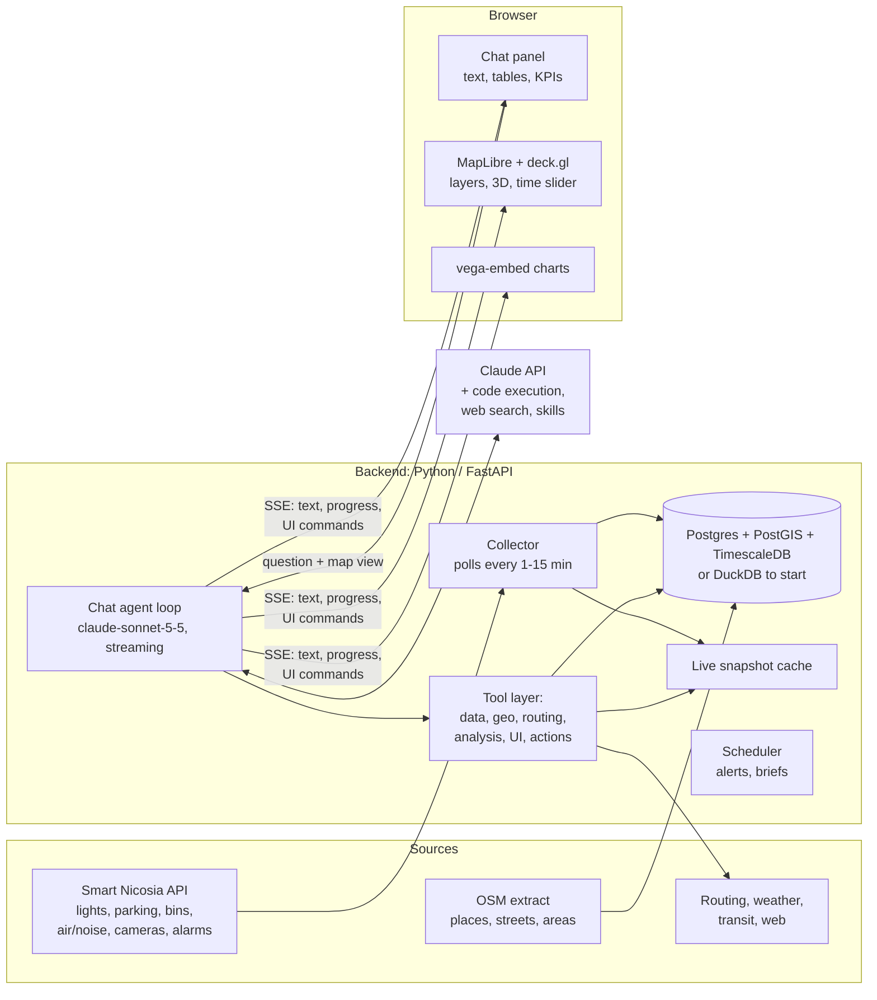

# Nicosia Digital Twin Chatbot: Research and Plan

Status: research, 19 Oct 2026. Nothing in here is built yet.

Goal: a chat assistant powered by Claude Sonnet 5.5 (`claude-sonnet-5-5`) that answers
questions about Nicosia by reading live and historic city sensor data, drives an
interactive map (zoom, highlight, routes, 3D, time-lapse), draws any chart, plans
routes and tours, and runs what-if scenarios.

## TL;DR

- **82 questions** a user could ask a Nicosia digital twin, in 11 themes from "which lights are on"
  to "what if we dimmed every lamp at 1am" (section 1).
- **The Smart Nicosia API covers 740 devices live**, with history back to 2022–2024. It needs our
  own collector and database for three reasons (section 2):
  - history comes back in 1,000-record pages;
  - long-range queries take 30–60 s;
  - lamps go silent by day, so "latest" isn't "current".
- **About 40 chatbot tools in six groups:** city data, places and context, routing and
  optimization, analysis and charts, map/UI control, and confirmation-gated actions (section 3).
- **Everything else we need is free and keyless:** Valhalla for comfort routing and tours, the
  Cyprus national traffic feed (live Bluetooth travel times), NPT bus GTFS and GTFS-RT, Open-Meteo,
  OSM places, MapLibre + OpenFreeMap + deck.gl for the map, and Let's Culture for events (section 4).
- **Charts:** the model writes **Vega-Lite** JSON and the server fills in the data. Code execution
  handles anything exotic (section 5).
- **Claude features to use:** `claude-sonnet-5-5` with adaptive thinking, streaming tools,
  programmatic tool calling for heavy analysis, Agent Skills for PPTX/XLSX/PDF reports, memory, web
  search and prompt caching (section 6).
- **Plan:** start the collector now, then the chat-and-map MVP, routing and tours, history
  analytics, and what-if scenarios with alerts (section 8). Five decisions are open (section 9).

---

## 1. Questions a user could ask

Each question is tagged with what it needs:

| Tag | Meaning |
|---|---|
| **LIVE** | Answerable today from the live Smart Nicosia API |
| **HIST** | Needs history we collect ourselves (see section 2) |
| **EXT** | Needs an external service (routing, weather, places, transit, web) |
| **SIM** | Needs a model or simulation (forecast, optimization, what-if) |
| **ACT** | Does something: alerts, schedules, tickets, reports |

### 1.1 Live city status ("what is happening right now?")

| # | Question | Needs |
|---|---|---|
| 1 | Which street lights are on right now? Show them on the map, coloured by dim level. | LIVE |
| 2 | Which lights are on in daylight, wasting energy? | LIVE, EXT (sunrise/sunset) |
| 3 | Which lights, bins or parking sensors have stopped reporting, and since when? | LIVE |
| 4 | Where can I park near Ledras Street right now, and how far is the walk from each free spot? | LIVE, EXT (routing) |
| 5 | Which bins are more than 80% full? Show a heat map. | LIVE |
| 6 | What's the air quality and noise level near Eleftheria Square right now? | LIVE |
| 7 | How many pedestrians, cars and buses passed the cameras in the last hour, compared with usual? | LIVE, HIST |
| 8 | What's the average traffic speed in the city now, compared with the same hour last week? | LIVE |
| 9 | Which traffic cameras or info screens are offline? | LIVE |
| 10 | Give me a one-screen "city pulse": lights, parking, bins, air, traffic. | LIVE |
| 11 | Which parking sensors have a low battery and need a visit soon? | LIVE |
| 12 | What are the active alarms, grouped by type and street? | LIVE |

### 1.2 Map exploration ("show me")

| # | Question | Needs |
|---|---|---|
| 13 | Zoom to the old town and highlight every smart device inside the Venetian walls. | LIVE, EXT (OSM outline) |
| 14 | Draw a 300 m circle around the Cyprus Museum and list everything inside it. | LIVE, EXT (geocode) |
| 15 | Which streets are darkest at night (fewest working lights per 100 m)? | LIVE, EXT (street network) |
| 16 | Where are the coverage gaps, i.e. areas more than 200 m from any bin, parking sensor or air station? | LIVE |
| 17 | Show bins as 3D columns whose height is fill level and colour is temperature. | LIVE |
| 18 | Compare Makariou Avenue and Ledras Street side by side: parking, lights, people. | LIVE, HIST |
| 19 | Which street has the most smart lights, and what do they draw in total? | LIVE |
| 20 | Show a noise surface across the centre, interpolated from the stations (with a warning about how few stations there are). | LIVE, SIM |
| 21 | Fly me along this route like a drone video. | EXT |
| 22 | Show everything that changed in the last hour: new alarms, newly free spots, newly full bins. | LIVE, HIST |

### 1.3 History, trends and analytics ("how has it been?")

| # | Question | Needs |
|---|---|---|
| 23 | Plot street-light energy use over the last 30 days, with total kWh and cost (metadata has €0.20/kWh). | HIST |
| 24 | Which lights draw more power than similar lamps (a failing driver or ballast)? | HIST, SIM (anomaly) |
| 25 | How fast does each bin fill? When will bin YW1394 be full? | HIST, SIM (forecast) |
| 26 | Which bins overflow most often, and on which weekdays? | HIST |
| 27 | Parking occupancy heat map, hour of day by weekday. | HIST |
| 28 | Average parking dwell time and turnover per street. | HIST |
| 29 | Pedestrian counts on the camera corridors: busiest hour, weekdays against weekends, before and after the holidays. | HIST |
| 30 | Does air quality track traffic counts? Show the scatter and the lagged correlation. | HIST |
| 31 | How many nights did noise go above WHO night-noise guidelines? | HIST |
| 32 | Did average speed change after a road change on date X? Do a before/after analysis. | HIST, SIM |
| 33 | How did pedestrian flow change during last summer's heatwave? | HIST, EXT (weather history) |
| 34 | Make a complex chart, e.g. small multiples of bin fill per district, a calendar heat map of energy use, or a violin plot of lamp power. | HIST |
| 35 | When was each bin last emptied, and how full was it at pickup (pickups too early or too late)? | LIVE, HIST |

### 1.4 Planning and optimization ("what's the best way?")

| # | Question | Needs |
|---|---|---|
| 36 | Plan the best walking tour of 5 museums from my hotel, given opening hours and a lunch stop. | EXT (places, routing), SIM (route ordering with time windows) |
| 37 | Same tour, but the most comfortable one: shaded, quiet, clean air and few hills. | EXT, LIVE (noise and air), SIM |
| 38 | Fastest drive to the Cyprus Museum now, then the nearest free parking spot and the walk from it ("park and walk"). | EXT, LIVE |
| 39 | Safest walk home after midnight, preferring well-lit streets with working lights. | LIVE, EXT |
| 40 | A wheelchair-accessible route from A to B. | EXT |
| 41 | Can I take a bus instead? Which line and when? | EXT (bus timetable data, GTFS) |
| 42 | Best collection route today that visits only bins above 70%, given truck capacity and a depot. | LIVE, SIM (vehicle routing) |
| 43 | A technician route covering every offline light and every sensor with a low battery. | LIVE, SIM |
| 44 | Where should the next air-quality station go to fill the biggest gap? | LIVE, SIM |
| 45 | Where should EV chargers or more parking sensors go, judged by demand against supply? | HIST, SIM |
| 46 | When is the best time to visit Ledras Street to avoid crowds? | HIST |
| 47 | What can I reach on foot in 15 minutes from here? Show the area. | EXT (isochrone) |
| 48 | Is it a good time for a run in Pedieos park? Check air, heat and UV. | LIVE, EXT (weather) |

### 1.5 What-if scenarios (the "twin" part)

| # | Question | Needs |
|---|---|---|
| 49 | What if all lights dimmed to 50% from 01:00 to 05:00? Energy, euros and CO2 saved per year. | HIST, SIM |
| 50 | What if lights switched on and off by actual sunset and sunrise plus 10 minutes? | HIST, EXT, SIM |
| 51 | What if bins in zone A were collected every other day? How much would overflow risk rise? | HIST, SIM |
| 52 | What if Makariou Avenue were closed to cars on Sundays? Where would traffic go? | SIM (traffic model, advanced) |
| 53 | What if 30% of on-street parking became paid or EV-only? Expected occupancy and revenue. | HIST, SIM |
| 54 | Compare two scenarios side by side on the map and in charts. | SIM |

### 1.6 Monitoring, alerts and automation

| # | Question | Needs |
|---|---|---|
| 55 | Tell me when bin X goes over 90%, air quality turns poor, or a light goes offline. | ACT |
| 56 | Send the operations team a morning brief every weekday at 07:30. | ACT |
| 57 | Flag anything odd, e.g. a parking sensor stuck "occupied" for 7 days, or a lamp still on at noon. | HIST, SIM, ACT |
| 58 | Why are three lights on Mnasiadou offline? Check alarms, disconnect times and nearby devices for a shared cause such as a power cut. | LIVE, HIST |
| 59 | Open a maintenance ticket for these five devices (with a confirmation step). | ACT |

### 1.7 Reports and sharing

| # | Question | Needs |
|---|---|---|
| 60 | Make a monthly operations report as PowerPoint, PDF or Excel. | HIST, ACT |
| 61 | Export the light inventory with status as CSV or GeoJSON. | LIVE |
| 62 | Write a plain-language summary of this month's air quality for the website. | HIST |
| 63 | Give me a shareable link to this map view. | ACT |

### 1.8 Citizens, tourists and multimodal input

| # | Question | Needs |
|---|---|---|
| 64 | (Photo of a broken lamp) Which light is this, what's its status, and can you report it? | LIVE, vision, ACT |
| 65 | Where's the nearest drinking fountain, public toilet or open pharmacy? | EXT (places, opening hours) |
| 66 | What's on tonight near me? | EXT (web search) |
| 67 | Answer me in Greek, Turkish or Russian. | (built into the model) |
| 68 | Voice questions while walking. | browser speech-to-text |
| 69 | Carbon footprint of walking, driving or the bus for this trip. | EXT, SIM |

### 1.9 Trust and data quality

| # | Question | Needs |
|---|---|---|
| 70 | How fresh is the data for each device type? Which sensors are stale? | LIVE |
| 71 | How reliable is this sensor (uptime % over 30 days)? | HIST |
| 72 | How did you work that out? Show the method and the data sources. | (prompting + tool trace) |
| 73 | Does the bin temperature sensor agree with the weather service? (calibration check) | LIVE, EXT |

### 1.10 Playful and storytelling

| # | Question | Needs |
|---|---|---|
| 74 | Play a time-lapse of yesterday: lights switching on at dusk, parking filling, pedestrian waves. | HIST |
| 75 | Give me a "city mood" score from noise, air, crowds and weather. | LIVE, EXT |
| 76 | Tell me the story of the old town in a 10-stop guided tour, moving the map as you narrate. | EXT |
| 77 | Talk to me as the city ("I'm Nicosia, and tonight 167 of my lamps are lit..."). | LIVE |
| 78 | Quiz me: guess which street is busiest at 18:00. | HIST |

### 1.11 Made possible by the open Cyprus feeds found in this research (section 4)

| # | Question | Needs |
|---|---|---|
| 79 | Where are the buses right now? Animate them on the map. | EXT (GTFS-RT) |
| 80 | How long does it take to drive along Makariou Avenue right now, compared with usual? | EXT (national Bluetooth travel times), HIST |
| 81 | What's on in Nicosia this weekend, and how crowded will the old town be? | EXT (events), HIST (pedestrian counts) |
| 82 | Is there Saharan dust today? Should I avoid running? | EXT (Open-Meteo dust), LIVE (PM10 stations) |

---

## 2. What the Smart Nicosia data can and can't tell us

Checked against the live API on 19 Oct 2026 with about 300 read-only requests. The Swagger 2.0
spec is embedded in `https://nokia.smartnicosia.eu/api-docs/swagger-ui-init.js`. It lists exactly
the 10 endpoints in [smart_nicosia_api.py](../smart_nicosia_api.py); there are no hidden ones.
No authentication, CORS `*`, no rate-limit headers seen, about 40 ms per request.

### 2.1 What exists (tenant `CYTA`, 740 devices)

| Device type | Count | Useful live fields | History in the API since |
|---|---|---|---|
| Lighting | 240 | `state`, `level` 0/100, `last_lamp_status`, `powerstats` (W, V, kWh); attributes `name` = street ("Mnasiadou 2"), `metadata.extra.cost` = €0.20/kWh | early 2024 |
| Parking (on-street) | 303 | `status` 1/0, `is_pwd` (disabled bay), `vbatt`, `temperature` | 2023 |
| Wastebin | 139 | `level` (fill %), `temperature`, `pickup_time`, `level_before_pickup`/`after`; attributes trash type, volume, postcode | mid-2024 |
| smartsense (air and noise) | 7 | PM1/2.5/10, NO, NO2, O3, CO, CO2, SO2, T, RH, P, `Sound_level` dB, CAQI, EAQI, with units and dominant pollutant; named streets (in Greek) | 2021/22 |
| Camera | 31 | `connectionState`; records have real coordinates | n/a |
| InfoPoints (screens) | 15 | `state`, `planState` | n/a |
| ParkingLot | 5 | free/occupied bays, **stale since Feb 2023** | 2023 only |

City-wide feeds:

- **Traffic counts per camera, counting line, direction and object type**
  (people, bike, car, motorcycle, bus, truck) come from `getTrafficReports`. Use `group_by=stream`
  for per-camera detail. Sub-keys "1"/"2" are the crossing direction relative to the drawn
  counting line. History goes back to at least Dec 2022.
- **City-wide average speed** comes from `generalReports` (5 min to month buckets, since about Oct
  2023) and `hourlyReports` (15-minute slots per weekday). It is one speed source for the whole
  city, so there is no per-street speed.
- **A city event feed.** `getTelemetryRange` with `entityType=TENANT&entityName=CYTA&keys=toastDesc`
  is a running log of every alarm in the city ("YW1337: Fill level above threshold of 80 %").
  1,000 records cover about 14 days.
- **Alarms** come from `getAlarms`, filterable by state (`ACTIVE_UNACK` and so on), but capped at
  20 per request with no paging. Types seen: lost connection, bin over 80%, high CAQI, AQI not
  reported, lamp fault, screen-player warnings, camera tamper.

### 2.2 Gotchas that would make a chatbot give wrong answers

1. **"Latest" street-light state isn't the current state.** Lamps report hourly only while powered
   (about 18:18 to 06:22 local in mid-October) and go silent by day. At noon, 167 lamps still show
   `Dimmed / 100 / True` from their last night-time report. **Rule: a lamp is on only if it reported
   in the last ~70 minutes.** Otherwise it is off (by day) or offline (by night).
2. **History is capped at 1,000 records per request**, shared across all requested `keys` and
   returned newest first. Page backwards by setting `endTs` to the oldest timestamp minus 1.
   1,000 records is about 4 days of everything for a lamp, but 720 hourly points of a single key.
   `limit`/`offset` are ignored.
3. **Long ranges are slow:** traffic over 90 days takes about 26 s, a year about 52 s, and 4 years
   by month times out. Chat answers must use our pre-aggregated store, not live long-range calls.
4. **Camera locations are only half known.** 29 of the 68 traffic-analytics feeds match a Camera
   device by name and get real coordinates. The other 39 (old town: Ledras, Onasagorou, Ermou,
   Trikoupi, ...) need hand-made coordinates. The `analytics` stream locations are placeholders
   (49.23, 28.47 or 0, 0).
5. **Errors from the traffic and speed endpoints come back as HTTP 200** with
   `[{"type":"ERROR_FAILED_TO_PROCESS_REQUEST"}]`, so check the body. Unknown device names return `[]`.
6. **Names are case-sensitive** (`yl1015` returns `[]`), and many are in Greek. We need an alias
   table for name matching.
7. **Some meanings are unconfirmed:** lamps report `Dimmed` against `Online`, while `level` is 100
   for "Dimmed". Parking `status` 1 looks like "occupied". Confirm both with the vendor.

### 2.3 Consequences

- **A collector and our own database are required.** With them we can answer history, trend and
  what-if questions in under a second, and stay gentle on the city API. Suggested cadence:
  - parking: latest every 2–5 minutes
  - lamps: every 15 minutes at night
  - bins and screens: every 30 minutes
  - air: hourly
  - city event feed: every 5 minutes
  - traffic: a daily `stream` pull plus an intraday `hour` pull for today
  - history: one gentle backfill by paging
- **Polling all 740 devices every few minutes means about 100k requests a day.** Agree this with
  the API owners first, or ask them for a bulk "latest for all devices" endpoint or credentials
  (the login raises the cap to 5,000 records).
- **There's no live per-street traffic.** Traffic-aware driving routes need a commercial traffic
  API (section 4) or a city-wide slowdown factor estimated from `generalReports`.

---

## 3. Tools the chatbot needs

Claude calls these tools. They fall into three kinds:

- **Data tools** run on our server and return compact JSON. We aggregate on the server so we never
  send 740 raw devices into the model's context.
- **UI tools** return "ok" to Claude and send a command to the browser over the same event stream
  (fly to, highlight, chart, and so on).
- **Action tools** change something and need user confirmation.

### 3.1 City data

| Tool | Does | Backed by |
|---|---|---|
| `city_snapshot()` | KPIs per device type: counts, on/off, free/occupied, full bins, worst air, freshness | snapshot cache |
| `query_devices(type, where, near, within, fields, limit)` | Filter devices by type, status, area, radius, street; returns ids, coordinates and a few fields | snapshot cache + PostGIS/DuckDB-spatial |
| `get_device(id)` | Every latest attribute and telemetry value for one device | live API |
| `get_history(device_ids or type, keys, start, end, agg, bucket)` | Time series with server-side aggregation (avg, max, last, count; 15 min, hour, day) | our time-series DB |
| `get_alarms(scope, state, since)` | Alarms by device, type or area | live API |
| `get_traffic(cameras, start, end, group_by, object_types)` | Counts by object type (people, bike, car, motorcycle, bus, truck) | live API + DB |
| `get_speed(start, end, group_by)` | City average speed | live API + DB |
| `get_travel_times(corridor or bbox)` | Current travel time and speed per road segment | Cyprus national Bluetooth feed (DATEX II) + DB |
| `get_events(query)` | The city event log (alarms, fill warnings) for a period | TENANT event feed + DB |
| `run_sql(query)` | Read-only SQL over the history DB, for questions no fixed tool covers | DuckDB/Postgres read-only role, row and time limits |

### 3.2 Places, geography and context

| Tool | Does | Backed by |
|---|---|---|
| `geocode(text)` / `reverse_geocode(lat, lon)` | Place name to coordinates and back. Strip "Street"/"Οδός" first, because Nominatim needs every word to match | local alias table, then Nominatim (`countrycodes=cy`), then Photon (with `bbox`) |
| `find_places(category, near, within, open_at)` | Museums, cafés, pharmacies, toilets, fountains, parks | Overpass results cached as GeoJSON (refreshed weekly) + `opening_hours` parser |
| `get_area(name)` | Polygon for "old town", "Strovolos", "Venetian walls", municipalities | OSM boundaries cached locally |
| `isochrone(point, minutes, mode)` | The area you can reach in N minutes | Valhalla `/isochrone` |
| `get_weather(at, hours)` / `get_sun(date)` | Forecast, heat, UV, feels-like, dust, sunrise/sunset/civil dusk, air-quality forecast | Open-Meteo forecast + air quality + archive, `astral` |
| `find_transit(from, to, at)` / `bus_positions()` | Bus options and live vehicles | NPT GTFS + GTFS-RT |
| `find_events(start, end, near)` | Cultural events | Let's Culture REST API, Visit Cyprus iCal |
| web search / web fetch (server tools) | News, road works, anything not covered above | Anthropic server tools |

### 3.3 Routing and optimization

| Tool | Does | Backed by |
|---|---|---|
| `route(stops, mode, prefer)` | A-to-B or multi-stop route; `prefer` = fastest, shade, lit, quiet, clean_air, accessible | Valhalla pedestrian options (`use_lit`, `use_hills`, `walkway_factor`, `step_penalty`, `type=wheelchair`) + `exclude_polygons` around noisy or polluted spots |
| `plan_tour(places, start, start_time, mode, max_minutes, prefer)` | Order the stops, respecting opening hours, dwell times and breaks | OR-Tools VRP with time windows over a Valhalla duration matrix; Valhalla `optimized_route` as the quick path |
| `plan_collection(bins_filter, trucks, depot)` | Vehicle routing for bins or maintenance visits | pyvroom over a Valhalla matrix |
| `park_and_walk(destination)` | Drive leg, then the nearest free sensors, then the walk leg | Valhalla + parking snapshot |
| `what_if_closure(polygon, time)` | Before/after travel times when a street is closed | Valhalla `exclude_polygons`; SUMO later, for one corridor |

### 3.4 Analysis, charts and simulation

| Tool | Does | Backed by |
|---|---|---|
| `show_chart(spec, dataset_ref, title)` | Render any chart from a Vega-Lite spec. The server fills in data from a `dataset_ref` that a data tool returned, so the model never copies numbers into the spec, then validates the spec against the Vega-Lite JSON Schema | vega-embed in the browser |
| code execution (server tool) + programmatic tool calling | Claude writes Python that calls our data tools in a loop, crunches the results and returns a small result or a figure | Anthropic sandbox |
| `forecast(series_id, horizon)` | Bin fill, parking occupancy, energy | statsforecast |
| `detect_anomalies(type, key, window)` | Stuck sensors, odd power, unusual counts | rules + IsolationForest |
| `simulate(scenario)` | Lighting dimming or schedules, collection frequency, paid parking | our scenario functions over the history |

### 3.5 Map and UI control

| Tool | Does |
|---|---|
| `map_view(center, zoom, bbox, pitch, bearing, animate)` | Fly or zoom the camera (answers "zoom in on ...") |
| `map_layer(id, source, style, color_by, size_by, filter, legend, label)` | Add or update a layer. `source` is a device query, places, a route or GeoJSON. `style` is markers, clusters, heatmap, hexbin, 3D columns, lines, animated trips or a polygon |
| `map_highlight(feature_ids, effect, popup, duration)` | Pulse, glow, outline or bounce particular features; open popups |
| `map_remove(layer_id)` / `map_reset()` | Clean up |
| `map_timeline(start, end, step, layers)` | Time slider and time-lapse playback |
| `map_story(steps)` | A scripted sequence of camera moves, highlights and captions |
| `show_table(rows, columns)` / `show_kpis(cards)` | Rich panels in the chat |
| `ask_user(question, options)` | Clarifying choices as buttons |

### 3.6 Actions (each needs confirmation)

| Tool | Does |
|---|---|
| `create_alert(condition, channel)` | Threshold rules checked by the collector |
| `schedule_report(cron, recipients, prompt)` | Recurring briefs |
| `draft_ticket(devices, issue)` | Maintenance ticket draft (sent only after the user says yes) |
| `export(dataset, format)` | CSV, GeoJSON, XLSX, PPTX, PDF |
| memory tool | Remember a user's home, language, mobility needs and favourite places |

---

## 4. External services and libraries

Probed on 19 Oct 2026. "Live" means we got a real answer from it today.

### 4.1 Recommended stack

| Need | Pick | Backup | Key? | Live |
|---|---|---|---|---|
| Walking/comfort routing, isochrones, tours, matrix, elevation | **Valhalla** (public `valhalla1.openstreetmap.de` now; self-host in Docker for production) | OpenRouteService (free key: 2,000 routes/day), OSRM | no | yes, 0.2–1.3 s |
| Itinerary with opening hours | **OR-Tools** VRP with time windows | Valhalla `optimized_route` | no | n/a (library) |
| Waste-collection and technician routes | **pyvroom** + Valhalla matrix | OR-Tools | no | n/a |
| Live traffic | **Cyprus National Access Point** Bluetooth travel times (339 segments, 37 sites in Nicosia, about 5 min fresh, CC BY 4.0) + Nokia camera counts | TomTom Flow (free tier: 20K requests/month) | no | yes |
| Geocoding | Local alias table + **Nominatim** (1 req/s, cache) | Photon with `bbox` | no | yes |
| Places | **Overpass, cached as GeoJSON** (one query gave 649 places: 225 cafés, 105 pharmacies, 35 museums...) | Geofabrik Cyprus extract | no | yes, but slow (45 s) and mirrors fail, so never call it per request |
| Public transport | **NPT Nicosia GTFS** + **GTFS-RT** (CC BY 4.0) | Mobility Database copy | no | yes |
| Weather, heat, UV, dust, sun | **Open-Meteo** forecast, air quality and archive + `astral` | MET Norway | no | yes |
| Shade | SunCalc + OSM building heights (sparse in Nicosia, so approximate) | ShadeMap (key by email) | no | no |
| Map | **MapLibre GL JS 6.15** + **OpenFreeMap** `liberty` style (3D buildings, keyless) + **deck.gl 9.4** overlay | Leaflet 1.9 | no | yes |
| Charts | **Vega-Lite 6.5** + vega-embed 7.3 | ECharts 6.1 | no | n/a |
| What-if traffic | Valhalla closures + a volume-delay model on an OSMnx graph | SUMO 1.28 for one calibrated corridor | no | yes (closures) |
| Forecasts and anomalies | **statsforecast** (+ river for streaming) | Prophet, IsolationForest | no | n/a |
| Events | **Let's Culture** REST API (66 events in the next month) | Visit Cyprus iCal | no | yes |
| Database | DuckDB (start) → Postgres + PostGIS + TimescaleDB | | no | n/a |

Everything above is free and keyless. Only the optional backups need keys. The production risks
are the public demo servers (Valhalla, Nominatim, Overpass, OpenFreeMap) and their fair-use rules,
so plan to self-host Valhalla and Nominatim, or pay for hosted versions, before any public launch.

### 4.2 Notes

- **Commercial traffic APIs.** Google Routes requires route results to be shown on a Google Map and
  forbids caching most content. That conflicts with a MapLibre frontend, so avoid it. TomTom covers
  Cyprus and has a free tier; HERE coverage is unconfirmed.
- **Comfortable routing is real, not hand-waving.** Valhalla's pedestrian costing takes `use_lit`
  (prefer lit streets), `use_hills`, `walkway_factor`, `step_penalty` and `type=wheelchair`.
  `exclude_polygons` lets us route around places that are noisy or polluted right now, using the
  Nokia air and noise stations.
- **Opening hours** are tagged on about half the museums in OSM (17/35) but on almost no pharmacies
  (2/105). Keep a small hand-checked file for the top tourist sites.
- **The GTFS-RT feed** is plain HTTP on a raw IP address (`20.19.98.194:8328`). It works, but treat
  it as fragile.
- **deck.gl layers to use:** `HeatmapLayer` (noise, air), `HexagonLayer` (parking, bins),
  `ColumnLayer` (3D bars per sensor), `TripsLayer` (animated buses and routes), `ArcLayer` (flows),
  `PathLayer` (routes), `ScatterplotLayer` with animated radius for "pulse" highlights.

---

## 5. Is there a plot library the model can drive to make any chart?

Yes. Use a **declarative chart grammar the model writes as JSON**, and let the browser render it.
The best fit is **Vega-Lite**:

- **It can express almost any statistical chart:** layered, faceted (small multiples),
  concatenated, binned, time-unit, window, regression, density, fold/pivot transforms, and
  interactive selections (brushing, linked views).
- **It is safe.** A spec is data, not code, and its expression language is sandboxed. We can
  validate every spec against the official JSON Schema before rendering.
- **Models know it well.**
- **The data can be swapped in** (`dataset_ref`), so numbers come from our tools, not from the
  model's memory. `vl-convert-python` can also render PNGs for reports.

How it compares:

| Option | Verdict |
|---|---|
| Vega-Lite | **Primary.** Expressive, transforms inside the spec, safe, schema-validated |
| Plotly JSON | Good for 3D surfaces and sankeys, but no transforms, so the server must pre-aggregate. A heavy bundle |
| ECharts option JSON | Strong for gauges, calendars, graphs and sankeys; strip function-valued formatters for safety. A good second renderer |
| Observable Plot | Not JSON. The model's output would have to run as JavaScript. Skip |
| AntV `mcp-server-chart` | Sends data to an Alibaba cloud renderer by default. Skip |
| LIDA, PandasAI | Execute generated code on our server. Skip |
| Claude code execution (matplotlib/seaborn) | **Fallback for anything exotic** (statistical plots, custom figures). It runs in Anthropic's sandbox, not ours, and returns PNGs |

So "do whatever the model wants" becomes two tools:

- `show_chart` (Vega-Lite) for interactive charts, which covers most requests.
- Code execution for anything Vega-Lite can't express.

---

## 6. Claude platform features and skills

### 6.1 Model settings for `claude-sonnet-5-5`

- **Thinking and effort.** Use adaptive thinking (the default). Set `output_config.effort` per route:
  `low` for quick chat answers and `medium` for multi-step tool work (tours, analysis). Sonnet 5.5
  rejects `thinking: {type: "disabled"}`.
- **Progress messages.** On Sonnet 5.5, notes the model writes between tool calls come back as
  `thinking` blocks. Set `thinking.display: "summarized"`, or `"updates"` (beta
  `thinking-display-updates-2026-08-18`), so the chat doesn't go quiet during long tool chains.
  Render those blocks as a small progress line.
- **Streaming.** Stream every turn, with `eager_input_streaming: true` on each of our tools so
  large inputs (chart specs, GeoJSON) arrive early. Validate every tool input before running it.
- **No forced tool choice.** Sonnet 5.5 returns a 400 for `tool_choice` `any`/`tool`. Use `auto`,
  steer from the system prompt, and set `strict: true` on tool schemas. `strict` can't be combined
  with programmatic tool calling, so leave it off any tool that code calls.
- **Append-only history** (preserved thinking). Never edit earlier turns, the system prompt or the
  tool list mid-conversation. Put changing context, such as the current time or the user's map
  view, in the user turn or in a mid-conversation `role: "system"` message.
- **Prompt caching.** A frozen system prompt (data dictionary, map conventions, chart style) plus a
  fixed tool list gives a cacheable prefix; add top-level `cache_control` for the conversation tail.
- **Refusal handling.** Check `stop_reason == "refusal"`. Server-side fallback
  (`fallbacks: "default"`, beta `server-side-fallback-2026-07-01`) re-runs declined `cyber` and
  `frontier_llm` requests on Sonnet 5; city questions should almost never trigger this.

### 6.2 Server-side tools and API features

| Feature | Use here |
|---|---|
| Code execution (`code_execution_20260120`) | Heavy or one-off analysis: pandas, statsmodels, scikit-learn, matplotlib. The sandbox has no internet access. |
| Programmatic tool calling (`allowed_callers`) | Lets that Python call our data tools, e.g. loop over 139 bins without 139 round trips, and return only the aggregate. This is how "complicated plots over lots of data" stay cheap. |
| Web search / web fetch (`_20260209`) | Events, opening-hour changes, news about road works. |
| Tool search | Once the tool list grows past roughly 20–30 tools, load tool definitions on demand. |
| Memory tool | Per-user preferences (home, language, accessibility) and saved places. |
| Files API | Return generated reports and figures. |
| Agent Skills: `xlsx`, `pptx`, `docx`, `pdf` (Anthropic) | "Make me a monthly report as a deck or spreadsheet." |
| Custom Agent Skill: `nicosia-city-data` | Data dictionary (what `Dimmed`/`Online`, `status`, `level`, `caqi` mean), units, gotchas, analysis recipes and chart conventions, loaded only when needed. Before that, the same text can live in the cached system prompt. |
| Vision | Photos of broken street furniture; screenshots of charts. |
| Structured outputs | Machine-readable answers for automations, e.g. the morning brief's KPI block. |
| Compaction / context editing | Long sessions that pull lots of tool output. |
| Message Batches | Cheap overnight jobs, e.g. writing the daily summaries. |

### 6.3 Claude Code skills that help us build it

- `claude-api`: correct SDK usage for Sonnet 5.5 (thinking, tools, streaming, caching, fallbacks).
- `dataviz`: chart design rules and palette for the Vega-Lite theme and map legends.
- `run`: launch the app and check changes in the browser.
- `code-review` / `security-review`: review the tool layer, especially `run_sql` and action tools.
- `claude-api build-eval`: turn the question catalog in section 1 into an eval set.

---

## 7. Architecture

How one turn works:

1. The browser sends the question, the current map view (centre, zoom, bbox, visible layers) and
   the local time.
2. The backend streams the turn to Claude. When Claude calls a data tool, the server runs it and
   returns compact JSON. When Claude calls a UI tool, the server pushes a command event to the
   browser and returns `"ok"` plus anything Claude needs, such as layer ids.
3. Text, progress notes, tool chips and UI commands all reach the browser over one
   Server-Sent Events stream, so the map moves while the answer is still being written.
4. The full assistant content, thinking blocks included, is appended unchanged to the history.

Design rules:

- **The model never sees raw device lists.** Tools filter and aggregate on the server, and big
  layers go to the map by reference (`source: {query: ...}`): the browser fetches the GeoJSON
  itself, so it never passes through the model.
- **Interpret the data in one place.** The rules that turn raw telemetry into meaning (for
  example "a lamp is on if it reported in the last 70 minutes") live in one tested module that
  the tools, alerts and dashboards all share.
- **Every number in an answer traces to a tool call.** The UI shows the tool trace, and the
  system prompt asks for the method behind derived numbers.

---

## 8. What needs to be done

Sizes are rough: S is a few days, M about a week, L two weeks or more.

### Phase 0: Foundations (start the collector first, because history takes time to build up)

| Task | Size | Done when |
|---|---|---|
| Write the data dictionary and the interpretation module (lamp on/off, parking free/occupied, bin fill, air-quality bands, staleness), with unit tests on captured payloads | M | Every device type has a tested `interpret()` that returns meaning plus a confidence/staleness flag |
| Build the collector, stored in DuckDB at first and Postgres/PostGIS/Timescale later | M | It runs unattended, writes snapshots and changes, backfills what `getTelemetryRange` allows, and shows its own health |
| Cache static geodata: an OSM extract for Nicosia (places, streets, area polygons, Venetian walls), plus a Greek/English name-alias table | S | `find_places`, `get_area` and `geocode` answer offline |
| Map the cameras: link the 29 analytics feeds that match by name; hand-geocode the other 39 from their street names | S | Every traffic count has coordinates |
| Add the national Bluetooth travel times, GTFS-RT bus positions and the city event feed to the collector | S | Stored every 5 minutes |
| Agree polling rates and terms of use with Nokia/CYTA/the municipality; confirm what the fields mean (`Dimmed` against `Online`, parking `status` 1/0) | S | Written confirmation |

### Phase 1: MVP chat and map (questions 1–19, 61, 70)

| Task | Size |
|---|---|
| FastAPI + SSE agent loop on `claude-sonnet-5-5`: streaming, prompt caching, refusal handling, tool validation, tool trace | M |
| Tools: `city_snapshot`, `query_devices`, `get_device`, `get_alarms`, `get_traffic`, `get_speed`, `geocode`, `find_places`, `get_area` | M |
| UI tools and frontend: MapLibre + deck.gl map, chat panel, `map_view` / `map_layer` / `map_highlight` / `map_remove`, `show_chart` (vega-embed), tables and KPI cards | L |
| Eval set v1: about 40 questions from section 1, each with expected tool calls and checkable answers | S |

### Phase 2: Routing and tours (questions 36–48)

| Task | Size |
|---|---|
| `route`, `isochrone`, `park_and_walk`, weather and sun | M |
| `plan_tour`: OR-Tools TSP with time windows, opening-hours parsing, dwell times, a lunch break | M |
| Comfort weights: lit streets (lamp positions and status), quiet and clean air (station interpolation), shade (sun position + building heights) | L |
| Bus options and live buses from the NPT GTFS and GTFS-RT feeds | M |

### Phase 3: History and analytics (questions 23–35, 60, 62, 71, 74), once 4+ weeks of data exist

| Task | Size |
|---|---|
| `get_history`, read-only `run_sql` (row, time and statement limits), `map_timeline` time-lapse | M |
| Code execution + programmatic tool calling for free-form analysis and figures | M |
| `forecast` and `detect_anomalies` | M |
| Reports through Agent Skills (`xlsx`, `pptx`, `pdf`) and the Files API | S |

### Phase 4: What-if scenarios and automation (questions 49–59, 64)

| Task | Size |
|---|---|
| `simulate` for lighting policy, collection frequency and parking pricing, with side-by-side comparison | L |
| `plan_collection` and technician routes (VROOM or OR-Tools) | M |
| Alerts, scheduled briefs, ticket drafts (confirmation required), memory tool, photo input | M |

### Phase 5: Hardening

| Task | Size |
|---|---|
| Two roles: public (read-only) and operator (actions, `run_sql`); authentication | M |
| Cost and latency monitoring per question; effort tuning; cache-hit checks | S |
| Eval regression in CI; prompt and tool-description audit | S |
| Deployment (Docker), logging, privacy review (memory and location data), Greek/English UI | M |

---

## 9. Open questions and risks

### Decisions needed

1. **Who is it for first:** residents and tourists (read-only, public) or city operations
   (alerts, tickets, `run_sql`)? This sets authentication, tone, and which tools ship in Phase 1.
2. **Polling agreement.** About 100k requests a day against the Nokia API needs the owners'
   OK. Could they provide a bulk "latest for all devices" endpoint or credentials (5,000-record
   pages)?
3. **Hosting and budget:** self-host Valhalla and Nominatim, or pay for hosted ones? Do we want a
   paid traffic API at all, now that the national Bluetooth feed exists?
4. **Frontend:** a plain JS single page (fastest to build) or React (easier to grow)?
5. **Languages:** English and Greek at launch? Turkish and Russian?

### Risks

| Risk | Mitigation |
|---|---|
| The model states a number that no tool returned | Numbers come only from tools; `dataset_ref` charts; the UI shows the tool trace; evals check it |
| Data is misread (lamp state, parking status) | One tested interpretation module; vendor confirmation; staleness shown in every answer |
| Public demo servers rate-limit or go down | Cache POIs and geocodes; self-host Valhalla and Nominatim before launch |
| Slow long-range API queries (30–60 s) | Never call them from chat; pre-aggregate in the collector |
| 39 of the 68 cameras have no coordinates | Geocode them by hand once from their street names; store the mapping |
| Cost per question | Sonnet 5.5 at $2/$10 per million tokens; a cached prefix; effort `low` for chat. Measure per question; expect cents, not dimes |
| Privacy | The city API exposes only counts and aggregates, no images or plates. User location and memory are personal data: opt-in only, retention limits, GDPR review |
| Prompt injection through external text (event descriptions, web pages) | Treat tool output as data; action tools always need confirmation |
