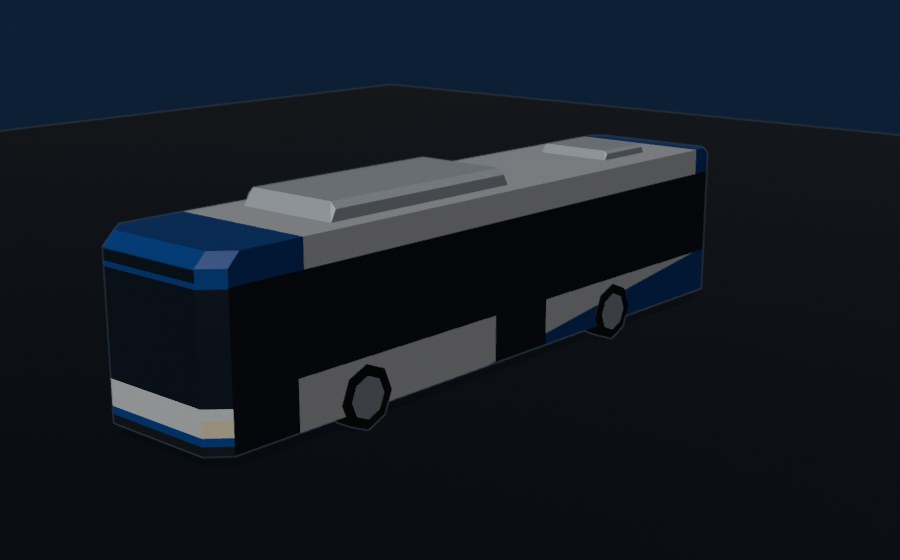
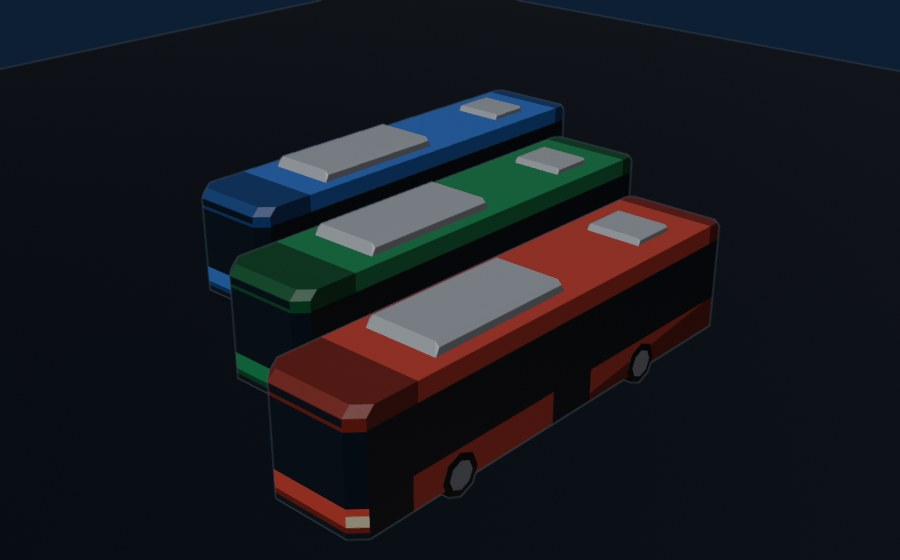

# Live mobility

Feature 4 of the [roadmap](digital-twin-roadmap.md): buses on the road, departures, bus trips
and road speeds, as map layers, inspector kinds, a workspace and chat tools.

## Sources

All from the Cyprus National Access Point ([traffic4cyprus.org.cy](https://traffic4cyprus.org.cy)),
CC BY 4.0.

| What | Where | How often | Notes |
| --- | --- | --- | --- |
| Bus timetables (GTFS) | `motionbuscard.org.cy/opendata/downloadfile?file=GTFS%5C<n>_google_transit.zip`, n = 9 NPT, 5 Intercity, 11 Pame Express | Cached in `data/chatbot_cache/gtfs/`, fetched again after a day | Stop ids are one national registry, so the three feeds merge. calendar_dates only today; calendar.txt is read too |
| Live buses (GTFS-RT) | `http://20.19.98.194:8328/Api/api/gtfs-realtime` | At most every 30 s, one fetch for every page and tool | Island-wide, about 440 KB, plain HTTP on a raw IP. Its trip ids are its own: vehicles are matched by route, direction and first departure. The last good copy stands in for 5 minutes when it fails |
| Road travel times (DATEX II) | `.../swarco3/api/Data/PredefinedLocationDataPublication` | At most every 5 minutes, recorded into the memory | The same feed the collector's `travel_times` job polls |
| Road geometry and site names | `PredefinedLocationPublication`, `BTMeasurementSiteTablePublication` | Cached, daily | The live publication's line strings are empty; the paths inventory holds them as escaped GML (`lat,lon` pairs) |

## How it is built

- `chatbot/mobility/gtfs.py`: the timetable (stops, lines per operator, trips with their stop
  times as arrays, shapes), departures by stop over service days (times past 24:00 belong to
  the day before), stop distances along each trip's shape.
- `realtime.py`: the fleet. Each vehicle is placed along its trip's shape (looking forward from
  where it was, as loops pass places twice), gets its next stops, and a delay: the feed's
  trip update when believable (between 10 minutes early and 30 late, never early at the first
  stop), else from its position against the timetable, said as an estimate.
- `planner.py`: departures with the live estimate, and walk-ride-walk trips, direct or with
  one change (same stop or within 200 m), leaving in the next 90 minutes, ranked by arrival
  with a little weight against changes and walking. It says when walking beats every bus.
- `roads.py`: segments wholly inside Greater Nicosia, speeds now or at a moment from the
  memory, free flow (measured: 85th percentile of 4 weeks once a day is stored; estimated:
  Valhalla's typical speed for the road, fetched once and kept in
  `data/chatbot_cache/road_reference.json`; assumed: 50 km/h until that estimate lands), the
  usual for this hour of this weekday, and bands: moving freely (75% of free flow or more),
  busy (55%), slow (35%), very slow. Readings under 3 km/h are a phone that stopped between
  the detectors, not the road, and count as no reading.
- `entities.py`: the kinds `bus` (bus-5006), `bus_stop` (stop-1297), `bus_line`
  (line-npt-26, line-ic-42, line-pame-gsp1) and `road_segment` (road-12), with search items
  and a road's 24-hour series, through `register_kind`, `register_search` and
  `register_series` in `chatbot/entities.py`.
- `chatbot/tools/mobility.py`: `get_buses`, `get_departures`, `plan_transit`,
  `get_road_speeds`. Their layers carry `meta.live` ({kind: buses | roads}), so the page draws
  them with the live buses (gliding, filtered to the lines asked) or the road style (offset by
  direction), through `registerLayerRenderer` in the map engine.
- `chatbot/routes/mobility.py`: `/api/buses`, `/api/transit/shapes/{id}`, `/api/transit/stops`,
  `/api/roads?at=` (ISO local time or epoch ms, for the city clock) and `/api/mobility`.
- The page: `chatbot/web/src/lib/mobility/` (store, map layers, registration) and
  `components/mobility/` (inspector sections, the workspace and its switches). The Buses and
  Traffic topic chips and the Layers sheet's rows read the same store.

## On the map

Buses glide along their route shapes: between reports each moves on at its reported speed
(for 2 minutes at most) and its marker eases toward that point; a bus never slides
backwards. With reduced motion each report is shown as it comes. Roads are drawn offset to
the left of their direction of travel (Cyprus drives on the left), so both directions of an
avenue show. Their colours are a neutral for roads that flow and one warm hue that brightens
as they slow, stepped for each base map; the line widens too, so colour never carries it alone.

## The buses in 3D

From near city zoom (z13.4) each bus is a small low-poly 3D bus in its line's colour, facing
where it heads, with its line number in a pill just above it. It is modelled on the buses Cyprus
Public Transport runs in Nicosia (King Long U12 and B12, Yutong E12): a continuous dark window
band, caps over the front and rear of the roof, a lower panel that rises toward the back, a pod
on the roof, a big windscreen under a destination display, and the doors on the left. No logos
or lettering: the body takes the line's colour, glass, wheels and trim stay constant, and the
open bus turns sodium.




- **Size.** A true-size bus is a speck at city zoom, so it is drawn at a steady size on screen
  (26 px long at z13.4, 34 px at z15, 42 px at z16.5) and reaches true size near z18. Farther
  out the plain dots stay: there a model would be noise.
- **Depth.** The buses share the depth buffer with the 3D city, so at street zoom a bus hides
  behind the buildings in front of it. While a bus is drawn larger than life it would sink into
  the blocks beside its street, so the parts that are behind something show as a faint
  silhouette, fading out as the bus comes down to true size.
- **Numbers.** The pill floats half a bus length above the bus, so it covers neither the bus
  nor its neighbours' at any pitch or bearing; where pills would overlap, MapLibre leaves some
  out (the open bus's first) rather than stack them. They show from z13.4, earlier than before.
- **Clicks.** A custom layer isn't hit-tested by MapLibre, so the dot layer stays under the
  model, transparent and as big as the bus, for the pointer and clicks; a click opens the bus
  whose middle is nearest the pointer.
- **Fallback.** Without WebGL2, or if the model or its code doesn't load, the dots, arrows and
  pills are drawn as before.

The renderer is `chatbot/web/src/lib/mobility/bus-model.ts`: a MapLibre custom layer that draws
every bus in one instanced WebGL2 call (two while some are behind buildings), loaded the first
time buses are shown, so the first page load doesn't grow. It reads the model from
`chatbot/web/src/assets/models/bus.glb` (379 triangles, 25 KB, flat shaded, no textures; glTF
axes: +Y up, +Z forward, -X to the bus's right; metres; the origin on the ground under the
middle). A three.js layer would have worked too, but for one small mesh drawn a few hundred
times it would have added a second renderer of about 150 KB that shares MapLibre's GL state.

### Rebuilding the model

The model is built by a Blender script, so it can be changed in code and built again (Blender
4.2 or later; 5.0 built the file in the repository). From the repository root:

```bash
"C:/Program Files/Blender Foundation/Blender 5.0/blender.exe" --background --factory-startup \
    --python tools/bus_model/build_bus.py
```

It writes `bus.glb` and renders the previews in `docs/screenshots/bus-models/` (`-- --no-previews`
skips them; `-- --out PATH --previews DIR` writes elsewhere). The dimensions, livery bands and
material colours are constants at the top of the script. Material names matter to the map:
`body` and `accent` take the line's colour, `lights` and `tail` are drawn unlit, and the shell
(`body`, `accent`, `glass`, `trim`, `lights`, `tail`) must stay convex, since the silhouette pass
draws it alone.

### Testing with a full street

The live feed goes quiet in the evening. `tools/bus_model/busy_feed.py` writes an `/api/buses`
body from the timetable at a moment (by default the Monday morning peak), about 90 buses within
12 km of the old town, or about 180 with `--also` for a second moment. Replay it in a browser
test by fulfilling `/api/buses` with the file (Playwright's `page.route`), after setting each
bus's `reported` to now so the page moves them on.
