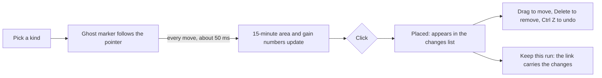
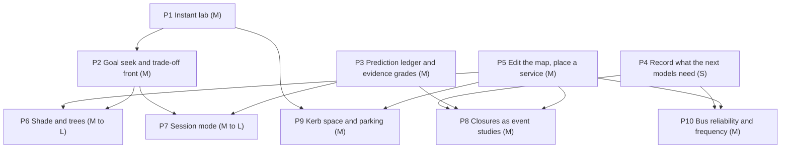

# Simulations people can decide with: research and plan

Status: research and plan, 27 November 2026. Nothing in here is built. It follows
[digital-twin-roadmap.md](digital-twin-roadmap.md) (feature 9, the Scenario lab) and builds on the
lab's contract on the `scenario-lab` branch and the waste scenario on `waste-scenario`.

The question: how can Nicosia's twin offer simulations that are interactive enough to explore in
a meeting and trustworthy enough to act on, with the data the twin really has?

## Executive summary

**What the evidence says, in five sentences.** Simulations get used when they answer one bounded
question for a named office, with a model simple and open enough for staff to run and outsiders
to check; the tools that spread let people change the thing itself and see a few plain
consequences at once. Nobody has shown that complex urban models forecast better, and the ones
built without an owner stall. At Nicosia's size every model worth building already runs in
milliseconds to a second, so "instant" is plumbing, not research. The twin's rare advantage is
its sensor history: it can check its own predictions against what happened, which almost no city
twin does. Its limits are just as clear: it sees bays, bins, lamps, footfall, streets and shade,
and it does not see where traffic comes from, who rides the bus, or the air between seven
stations.

### The ten most valuable ideas, ranked

Ranked by decision value, by what Nicosia's data can support today, and by effort (S: part of a
session; M: one feature session; L: more than one).

| # | Idea | What someone can do | Decision value | Feasible with Nicosia's data | Effort |
| --- | --- | --- | --- | --- | --- |
| 1 | **An instant lab** | Drag a slider and see the numbers move, with the whole curve of the KPI behind the slider and a target line | High: turns every scenario from "run and wait" into exploring | Yes: one evaluation costs 4 to 28 ms in the spikes | M |
| 2 | **Goal seek and the trade-off front** | Say "keep overflow under X" and get the cheapest policies that do, as dots on a cost against harm chart | High: answers the question officers actually ask | Yes: 24 policies for 86 bins in 28 ms coarse, 1 s exact | M |
| 3 | **A prediction ledger and evidence grades** | Mark a run as done; the twin scores its prediction against the sensors weeks later; every number is labelled measured here, borrowed or assumed | High: the cheapest way to earn trust, and the twin's real advantage | Yes: the memory already holds what is needed | M |
| 4 | **Record what the next models need** | Nothing visible yet: bus positions, Bluetooth travel times, hourly counts for every camera and a calendar of closures and events are kept from today | High later: gates closures and buses | Yes, and urgent: two feeds have no past | S |
| 5 | **Edit the map: place a service, see who gains** | Move a pharmacy, a recycling point or a bus stop over the map and watch the 15-minute walking area and the people gained update under the pointer | High: siting is a decision the municipality owns | Yes: whole city in 48 ms, one added place in 0.2 ms | M |
| 6 | **Shade and trees** | Draw a row of trees or a canopy; see shade on the pavement at 15:00 in July and the shaded walking hours gained; ask where 50 trees do most | High: heat is the city's widest shared problem | Shade yes (geometry); temperatures no | M to L |
| 7 | **Session mode** | Run a workshop on one question: people propose scenarios from their phones, the room compares and marks them, and a signed brief comes out | High: the literature credits the facilitated session, not the software | Yes: needs no data | M to L |
| 8 | **Closures as measured event studies** | Pick a street to close; see what happened to travel times, footfall and parking the last times it was closed, and who would detour | High, and honest: no traffic model is pretended | In about eight weeks, once idea 4 has recorded them | M |
| 9 | **Kerb space and parking provision** | Turn bays into disabled or loading bays or set a time limit; see the chance of a free bay by hour | Medium: sensed parking is rarely full; a third of sensed bays are disabled bays | After calibration: the first model overstates "full" five times | M |
| 10 | **Bus reliability and frequency** | See where buses bunch and crawl against the timetable; try a higher frequency or a moved stop | Medium: the levers belong to the operator | In about four weeks, once idea 4 has an archive | M |

**The first three to build are 1, 2 and 3**, with idea 4 done on the first day as a chore because
every day not recorded is lost. Ideas 1 and 2 share files and run in one lane, one after the
other; idea 3 can run beside them. Idea 5 starts as soon as a lane frees.

### What not to build

A city traffic simulation (no demand data, no signal plans; person-years; the open examples call
themselves barely usable). A street-level air or noise what-if (seven stations; the twin's own
noise data does not follow traffic the way the textbook rule says). Machine-learned surrogates,
WebGPU computing or copies of the models in the browser (the models are already fast; the cost is
the round trip). Parking price response (no price data). Degrees of cooling from trees (shade is
checkable, temperature is not). More 3D for its own sake.

### Five findings from the twin's own data

Measured for this document on a copy of the store ([Appendix A](#appendix-a-spikes)):

1. **Sensed parking is not scarce, and a third of it is disabled bays.** Weekday occupancy peaks
   at 55%; blocks are full 0.4% of the time. A queueing model is fast (4 ms a block) and ranks
   blocks correctly, but overstates "full" five times and does not beat a plain typical week.
2. **Inverse questions are cheap.** A whole grid of collection policies takes 28 ms coarse and
   1 s exact; the coarse pass ranks correctly but can name the wrong winner, so it must be
   confirmed before it is stated.
3. **NumPy matters and the browser does not.** NumPy is 9 to 31 times faster than the pure Python
   the scenario code uses today; JavaScript is the same order as NumPy.
4. **Drawn changes can be answered from a street graph in memory.** The public routing server
   needs 230 ms for one question; a local graph answers a city-wide access question in 48 ms.
   Closing 1.2 km of Makariou changes almost nothing at free flow, which shows why routing alone
   cannot judge a closure.
5. **Two feeds are not being kept.** The store holds 7 hours of Bluetooth travel times and no bus
   positions.

## How this document is organised

- [Part 1: Findings](#part-1-findings), with sources: what works elsewhere, interaction patterns,
  making it instant, model families that fit Nicosia's data, trust.
- [Part 2: The plan](#part-2-the-plan): the ten proposals in detail.
- [Part 3: The order, and the first three to build](#part-3-the-order-and-the-first-three-to-build).
- [Appendix A: spikes](#appendix-a-spikes), with their numbers.
- [Appendix B: how the research was done](#appendix-b-how-the-research-was-done), and its gaps.

## Part 1: Findings

Each finding links to its source. Where a claim rests on the builder's or a vendor's own account,
the text says so. "Spike" means a measurement made for this document on a copy of the twin's own
store; the numbers are in [Appendix A](#appendix-a-spikes).

### 1. What works elsewhere

**The short version.** Simulations get used when they answer one bounded question that a named
office already has to answer, inside a procedure that already exists, with a model light and open
enough for staff to run and outsiders to check. They become shelfware when the platform or the 3D
scene is built first and the purpose, the users and the payer are left open. Nothing in the
evidence says a small team needs heavy models or heavy computing to be useful; most of it says the
opposite.

#### 1.1 City twins: where decisions are documented, and where they are not

| City | What the simulation was | Evidence of a decision |
| --- | --- | --- |
| Zurich | 3D scenarios for the municipal structure plan; a public web app of existing and planned towers for the high-rise guideline update; cold-air flow analysis of planned buildings for the heat plan; competition entries judged inside the city model | Documented, written by the city's own staff: each use sat inside a statutory plan or a routine procedure ([Schrotter and Hürzeler 2020](https://living-in.eu/sites/default/files/files/the-digital-twin-of-the-city-of-zurich-for-urban-planning.pdf)) |
| Boston | Shadow analysis and zoning capacity in the planning agency's own 3D model | Documented in development review; built in house after a tower shadow dispute so the agency would not depend on developers' studies ([Route Fifty 2018](https://route-fifty.com/digital-government/2018/07/boston-plans-its-future-with-gis-based-3d-models/299809), [Next City](https://nextcity.org/urbanist-news/paint-the-town-with-data-in-bostons-new-3d-model)) |
| Barcelona | Walking access to services (the 15-minute city), stop choice on two metro lines, a low emission zone plus superblocks simulation | Claimed by the builders; no council document found. The one case where a prediction was later checked against counts and the miss was published: a predicted traffic rebound on the perimeter did not happen ([Tomorrow.City 2024](https://tomorrow.city/?p=22681), [Eurocities 2024](https://eurocities.eu/latest/local-digital-twins-empower-urban-planners-for-informed-decisions/)) |
| Bordeaux | A twin of about 50 public buildings to choose energy renovations | Narrow scope with a three-year decision attached ([OASC 2024](https://oascities.org/exploring-local-digital-twins-lessons-from-oascs-first-knowledge-exchange-webinar/)) |
| Singapore | Virtual Singapore: S$73 million over five years | Public evidence of named decisions is thin; sources describe what agencies could test. Effort has moved to twins built around one question (heat, the port, the subsurface) ([GovInsider](https://govinsider.asia/intl-en/article/meet-virtual-singapore-citys-3d-digital-twin), [OECD OPSI](https://oecd-opsi.org/innovations/virtual-twin-singapore/), [URA on heat resilience](https://www.ura.gov.sg/land-planning/planning-strategies/exploring-new-frontiers/heat-resilience/)) |
| Helsinki, Rotterdam, Gothenburg, Munich, Wellington | Open 3D models, platforms, engagement exhibits | Capabilities and pilots are listed; few or no named decisions in the sources read ([ELISE on Kalasatama](https://interoperable-europe.ec.europa.eu/collection/elise-european-location-interoperability-solutions-e-government/solution/eulf-blueprint/best-practice-31), [Erasmus RSM teaching case 2021](https://ecda.eur.nl/wp-content/uploads/2021/10/Urban-platform-teaching-case-final_.pdf), [OECD on Virtual Gothenburg](https://infrastructure-toolkit.oecd.org/wp-content/uploads/Sweden_Digital-twin.pdf), [muenchen.digital](https://muenchen.digital/twin/), [Smart Cities Council 2025](https://www.smartcitiescouncil.com/news/post/wellington-s-digital-twin)) |
| Herrenberg (about 30,000 people) | Research twin with traffic and wind simulation, shown to about 1,000 citizens | Very well received (95% of 39 surveyed expected benefits), and its authors still say performance in a real planning process is unknown ([Dembski et al. 2020](https://living-in.eu/sites/default/files/files/sustainability-12-02307-v2.pdf)) |

The EU project DUET (Flanders, Athens, Pilsen; about EUR 4.5 million, 2019 to 2022) names three
different ways to stall, one per pilot: no usable data (Athens: closed, fragmented, incompatible
datasets), no cooperation between departments (Flanders), and no demand from decision-makers until
they were shown concrete examples (Pilsen). Its most reusable technical idea was small: wire a
model that already exists to a what-if interface for one question, what happens around a closed
street ([CORDIS reporting](https://cordis.europa.eu/project/id/870697/reporting)). No continued
operational use after the grant is reported ([CORDIS article](https://cordis.europa.eu/article/id/455719-digital-twins-enable-smarter-decision-making)).

#### 1.2 What the critics and the surveys say

- A Delphi study of 52 experts ranked 39 problems of urban digital twins. Unclear purpose, business
  model and financing came out as the most severe; computing hardware came out last. Experts said
  it is often unknown who the users are and who pays, and that vendors lead many efforts
  ([Lei et al. 2023](https://ual.sg/publication/2023-autcon-dt-challenges/2023-autcon-dt-challenges.pdf)).
- Batty: the most common city twin is a 3D model used as a frame for data, built for visual value,
  with none of the processes that explain how a city works; social systems need people in the loop
  and several competing models ([Batty 2024](https://discovery.ucl.ac.uk/10190386/1/Final-Article.pdf)).
  Wan, Jin, Echenique, Batty and Wegener add that chasing data without domain knowledge is an
  existential risk for city twins ([EPB 2026](https://econpapers.repec.org/RePEc:sae:envirb:v:53:y:2026:i:4:p:740-747)).
- The Cambridge policy twin study found model evidence locked in consultants' silos and seen by
  citizens as a black box, and asked for a twin that is built around a purpose, light enough to run
  quickly on ordinary computers, simple enough for officers to use themselves, and open to scrutiny
  ([Nochta et al. 2019](https://www.cdbb.cam.ac.uk/files/cdbb_ecr_project_final_report_tn_10july_timea_nochta_.pdf)).
- Vendor dependence is a lifespan risk. Rotterdam's own panel warned about lock-in
  ([Erasmus RSM 2021](https://ecda.eur.nl/wp-content/uploads/2021/10/Urban-platform-teaching-case-final_.pdf)).
  Cityzenith, a twin vendor that raised money from thousands of crowdfunding investors, closed in
  2023 amid allegations by a critic it had sued; the regulatory charges sometimes reported could
  not be verified from primary sources for this document, so they are not repeated here
  ([Crowdfund Watchdog 2023](https://cfwatchdog.com/michael-jansen-and-cityzenith-inc-lawsuit-thrown-out-of-illinois-federal-court/), an interested party).

#### 1.3 Planning tools: sketch tools spread, full models stall

- **Remix** (transit route sketching) is the clearest success: draw a bus route and see cost and the
  people reached update at once, in a browser. An independent consultant called it "the first tool
  where we can really play with our ideas and see the outcomes instantly"
  ([Governing 2016](https://www.governing.com/topics/transportation-infrastructure/gov-remix-esri-transit-planning-software.html)).
  Virginia bought it for more than 40 agencies while noting it is less advanced than the software
  it replaced, though much easier to use ([SSTI 2023](https://ssti.us/2023/06/26/virginia-hopes-to-expand-transit-access-by-leveraging-data/)).
- **Conveyal** computes access to opportunities under scenario edits and reports a percentile of
  the travel time distribution instead of one number, explaining why an average misleads
  ([Conveyal methodology](https://docs.conveyal.com/analysis/methodology)).
- **A/B Street** is the warning for a small technical team. A free, impressive, browser-based
  traffic simulation found no institutional owner: in its author's words, stakeholders stop
  responding after a first meeting, and nobody had expressed a need for software for one specific
  problem. The narrow tool that came out of it, for one policy (low traffic neighbourhoods), was
  used in a council consultation in Bristol ([A/B Street project notes](https://a-b-street.github.io/docs/print.html)).
- **MIT CityScope** shows where the speed comes from. In Hamburg's FindingPlaces workshops no
  simulation ran live: parcels were classified beforehand and the table did lookups and running
  totals, with the city's 20,000-place target counting down as people placed bricks. In the
  CityMatrix line, a one-minute agent-based traffic run was replaced by a neural network trained
  on 10,000 offline runs that answers in under 10 ms at R2 0.86
  ([Noyman et al. 2017](https://arxiv.org/pdf/1811.10123), [Zhang et al. 2018](https://www.ifaamas.org/Proceedings/aamas2018/pdfs/p2171.pdf)).
  The sober result in Hamburg: 161 proposed sites with room for about 24,000 people became 6
  recommended sites with about 750 places once the authorities checked feasibility. What made the
  exercise credible was that the administration published its verdict and reasons for every
  proposal within two weeks, and that the origin of the data was explained when participants
  suspected manipulation ([Noyman et al. 2017](https://arxiv.org/pdf/1811.10123)).
- **Full models are institutional commitments.** The Swiss railways needed a board decision, a
  three-year project and their own code before MATSim became a product, and a national sketch run
  still takes about 24 hours ([SBB at FOSDEM 2024](https://archive.fosdem.org/2024/events/attachments/fosdem-2024-2203-matsim-at-sbb-using-and-contributing-to-the-open-source-transport-simulation-for-advanced-passenger-demand-modeling-/slides/22143/MATSim_at_SBB_FOSDEM_0rxDIl2.pdf)).
  The maintainers of the best known open SUMO city scenario write that it "is only hardly usable":
  demand cut to 30% to avoid gridlock, turning lanes missing, no signal programs
  ([SUMO docs, TAPAS Cologne](https://sumo.dlr.de/docs/Data/Scenarios/TAPASCologne.html)). A
  carefully built city model (Ingolstadt) is off by a normalised RMSE of 0.33 against counts
  ([InTAS paper](https://ar5iv.labs.arxiv.org/html/2011.11995)). UrbanSim's parcel data "may take
  months or even a few years" to clean ([Duthie et al. 2007](https://www.caee.utexas.edu/prof/kockelman/public_html/RSAI07TELUMUrbanSim.pdf)).
- **The plainest tools have the strongest decision record.** The UK 2050 Calculator, an open
  spreadsheet model with a web front end, is credited by its department with inspiring Electricity
  Market Reform, and the review of government modelling said it set a new standard for
  transparency ([UK Open Policy blog 2014](https://openpolicy.blog.gov.uk/2014/02/19/opening-up-the-energy-debate/)).
  A budget simulator preceded a real tax decision in Norfolk, Virginia (vendor-linked account:
  [National League of Cities 2024](https://www.nlc.org/article/2024/09/30/how-residents-can-help-you-make-tough-local-government-budget-decisions/)).
  For Cities: Skylines and similar games the evidence is of attention and workshops, with no
  documented planning outcome.

#### 1.4 Fifty years of the same lesson

Lee's 1973 "Requiem for large-scale models" blamed data hunger and a complexity that defied
understanding by the people meant to use the models, and asked modellers to make assumptions
transparent, stay close to the policy problem and retreat from needlessly comprehensive tools
([Lee 1973](https://informahealthcare.com/doi/full/10.1080/01944367308977851), as summarised by
[te Brömmelstroet and Bertolini 2010](https://wctrs-society.com/wp-content/uploads/abstracts/lisbon/general/01060.pdf)).
A survey of 124 Dutch land use and transport practitioners found the same thing 34 years later
([te Brömmelstroet 2010](https://pure.uva.nl/ws/files/1236433/73564_06.pdf)):

- Almost two thirds named lack of transparency as a big problem. Low communication value, poor
  user friendliness and the inability to experiment followed. Price and calculation time scored
  low.
- Developers saw it differently: 52% of them thought the main problem was that tools are not
  known.
- Only 12% said the tools were used during workshops. Mostly consultants ran them in a back
  office, and they were used for "fact-fighting", to justify positions already taken.
- About 85% wanted information that creates new insight and almost 70% wanted tools that are "easy
  to play with". One respondent preferred "a provisional instrument that is simple to use and
  shows useful images" to "the current sophisticated black boxes".

The fix that was tested in practice is to build the tool with the planners around one real
problem, in prototype rounds, with a facilitator, letting the planners choose the indicators:
"You should fit a PSS into a planning process, for you cannot fit a planning process into a PSS"
([te Brömmelstroet and Bertolini 2010](https://wctrs-society.com/wp-content/uploads/abstracts/lisbon/general/01060.pdf)).

On accuracy, no study retrieved shows that complex models forecast better in practice. Across 210
transport projects in 14 countries, rail passenger forecasts were too high in about nine of ten
cases, by 106% on average, and accuracy did not improve over 30 years
([Flyvbjerg, Holm and Buhl 2005](https://arxiv.org/abs/1303.6654)).

#### 1.5 What this means for Nicosia

1. Bind every scenario to one decision that a named office faces, and say whose it is in the
   scenario itself (the lab's `question` field is the right place).
2. Prefer the simplest model that moves in the right direction by a believable amount, and let
   the twin's own backtests carry its credibility, not the pedigree of the method.
3. Make it playable in the room: direct edits on the map, a handful of outcome numbers in the
   officers' own words, one of them money and one of them "who gains and who loses", and a link to
   share.
4. Keep assumptions visible and editable. The lab's assumptions panel already does this; the plan
   below extends it to every number.
5. Compare predictions with what happened afterwards and publish the misses. The twin's sensor
   history makes this cheap, and almost no twin in the literature does it.
6. Expect the first benefit to be shared understanding between departments, and plan for a
   facilitator: the literature credits the mediated session, not the software.

### 2. Interaction patterns that turn a simulation into a decision tool

**The short version.** Show the answer without asking for a click, then let the person change the
thing itself (a street, a bin, a tree, a schedule) and see a few plain consequences at once. Show
the whole response of a number to a setting, not one value at a time. Let people state a target
and get back a short list of options, never one "optimal" answer. Show what could happen as
counts ("9 weeks in 10"), keep several scenarios open side by side, and put a facilitator and a
published answer around the tool. Evidence strength varies and is marked.

| Pattern | Best examples | Evidence it helps | What it needs from the model |
| --- | --- | --- | --- |
| **Edit the map** as a list of named, reversible changes over an untouched baseline | Conveyal's modifications and its table of which change is in which scenario ([Conveyal docs](https://docs.conveyal.com/edit-scenario)); A/B Street applies an edit as a diff and delays the slow rebuild while the user is still editing ([A/B Street](https://a-b-street.github.io/docs/tech/map/edits.html)); Remix | Adoption and field reports, not trials (section 1.3). Constraints while drawing (snap a stop to a road) and defaults that make a drawn thing analysable at once are what make it learnable | Recomputing only what the change touched; a cheap proxy while dragging; the same result for the same list of changes, so links reproduce |
| **The whole curve behind a slider** | Victor's "ladder of abstraction": replace a control by the curve of every value at once ([Victor 2011](https://worrydream.com/LadderOfAbstraction/)); scented widgets put a small chart in the control ([Willett, Heer and Agrawala 2007](https://homes.cs.washington.edu/~jheer/files/2007-ScentedWidgets-InfoVis.pdf)); En-ROADS and the 2050 Calculator at policy scale | A strong design argument with a thin empirical base. Newsroom data says most readers never touch a control ([Tse 2016](https://raw.githubusercontent.com/archietse/malofiej-2016/master/tse-malofiej-2016-slides.pdf)), so the default view must already show the answer | A batch call that evaluates 10 to 30 values of a parameter; the same random draws across values so the curve is smooth; declared valid ranges |
| **Predict, then reveal** | Asking people to guess before showing the data | People prompted to predict recalled and understood more, including those with little prior knowledge ([Kim, Reinecke and Hullman 2017](https://idl.uw.edu/papers/explaining-the-gap)) | Nothing; it is a workshop device |
| **Goal seek** with the person in the loop | A target line on the curve; the Influence Explorer shades the settings that fail a requirement ([Tweedie et al. 1995](https://chi1995.chistatic.hosting.acm.org/proceedings/intpost/lt2bdy.htm)); brushing axes as constraints ([Cajot et al. 2018](https://www.frontiersin.org/articles/10.3389/fict.2018.00032/full)) | Established in spreadsheets and engineering; no rigorous evidence for lay users. Practitioners ask for it once they see trade-offs | Fast evaluation of a few hundred candidates; hard validity ranges so a search cannot exploit extrapolation; costs modelled, or "cheapest" means nothing |
| **Trade-offs as a short list** on one two-axis chart | Nine water utility managers used trade-off plots to build and justify choices and said it empowered their judgement; as objectives were added their choices diverged, and all of them wanted the link from levers to outcomes made explicit ([Smith et al. 2019](https://sciencepolicy.colorado.edu/admin/publication_files/2019.04.pdf)) | Small studies with practitioners. Parallel coordinates work for analysts after training ([Cajot et al. 2018](https://www.frontiersin.org/articles/10.3389/fict.2018.00032/full)). Weights should come after the options are on the table, with rank changes shown live ([LineUp](https://jku-vds-lab.at/publications/2013_infovis_lineup/)) | The non-dominated set with levers, KPIs and ranges stored per option; each KPI with a stated direction |
| **Several scenarios open at once** | Scenarios as cards that can be pinned, compared and branched | Fewer actions per task (22 against 34), lower workload, and 27% faster after practice ([Lunzer and Hornbæk 2008](https://www.kasperhornbaek.dk/papers/TOCHI2008_SubjunctiveInterfaces.pdf)) | All compared scenarios on the same inputs, draws and model version |
| **Comparing two maps** | Side by side, overlay, or drawing the difference ([Gleicher et al. 2011](https://experts.colorado.edu/display/pubid_153663)) | A translucent overlay was fastest and swipe among the slowest in a test of five ways to compare map layers; the authors say the common swipe control should be reconsidered ([Lobo, Pietriga and Appert 2015](https://perso.lisn.upsaclay.fr/anab/teaching/evaluation/papers/mapcomp.pdf)) | Results per feature with stable ids, so a difference layer can be drawn |
| **Uncertainty as counts of outcomes** | Quantile dot plots for bus arrival times ([Kay et al. 2016](https://idl.uw.edu/papers/when-ish-is-my-bus)) | Decisions with 50-dot plots reached about 97% of the best possible payoff and beat text intervals ([Fernandes et al. 2018](https://mucollective.northwestern.edu/project/uncertainty-bus)). Animated outcome draws beat error bars for "is A above B" ([Hullman et al. 2015](https://journals.plos.org/plosone/article?id=10.1371/journal.pone.0142444)). A mean with a confidence interval makes readers overestimate an effect ([Hofman et al. 2020](https://www.microsoft.com/en-us/research/?p=627861)). The hurricane cone is read as the storm growing ([Padilla et al. 2017](https://pmc.ncbi.nlm.nih.gov/articles/PMC5626802)). Numeric ranges cost little trust; vague words cost more ([van der Bles et al. 2020](https://www.repository.cam.ac.uk/handle/1810/304699)) | At least 20 to 50 draws per scenario on shared random numbers; a named source for every range |
| **Facilitated sessions** | Hamburg's workshops; a two-day geodesign session in Sydney where 40 people from six stakeholder teams negotiated over 400 proposals to one design ([UNSW City Futures](https://www.unsw.edu.au/research/city-futures/our-research/projects/geodesign-multi-agency-)) | Learning, engagement and perceived fairness are well evidenced; better outcomes are not. Legitimacy depends on what happens to proposals afterwards (section 1.3) | An answer within a second or two; clamped inputs; no hidden state |
| **Briefs for elected members** | Lead with the recommendation and local numbers; an options table that includes "do nothing" | In a trial with 331 local elected officials no format won (plain, risk-framed, story), and the story version scored lower on strength of reasoning; 92% wanted local data ([Dodson et al. 2024](https://www.frontiersin.org/articles/10.3389/fpubh.2024.1246897/full)). Legislators preferred data-led briefs, their staff story-led ones ([Brownson et al. 2011](https://profiles.wustl.edu/en/publications/communicating-evidence-based-information-on-cancer-prevention-to-/)). The sender matters more than the layout: the same evidence raised adoption by over 65% from an aligned institution and not at all from the other side ([IZA DP 17007](https://docs.iza.org/dp17007.pdf)). Guided first, free exploration after ([Segel and Heer 2010](https://idl.uw.edu/papers/narrative)) | A brief signed by the responsible office, with sources and date, never presented as the model's opinion |
| **Chat that sets up scenarios** | The assistant turns a request into a structured, previewed change and the simulator produces every number ([Giabbanelli et al. 2024](https://arxiv.org/html/2409.15290v1); [WhatIf, Li et al. 2026](https://arxiv.org/abs/2604.17615)) | Small evaluations. From nearby research: people over-rely less when checking is cheap ([Vasconcelos et al. 2023](https://arxiv.org/abs/2212.06823)) and when the assistant hedges in the first person ([Kim et al. 2024](https://www.arxiv.org/abs/2405.00623)) | A parameter schema with ranges and units (the lab has it); a proposed change shown as an editable card before it runs |

**What this means for the lab.**

1. Sliders stay, and gain a curve behind them and a target line (P1). The map gains edits as a
   typed list of changes that chat, sliders and the pointer all write to (P5).
2. The inverse question returns three to five named options on one chart, with today's policy
   among them and the levers beside the outcomes (P2). No weighted score up front.
3. The split map's swipe gets two companions: a translucent overlay with an opacity control, and
   a difference layer that hides what did not change.
4. KPI cards say the range in plain words and add one count sentence about the target ("stays
   under 100 bin-hours in about 9 weeks of 10"). The range's source is named: assumptions, week to
   week variation, or backtest error (P3).
5. A session mode with one operator, a facilitator, and a phone view for proposing and marking
   (P7), ending in a brief that carries the office's name, in two renderings: numbers first for
   members, a short narrative for the public.
6. The assistant proposes changes as an editable card and takes every number, range and count
   from the run. It says in the first person what the model does not cover.

### 3. Making it instant

**The short version.** At Nicosia's size the models are already fast: milliseconds to a second
(spikes A2, A3, A5). The work is in the plumbing: answer a dragged slider inside 100 ms from a
sweep prepared when the pointer went down, send small answers, drop stale ones, and confirm with
an exact run on release. No surrogate model, no WebGPU and no second copy of the models in the
browser is needed.

#### 3.1 What "instant" has to mean

- The classic limits: 0.1 s feels instantaneous, 1 s keeps the flow of thought, 10 s keeps
  attention ([Nielsen](https://www.nngroup.com/articles/response-times-3-important-limits/)).
- In a controlled study, 500 ms of added latency on linked brushing cut how much people explored
  and how much of the data they covered, and the effect carried over after full speed was
  restored. Six of 16 participants did not notice the delay, and 15 of 16 said it had not changed
  their behaviour, yet it had. Zooming and panning were not sensitive in the same way
  ([Liu and Heer 2014](https://idl.cs.washington.edu/files/2014-Latency-InfoVis.pdf)).
- The same study's slow condition was built with a 500 ms debounce. The usual habit of debouncing
  a slider by 300 to 500 ms is that harmful delay, added on purpose.

Three budgets follow. The control itself (the slider thumb, a vertex being drawn) moves at frame
rate, in the browser alone. Results linked to a drag land within about 100 ms. A committed change
may take up to a second if something visibly changed within 100 ms and the provisional state is
marked. Because people do not notice the delay that changes their behaviour, the page should log
the time from input to painted result; asking users will not reveal it.

#### 3.2 Techniques, and the verdict for this stack

| Technique | Evidence | Verdict here |
| --- | --- | --- |
| Run the whole model on every move | En-ROADS runs thousands of equations in about 30 ms in the browser, compiled from one model source to WebAssembly, with comparison checks on every model change ([Climate Interactive](https://support.climateinteractive.org/support/solutions/articles/47001200009-how-does-en-roads-run-so-quickly-), [SDEverywhere](https://github.com/climateinteractive/SDEverywhere)) | Yes, on the server: one evaluation costs 4 ms (parking, analytic) to 28 ms (24 bin policies, coarse). Keep `evaluate` off the event loop so chat and watch streams do not stall |
| Prepare on a cheap early signal | Falcon rebuilds its index when the active view changes so that brushing itself is a lookup at 50 frames a second on any data size ([Falcon](https://idl.uw.edu/papers/falcon)) | Yes: on pointer-down on a slider, compute that slider's sweep (21 values); dragging then interpolates in the browser. After each prepare, warm the defaults and one sweep per slider |
| Coarse first, exact after, marked as provisional | Optimistic visualisation: explore approximate results, compute precise ones behind, let people see the difference ([Moritz et al. 2017](https://idl.uw.edu/papers/trust-but-verify)) | Yes: fewer random draws and coarser time steps while dragging, the exact run on release. Spike A3: coarse ranks policies like fine but can name a different winner, so the provisional mark matters |
| Throttle with latest wins; cancel stale work | The debounce finding above | Yes: one request in flight, always the newest value, a sequence number on every answer, an exact request at once on release |
| Cache by content | `evaluate` is pure, so a result is fixed by the model version, the prepared data and the parameters | Yes: a key from those three, slider values snapped to their step, GET requests the browser may keep. New sensor data makes a new prepared version instead of invalidating; show the snapshot time beside the result |
| Send less | Encoding 200 kB of JSON is cheap with a fast encoder (0.3 ms for 489 kB: [orjson](https://github.com/ijl/orjson)) | A drag needs the KPIs (0.4 kB), or one value per entity in a fixed order (240 lamps: about 1 kB), not the whole 557 kB result (spike A4) |
| Precomputed matrices and surfaces | Helsinki publishes all travel times between 13,231 grid cells ([Digital Geography Lab](https://www.helsinki.fi/en/researchgroups/digital-geography-lab/helsinki-region-travel-time-matrix-2023)); Conveyal's engine keeps a prepared network and applies scenarios as light patches ([R5](https://github.com/conveyal/r5)) | For streets, exact recomputation is already fast enough (below), so a matrix is optional. A baked sun-hours raster for the unchanged city is worth it for the shade scenario |
| Fast exact routing | On a 120,412-node city graph: plain Dijkstra 6 ms a query; a customisable contraction hierarchy takes a whole new set of weights in 9 ms ([Dibbelt, Strasser and Wagner](https://arxiv.org/html/1402.0402)). Spike A5 on Nicosia: 4.5 ms one origin to everywhere, 48 ms for six kinds of place from every node, 0.2 ms for one added place | Yes: a street graph in memory on the server. The public Valhalla server allows one call a second per user and is not meant for production ([usage policy](https://github.com/valhalla/valhalla/discussions/3373)): keep it for prepare and for validation, cached |
| Surrogate models | They buy three or four orders of magnitude when a run costs minutes to hours. CityMatrix: R2 0.86 from 10,000 runs ([Zhang et al. 2018](https://www.ifaamas.org/Proceedings/aamas2018/pdfs/p2171.pdf)). A surrogate of a Paris traffic model scored R2 0.92 on the roads the policy touched and 0.39 on the roads it did not, which is where the side effects are ([Natterer et al. 2025](https://arxiv.org/html/2501.11057v2)) | Not now. Every model here is already milliseconds; a surrogate would add an error to explain and a training pipeline to keep. Revisit only if a slow simulator is wrapped (wind, flood) |
| Models in the browser | Pyodide needs a 6.4 MB download and 4 to 5 s to start and runs 3 to 5 times slower than native Python ([Pyodide](https://pyodide.org/en/stable/project/roadmap.html)). Spike A3: plain JavaScript is the same order as NumPy | Not now. Two hand-written copies of a model drift apart silently. The sweep sent to the page gives the same feel with one model |
| WebGPU | On by default in Chrome, Edge, Safari 26 and Firefox on Windows and macOS, not yet everywhere on Linux and Android ([web.dev 2025](https://web.dev/blog/webgpu-supported-major-browsers)); deck.gl 9.4 calls its WebGPU support experimental and not recommended for production ([deck.gl](https://deck.gl/docs/whats-new)); MapLibre renders with WebGL2 | Not now. Hundreds of entities need no GPU computing; WebGL2 draws them and casts the shadows |
| Streams | Without HTTP/2 a browser allows six open connections per site across all tabs, and server-sent events hold one each ([MDN](https://developer.mozilla.org/en-US/docs/Web/API/Server-sent_events/Using_server-sent_events)) | Plain requests for drags; one shared stream for the refine steps of a kept run. The page already holds a chat stream and a watch stream |

One server serves about 100 evaluations a second per core at 10 ms each: five to ten people
dragging at once. Caching snapped values and sending sweeps is what keeps a workshop smooth.

### 4. Model families that fit Nicosia's data

**The short version.** The twin's data supports models of things it measures directly and often:
bays, bins, lamps, footfall on Ledras, walking distances, shade. It does not support models of
flows it cannot see: where cars come from and go to, what signals do, who rides the bus, what the
air is like between seven stations. For those, measured before-and-after studies are the honest
tool. The table gives the verdict per family; [Appendix A1](#a1-what-the-store-holds) lists what
the store holds.

| Model family | Verdict with today's data | Used in |
| --- | --- | --- |
| Walking access to services (15-minute measures) | Evidence of proximity, not of behaviour; the most complete fit to the data | P5 |
| Shade from buildings and drawn trees | Evidence for shade hours; no temperatures | P6 |
| Bin fill and collection policies | Evidence for overflow risk and pickup counts; costs are assumptions | Waste scenario, P2 |
| Lamp energy and schedules | Evidence for today's energy; dimming savings are borrowed | Lighting scenario, P1 |
| Before-and-after studies of closures and events | Evidence, once eight weeks of Bluetooth travel times exist | P8 |
| Detours from routing alone | Evidence of who is affected and how far, not of traffic | P8 |
| Parking by block: arrivals, stays, loss model | Evidence for supply and time limit comparisons after calibration (spike A2) | P9 |
| Bus regularity from archived positions | Evidence for the vehicle side, after a feed quality report | P10 |
| Footfall statistics and comfort on Ledras | Evidence where cameras count by the hour | Lighting, P6 |
| Traffic assignment on an invented demand matrix | A sketch at best; ranges, no queues | Not proposed |
| Microsimulation of a corridor from counts | Decoration until signal plans and turning counts exist | Not proposed |
| Agent-based pedestrian models | Decoration without trajectories and street widths | Not proposed |
| Parking price response | An assumption band only; no local price data | Not proposed |
| Bus ridership and crowding | Not supportable without passenger counts | Not proposed |
| Street-level air or noise | Not supportable with seven stations (spike A6) | Not proposed |

#### 4.1 Mobility

**Road closures and traffic.**

- Demand cannot be recovered from counts. The number of origin and destination pairs grows with
  the square of the network while counts grow with its size, so infinitely many demand patterns
  match the same counts: "simply matching link volumes is not hard; rather, the problem is that
  it's too easy" ([Boyles, Lownes and Unnikrishnan](https://arxiv.org/pdf/2502.05182)). SUMO's own
  documentation says the same of its count-based tools, and that one of them produces implausible
  routes in city networks ([SUMO docs](https://sumo.dlr.de/docs/Demand/Routes_from_Observation_Points.html)).
- The accepted bar for a traffic model is high: modelled flows within 15% of counts and journey
  times within 15% on more than 85% of links and routes, validated on data not used for
  calibration ([UK TAG Unit M3.1](https://assets.publishing.service.gov.uk/media/6a033d074fb0713aa63ea802/tag-m3-1-highway-assignment-modelling.pdf),
  [FHWA Traffic Analysis Toolbox](https://ops.fhwa.dot.gov/trafficanalysistools/tat_vol3/sect5.htm)).
  Nicosia has hourly counts at cameras, no turning counts, no signal plans and no demand matrix.
- What real closures did elsewhere varies widely. A review of about 100 places found traffic on
  the treated roads fell by 41% on average, less than half of it reappeared on other routes, and
  the median overall reduction was 14 to 16% ([Goodwin's retrospective](https://www.transportxtra.com/publications/transit/news/48672/-disappearing-traffic--the-report-that-didn-t-quite-disappear)).
  Across 46 low traffic neighbourhoods in London, traffic inside fell by a median of 33% with
  little systematic displacement to boundary roads, and large differences between schemes
  ([Thomas and Aldred](https://westminsterresearch.westminster.ac.uk/download/74b26baccb2dbc0d26f1ca1773b3cdcd08402ef0e79fae1908f79d77c2cb7653/6168872/1-s2.0-S2213624X23001785-main.pdf)).
  These are borrowed ranges, not predictions for Makariou.
- The honest tools are therefore two: routing-only detours, labelled as reach and detour and not
  as flow (spike A5 shows how little they say), and measured before-and-after studies of past
  closures with comparison segments. The standard method builds, from series the closure did not
  touch, a forecast of what would have happened without it
  ([CausalImpact](https://google.github.io/CausalImpact/CausalImpact.html)).
- Bluetooth travel times are a usable speed truth with known flaws: systematic bias that depends
  on segment length, and outliers that need filtering ([Liu et al. 2020](https://espace.curtin.edu.au/handle/20.500.11937/78092)).

**Pedestrians.**

- Hourly counts support flow, crowding and forecasting. Transport for London grades comfort in
  pedestrians per metre of clear footway per minute and recommends no worse than 9 to 11
  ([TfL Pedestrian Comfort Guidance](https://content.tfl.gov.uk/pedestrian-comfort-guidance-technical-guide.pdf)).
  That needs the clear width of the street, which has to be surveyed.
- In Melbourne's long-running counts, time of day and day of week dominate footfall; weather and
  landmarks matter less, and the model over-predicts after the pandemic
  ([Asher, Oswald and Malleson 2025](https://ideas.repec.org/a/sae/envirb/v52y2025i8p1994-2017.html)).
  A typical-week model with weather is the right baseline; an agent-based model needs
  trajectories the cameras do not give.

**Parking.**

- Average occupancy is not availability. The chance that a block is full rises steeply and
  depends on block size; arrivals that find no space are never observed; and what drivers meet is
  occupancy weighted by arrivals, not by time
  ([Millard-Ball, Weinberger and Hampshire 2014](https://millardball.its.ucla.edu/wp-content/uploads/sites/22/2022/06/Millard-Ball_Weinberger_Hampshire_2014_Assessing_the_impacts_SFPark.pdf)).
  Spike A2 met each of these on Nicosia's data.
- Stay lengths are not exponential: a model with more realistic durations predicted Melbourne's
  bays distinctly better (Tavafoghi et al., [arXiv 1908.11479](https://ar5iv.labs.arxiv.org/html/1908.11479)).
  The spike draws stays from the measured ones for that reason.
- Price response cannot be predicted from elsewhere. San Francisco's average elasticity was -0.4
  with block-level responses "astonishingly varied", and its authors conclude that cities should
  adjust by trial and error against measured occupancy
  ([Pierce and Shoup 2013](https://escholarship.org/content/qt5jw96463/qt5jw96463.pdf)).

**Access to services.**

- Counting what can be reached within a time is the standard measure, and the standard tools keep
  a prepared network and patch it for scenarios ([r5py and R5](https://github.com/conveyal/r5)).
- The known criticisms should be on the page: one walking speed misrepresents real people, a
  fixed threshold for everyone and every service is a strong simplification, and a city can score
  well and still be unequal inside ([AGILE 2025](https://agile-giss.copernicus.org/articles/6/2/2025/agile-giss-6-2-2025.pdf), [arXiv 2408.03794](https://www.arxiv.org/pdf/2408.03794)). Hence a walking speed range
  and an adjustable threshold in P5.

**Buses.**

- Vehicle positions give the gaps between buses, bunching, speeds by stretch and time at stops.
  The feed itself must be checked first: a validation of 78 feeds found errors in 69%
  ([Barbeau 2018](https://ppms.trec.pdx.edu/media/project_files/GTFS-realtime_lessons_learned_-_TRB_2018_-_Poster-v3.pdf)).
- Bus lane results are credible when quoted against a comparison: in Philadelphia the treated
  stretch became 12% faster while other routes slowed 4%
  ([City of Philadelphia 2025](https://www.phila.gov/media/20251030130304/Chestnut_RedBusLaneEvaluation.pdf)).
- Without passenger counts nothing can be said about ridership or crowding.

#### 4.2 Waste collection

- **The model family.** Sensor-based collection is an inventory routing problem: each day decide
  which containers to empty and in what order. The reference study classes containers as "must go"
  (expected to overflow before the next working day) or "may go", with deposits as a random count a
  day and overflow penalised rather than forbidden ([Mes, Schutten and Pérez Rivera 2014](https://ris.utwente.nl/ws/files/5141220/wp_431.pdf)).
  Service level is stated as the share of bins allowed to overflow, for example 99%
  ([Ramos et al. 2018](https://repositorio.iscte-iul.pt/bitstream/10071/15661/1/Manuscript_review_FINAL.pdf)).
- **What the savings claims rest on.** Almost all are simulations. The often quoted "up to 40%" is
  a tuned heuristic against the same heuristic untuned, not against a fixed schedule
  ([Mes et al. 2014](https://ris.utwente.nl/ws/files/5141220/wp_431.pdf)). The Lisbon study's 33%
  less distance used simulated fill levels; its most useful number is the waste it found: only 40%
  of bins were collected more than 75% full ([Ramos et al. 2018](https://repositorio.iscte-iul.pt/bitstream/10071/15661/1/Manuscript_review_FINAL.pdf)).
  The one independent public audit found, of Philadelphia's sensor bins, could verify no savings
  eight years in, and found 47% of units silent five months after a network change, and broken
  bins misread as efficient ones ([Philadelphia City Controller 2017](https://controller.phila.gov/wp-content/uploads/2018/06/BigbellyReport_June2017.pdf)).
- **Forecasting is harder than it looks.** On 3,640 Dutch containers several fitted models were
  worse than a seasonal naive forecast, and hourly data was too noisy to model
  ([Fokker, Koch and Dugundji 2023](https://ir.cwi.nl/pub/33261/33261.pdf)).
- **Nicosia can support:** fill rates per bin with a weekly shape, the chance of overflow before
  the next pickup, the pickups a threshold or forecast policy would have made against the pickups
  the city did make, the share of pickups made under half full, and bins that are too small or too
  large for their street.
- **Nicosia cannot support:** kilometres, fuel, money or CO2 as measured savings. There is no
  depot, fleet log, shift rule or contract in the data. Such numbers are assumptions (a refuse
  truck burns 57 to 141 litres per 100 km in stop-start service: [JRC](https://greenbestpractice.jrc.ec.europa.eu/print/pdf/node/37))
  and must be graded as such. Siting a new bin cannot be validated either: demand is only seen
  where a sensor already is. A third of the sensors are offline, so city totals are not totals.

#### 4.3 Street lighting

- **Standards allow less light when streets are quiet.** Under EN 13201 practice a road's lighting
  class may drop when hourly traffic falls. A pilot on a main street in Istanbul, driven by hourly
  traffic counts, saved 33% of energy against constant full class, and a traffic forecast chose
  the same class as the real traffic in about 90% of hours
  ([CIE 2025](https://files.cie.co.at/x051_2025/P0848_ID236SerminOnaygil_OA_with_cover.pdf)).
  Hourly camera counts are therefore an accepted resolution for "who is on the street".
- **Dimming is not a straight line.** A lamp driver's efficiency falls from about 93% near full
  load to about 73% at 20% load, so power falls more slowly than light at deep dimming
  ([Perko, Pelin and Topić 2017](https://www.fe.um.si/images/jet/oktober-2017/03-poglavje-JET-oktober-2017.pdf)).
- **Safety evidence.** The largest study, of 62 local authorities in England and Wales, found no
  evidence that switch-off, part-night lighting, dimming or white light changed night-time
  collisions or crime ([Steinbach et al. 2015](https://researchonline.lshtm.ac.uk/id/eprint/2255432/);
  limits in the [NIHR summary](https://evidence.nihr.ac.uk/alert/reducing-street-lighting-doesnt-lead-to-more-road-traffic-accidents-or-crime)).
  Adding strong light in high-crime places does reduce crime ([Chalfin et al. 2022](https://www.nber.org/papers/w25798)),
  and one cannot infer the reverse for removing light.
- **Acceptance is the binding constraint.** Several English councils reversed part-night lighting
  because of fear of crime, some despite their own monitoring finding no effect
  ([Oxfordshire County Council 2024](https://mycouncil.oxfordshire.gov.uk/%28S%2833rhih553gpijinuki3kvf55%29%29/documents/s73236/CMDDLC14112024%20-%20Dark%20Skies%20-%20Street%20Lighting%20Illumination%20Proposals%20-%20Annex%202.pdf)).
- **Nicosia can support:** measured energy per lamp and wattage class, burn hours against sunset
  and sunrise, day-burners and outages, and the arithmetic of dimming or part-night schedules with
  the power curve shown as an assumption. For streets near a camera, a timetable of lighting
  classes from the hourly counts.
- **Nicosia cannot support:** a validated dimming saving (no lamp has ever reported a level other
  than 0 or 100), any safety statement (no crime or collision records), or compliance with the
  standard (that needs photometric design data). Lamps away from a camera inherit an assumed
  footfall, and that assumption dominates the uncertainty. The scenario's honest product is a
  consultation aid: what would change, where and at what hours.

#### 4.4 Heat and shade

- **Three quantities that must not be blurred.** Shade is geometry and is reliable. Mean radiant
  temperature is a model output with an error of about 5 °C at best
  ([SOLWEIG validation 2023](https://link.springer.com/content/pdf/10.1007/s00484-023-02441-3.pdf)).
  Air temperature barely changes under one tree or canopy: across 50 kinds of shade in a hot, dry
  city, air temperature differences were not significant while radiant temperature between sun
  and shade spanned a 50 °C range ([Middel et al. 2021](https://par.nsf.gov/biblio/10230332)).
- **Borrowed cooling numbers do not transfer.** Urban trees are 8 to 12 K cooler at the surface
  than built fabric in Central Europe but only 0 to 4 K in Southern Europe
  ([Schwaab et al. 2021](https://www.nature.com/articles/s41467-021-26768-w)).
- **Fast tree scenarios exist.** TreePlanter builds a simple tree, precomputes its shadow per time
  step and scores candidate positions in 0.13 to 0.26 s per iteration
  ([Wallenberg, Lindberg and Rayner 2022](https://gmd.copernicus.org/articles/15/1107/2022/)).
  CoolWalks computes the shaded share of walking routes from building footprints and heights alone
  ([Wolf, Viero and Szell 2025](https://arxiv.org/abs/2405.01225)).
- **Trees dominate noon shade where they exist.** In Los Angeles 99% of noon shade comes from
  trees, while by 18:00 about two thirds comes from buildings
  ([UCLA 2025](https://innovation.luskin.ucla.edu/wp-content/uploads/2025/10/Hot-Observations-about-Shade-in-Los-Angeles-research-brief-final-1.pdf)).
  Nicosia has no tree inventory, so a buildings-only shade map is weakest at noon and best in the
  late afternoon.
- **Local studies.** The Cyprus Institute has modelled Nicosia's heat island at 1 km and finds it
  strongest at night ([EGU 2025](https://meetingorganizer.copernicus.org/EGU25/EGU25-9245.html));
  a Landsat study of Cypriot cities finds hotter surfaces where vegetation is sparse
  ([Soteriades, Michaelides and Hadjimitsis 2025](https://ktisis.cut.ac.cy/bitstream/20.500.14279/36230/1/eesp-35-00080-v2.pdf)).
- **Nicosia can support:** building shade by hour and season, shade hours per street, bus stop or
  square, shaded share of walking routes, and tree scenarios in added shade hours with the crown
  size and light passing through stated.
- **Nicosia cannot support without measurements:** "this street will be X °C cooler", heat stress
  categories as fact, health effects, or a map of existing tree shade. A short campaign with a
  globe thermometer at sunlit and shaded spots on a hot day is how every validation cited here
  was done.

#### 4.5 Air and noise

- Seven stations support station statistics, episodes and before-and-after comparisons. They do
  not support street maps: land use regression needs more than 80 sites in a complex city, and
  with few sites the fit looks perfect and predicts poorly
  ([Basagaña et al. 2012](https://heronetnext.epa.gov/reference/1518954)). The air model the twin reads is on an 11 km grid, one or two cells for the whole city
  ([Open-Meteo](https://open-meteo.com/en/docs/air-quality-api)).
- For noise the honest statement is a relative change at a counted road: cutting traffic by 10%,
  30% and 50% lowers noise by 0.5, 1.6 and 3.0 dB at unchanged speed and mix, and most people do
  not notice 1 to 2 dB ([Danish Road Directorate 2004](https://www.vejdirektoratet.dk/api/drupal/sites/default/files/publications/traffic_management_and_noise_reducing_pavements.pdf)).
  A full noise map needs flows by five vehicle categories and speeds on every road
  ([NoiseModelling](https://noisemodelling.readthedocs.io/en/latest/Input_roads.html)); the twin
  has totals at cameras.
- Spike A6 tested the rule on the twin's own data and it does not hold at the stations: slopes of
  1.4 to 7.2 dB per tenfold traffic instead of 10. No air or noise what-if is proposed.

#### 4.6 Rooftop solar (noted, not ranked)

Roof geometry, roof types, terrain and the shadow engine make per-roof solar potential the most
physically grounded model the twin could add, using free irradiance data that itself ignores
neighbouring buildings ([PVGIS](https://joint-research-centre.ec.europa.eu/photovoltaic-geographical-information-system-pvgis/getting-started-pvgis/pvgis-data-sources-calculation-methods_en)).
It is already in the roadmap as part of feature 12 (`solar_potential`). It is a map more than an
interactive decision, and it cannot be validated without metered output, so it is not among the
ten.

#### 4.7 One backtest harness for every series

Accepted forecasting practice is the same for bins, lamps, counts and air: evaluate on a rolling
origin at the decision's horizon, scale errors against a seasonal naive forecast, score the whole
predicted distribution, and check that stated intervals cover what happened. A method that does
not beat the simple benchmarks "is not worth considering"
([Hyndman and Athanasopoulos](https://otexts.com/fpp3/tscv.html)). Decision scores belong beside
the statistical ones: for bins, how often "will overflow before the next pickup" was right. The
parking spike is this rule at work: the queueing model lost to a typical week on the present, and
the document says so.

### 5. Trust

**The short version.** Trust is earned by keeping score in public. The fields whose forecasts are
believed archive every forecast, compare it with what happened and publish the misses. A range
shown as a number costs almost no trust; vagueness costs more. People use an imperfect model when
they can adjust it, and drop one they have watched fail without explanation. For a policy that has
never been tried, the honest path is a labelled judgement, evidence from elsewhere, and a trial
with a comparison group.

#### 5.1 The minimum a small model should publish

Guidance from very different fields lists the same things: the purpose and what the model is not
for; the assumptions and data with their sources; evidence that it was built right and that it is
right for its purpose; its uncertainty and limits; its version; and who checked it. The UK's
rules for government analysis require this of all analysis in proportion to the risk, with the
checker a different person from the author ([The Aqua Book 2025](https://www.gov.uk/guidance/the-aqua-book)).
Validity is always judged against a stated purpose ([Sargent 2005](https://www.informs-sim.org/wsc05papers/014.pdf));
model cards add the uses that are out of scope and performance broken down by condition
([Mitchell et al. 2019](https://arxiv.org/abs/1810.03993v2)). The audit office still found, nine
years after the review that prompted these rules, that uncertainty analysis was often peripheral
and that government leaned on best estimates ([NAO 2022](https://www.nao.org.uk/reports/financial-modelling-in-government/)).
When England's 2020 exam grade algorithm lost public confidence, the regulator's finding was that
limits and uncertainty had not been communicated and the method had not been published in advance
([OSR](https://osr.statisticsauthority.gov.uk/publication/ensuring-statistical-models-command-public-confidence/)).

For the lab this is one page per scenario (the `method` and `question` fields grown into a short
card) plus the run record the lab already keeps.

#### 5.2 Backtests, and what to do when there is nothing to backtest

- Judge a model only on data it did not see, report error by place and time, and compare with a
  naive baseline (section 4.7). One number hides where a model fails: in the largest database of
  road forecasts, measured traffic averaged 6% below forecast with a typical miss of 17%, smaller
  on busy roads ([Hoque et al. 2021](https://link.springer.com/10.1007/s11116-021-10182-8)).
- Say plainly when a target is missed. The Thames Estuary plan's 2026 review reports that barrier
  closure forecasts are accurate to 0.30 to 0.40 m against a target of 0.20 m and that the target
  is not being met ([Environment Agency 2026](https://www.gov.uk/government/publications/thames-estuary-2100-15-year-monitoring-review-non-technical-summary/thames-estuary-2100-15-year-monitoring-review-2026)).
- Dimming has never been measured in Nicosia, so it cannot be backtested. The substitutes are
  evidence from other places (section 4.3), a range labelled as judgement, and a trial with a
  before, an after and a comparison group. No accuracy figure should be shown for it.

#### 5.3 Sensitivity that helps a decision

- One-at-a-time sensitivity and tornado charts are accepted practice and explore only a sliver of
  the input space; they miss interactions and should say so. The lab's runner already evaluates
  every corner of the assumptions for its ranges, which covers the interactions the tornado
  misses.
- The addition that decision-makers can use is the **switching value**: how far an assumption
  must move before the choice flips. UK appraisal guidance requires it for the preferred option
  ([The Green Book 2026](https://www.gov.uk/government/publications/the-green-book--2/the-green-book-2026)).
- Where likelihoods are unknown, name scenarios and attach review triggers. London's flood plan
  monitors ten indicators and in 2023 brought a deadline forward by 15 years on what they showed
  ([Environment Agency 2023](https://www.gov.uk/government/news/thames-estuary-2100-time-to-plan-and-time-to-act)).

#### 5.4 Saying how sure

- Across five experiments with 5,780 people, including a field test on BBC News, stating
  uncertainty as a numeric range reduced trust in the number and its source only slightly; verbal
  vagueness reduced it more ([van der Bles et al. 2020](https://www.repository.cam.ac.uk/handle/1810/304699)).
- Bands and cones are read as hard edges; counts of outcomes support better decisions (section
  2). The 2024 review of the Bank of England's forecasting recommended dropping its fan charts
  for named scenarios and a record of past forecast errors
  ([Bernanke review](https://www.bankofengland.co.uk/independent-evaluation-office/forecasting-for-monetary-policy-making-and-communication-at-the-bank-of-england-a-review/forecasting-for-monetary-policy-making-and-communication-at-the-bank-of-england-a-review)).
- Words need numbers attached. UK intelligence analysis fixes one term to each probability range
  ([Probability Yardstick](https://www.gov.uk/government/news/defence-intelligence-communicating-probability)).
- Separate how big from how sure. Health evidence is graded high, moderate, low or very low with
  fixed wording for each ([Cochrane Handbook](https://www.cochrane.org/authors/handbooks-and-manuals/handbook/current/chapter-14));
  English education research uses padlocks ([EEF](https://www.education.ox.ac.uk/wp-content/uploads/sites/3/2024/12/classifying_the_security_of_eef_findings_2019.pdf)).
- The lab's low and high come from moving assumptions across their plausible ranges. That is not
  a statistical confidence interval and must not be labelled as one. Suggested wording: "6,400
  kWh a year (5,900 to 7,100 across our assumptions)", with model error from the backtest shown
  separately.

#### 5.5 Track records

- Across 210 transport projects forecasts were badly and persistently off, and did not improve in
  30 years ([Flyvbjerg, Holm and Buhl 2005](https://arxiv.org/abs/1303.6654)). The remedy now
  written into UK guidance is to size adjustments from the organisation's own past forecast
  errors ([The Green Book 2026](https://www.gov.uk/government/publications/the-green-book--2/the-green-book-2026)).
- England's highways agency publishes an evaluation of each major scheme after opening, and the
  US research programme on forecast accuracy recommends archiving every forecast and reporting
  the results ([POPE](https://www.gov.uk/government/collections/post-opening-project-evaluation-pope-of-major-schemes),
  [NCHRP Report 934](https://www.nationalacademies.org/read/25637/chapter/2)).
- A city twin is unusually well placed to do this: the sensors that feed the model are the ones
  that will measure the outcome. Barcelona's published miss (section 1.1) is the only example
  found among city twins.

#### 5.6 The trial is the best simulation

- **Stockholm.** A seven-month full-scale trial of the congestion charge in 2006 cut traffic
  across the cordon by 20 to 25%. Opinion moved from a large majority against to 53% in favour in
  the city's referendum, because people could see the effect
  ([Eliasson 2008](https://econpapers.repec.org/RePEc:eee:trapol:v:15:y:2008:i:6:p:395-404)).
  The model's forecasts were later shown to have been good enough for the decision and better
  than expert judgement, while missing the fall in queueing
  ([Eliasson et al. 2013](https://econpapers.repec.org/RePEc:eee:transa:v:52:y:2013:i:c:p:34-46)).
- **San Francisco.** The parking pilot's results are all stated against control areas, and
  needed to be: occupancy rose more in the control areas than in the pilot areas over the period
  ([SFMTA 2014](https://www.sfmta.com/sites/default/files/reports-and-documents/2018/04/sfpark_eval_summary_2014.pdf),
  [Millard-Ball, Weinberger and Hampshire 2014](https://millardball.its.ucla.edu/wp-content/uploads/sites/22/2022/06/Millard-Ball_Weinberger_Hampshire_2014_Assessing_the_impacts_SFPark.pdf)).
- **The counter-case.** England's low traffic neighbourhoods had measurable benefits and still
  lost trust: monitoring was inconsistent, often with no before data or comparison group
  ([NIHR protocol](https://njl-admin.nihr.ac.uk/document/download/2047286)), and the government's
  review reported that most surveyed residents did not know they lived in one
  ([DfT 2024](https://www.gov.uk/government/publications/low-traffic-neighbourhood-review)).
  Monitoring persuades only when it is designed in advance, visible, and reports the bad news.

#### 5.7 Provenance

A run record maps onto the standard vocabulary for provenance: what data, which activity, who was
responsible ([W3C PROV](https://www.w3.org/TR/prov-primer/)). The lab stores parameters, period
and result for every run; adding the data snapshot time and the code version makes a run
reproducible. A caution from the planning literature: opening up a tool improved people's
understanding of what it could and could not do more than it improved how transparent they felt
it was ([te Brömmelstroet 2012](https://dare.uva.nl/id/41e36c21-2683-4f99-a3de-02207ee28384)).
Understanding the limits is the goal.

#### 5.8 How people take advice from models

- People abandon a model after watching it err, even when it beats a human
  ([Dietvorst, Simmons and Massey 2015](https://repository.upenn.edu/fnce_papers/58)). They use
  an imperfect model far more when they can adjust its output, even slightly
  ([Dietvorst, Simmons and Massey 2018](https://econpapers.repec.org/RePEc:inm:ormnsc:v:64:y:2018:i:3:p:1155-1170)).
  Editable assumptions are therefore more than a courtesy.
- Danish local politicians read evidence through their prior positions, and more evidence
  strengthened the effect ([Baekgaard et al.](https://www.cambridge.org/core/product/A3126372516F291CDEA12772425E4FA2)).
  A brief informs the undecided and gives officers a defensible record; it will not move settled
  views.
- Realistic visuals lead audiences to infer more accuracy than a model has
  ([NOAA](https://repository.library.noaa.gov/view/noaa/51259/noaa_51259_DS1.pdf)). Simulated
  layers should look simulated and be labelled so.

#### 5.9 The assistant

Language models state numbers with more confidence than is warranted, and tool access does not
stop them from answering without calling the tool. In a re-scoring of 33,583 agent traces, agents
reported tool results without making the call in 0 to 42.5% of traces depending on the model
([Gurram 2026](https://arxiv.org/abs/2604.16706)); on a 2026 benchmark the best of 19 models used
tools cleanly 86% of the time ([ToolFailBench](https://arxiv.org/abs/2607.04686)). Longer answers
raise users' confidence without raising accuracy ([Steyvers et al. 2025](https://arxiv.org/abs/2401.13835)).
The house rule that every number comes from a tool is the right defence, and it can be enforced:
a check on the server that each figure in an answer about a scenario matches the run it cites.

#### 5.10 What this means for the lab

1. One model card per scenario: purpose, not for, data, assumptions, backtest, limits, version,
   checked by.
2. Three evidence grades on every number (measured here, borrowed, assumed), each with fixed
   wording (P3).
3. A switching value beside every assumption in the sensitivity chart (P1 supplies the sweep, P3
   the sentence).
4. A prediction ledger and a public track record, misses included (P3).
5. "Turn this into a trial": for a policy never tried, the run proposes the smallest pilot with a
   comparison group that would produce a measurement (P3).
6. Ranges labelled by where they come from; backtest error shown apart.
7. A server-side check that the assistant's numbers match the run it cites.

## Part 2: The plan

Ten proposals, in the order of the executive summary. Each says what someone can do with it, the
decision it informs, the data and model behind it, how it is validated, the interaction, the
effort, and what it builds on. Effort: **S** is part of one feature session (a day or two), **M**
is one feature session and one pull request, **L** is two or more.

All of them build on the Scenario lab's contract (`chatbot/scenarios/base.py` on the
`scenario-lab` branch): a scenario prepares its data once per period, evaluates one set of
parameters quickly and purely, and backtests today's policy against the sensors. Parameters are a
JSON schema; those marked `x-assumption` carry a plausible range that the runner sweeps for KPI
ranges and the sensitivity chart. Runs are kept in `scenario_runs`. Nothing below changes that
contract; proposals 1, 2 and 3 add optional methods to it.

### P1. An instant lab: answers while you drag

**What someone can do.** Drag any slider and watch the headline numbers move with it. Behind each
slider sits a small curve of the main KPI across the slider's whole range, with a dot where the
slider is, so the knee of the curve is visible before the slider moves. Ranges, the sensitivity
chart, the split map and the charts fill in a moment after the hand stops. Nothing is saved until
"Keep this run".

**The decision it informs.** Every decision the lab serves. It changes how the lab is used, from
"set up, run, wait, read" to exploring, which is what practitioners ask for (section 1.4: "easy to
play with") and what made sketch tools spread (section 1.3). It is also where break-even values
come from: the sweep shows at which setting a KPI crosses zero or a target (section 5).

**Data and model.** No new data. Three additions to the lab:

1. A fast path. `GET /api/scenarios/{id}/evaluate` returns the KPIs of one evaluation (0.4 kB,
   one call to `evaluate`), unsaved. Today a run costs up to 77 evaluations and about 560 kB
   (spike A4). A scenario may implement `quick(data, params)` that skips building layers and
   series; by default it is `evaluate(...).kpis`.
2. Sweeps. `GET /api/scenarios/{id}/sweep` takes the current parameters and one parameter to
   vary, and returns the main KPIs at each slider stop (21 stops at most). The page asks for the
   slider under the hand first, then for the others while idle.
3. A streamed run. The full run sends its parts as they are ready over server-sent events, which
   the page already uses: the central result, then the ranges, then sensitivity, then layers and
   the backtest.

Scenario models that draw random numbers move their inner loops to NumPy (9 to 31 times faster
than pure Python in spike A3) and accept `fidelity` ("coarse" while dragging, "fine" for the kept
run), using the same random draws for every setting so that curves are smooth and comparisons are
fair. Evaluations run in the server's thread pool, never on the event loop that also streams the
chat and the watch. Results are cached under a key made of the model's version, the version of
the prepared data and the parameters (slider values snapped to their step), and both requests
are GETs so the browser can keep them too; new sensor data makes a new prepared version, and the
result shows the time of the snapshot it used. No model moves to the browser: the round trip,
not the arithmetic, is the cost, and one copy of each model is easier to trust (spike A3,
section 3).

**How it is validated.** Tests assert that `quick` returns the same KPIs as `evaluate`, that the
sweep's value at the current stop equals the run's, and that coarse and fine agree within a
stated tolerance on the fixtures. A latency test fails the build when one evaluation of a
registered scenario exceeds 50 ms on its fixture. The target on the page: numbers within 100 ms
of a slider step, the full run within 1 s (section 3 for the thresholds).

**Interaction.**

```
 Dim late at night to                               50 %
 kWh saved a year
 12,000 |' · .
        |      ' · .
  6,400 |            ' · o        now: 6,400 (5,900 to 7,100)
  5,000 |- - - - - - - - - - ' · . - - - - - target: at least 5,000
        |                          ' · .
      0 +--------------------------------' · .---------
        10 %             50 %                      90 %
        [================O-----------------------------]
```

- The curve is the sweep; the band around the dot is the range across the assumptions, drawn only
  once it has arrived, with a quiet "refining" state until then.
- A target can be typed for any KPI; it draws as a line on every sweep and feeds P2.
- Keyboard: arrows step the slider, Page Up and Down take big steps, Home and End go to the
  limits; the headline KPI is announced through `aria-live` half a second after the last step.
- Reduced motion: numbers change without counting up; curves do not animate.
- No debounce. Requests are throttled to the newest value with one in flight, each carries a
  counter so a stale answer is dropped, and the exact run fires at once on release (section 3.1:
  a 500 ms debounce is the delay that was shown to harm exploration).
- Pressing down on a slider is the cue to fetch its sweep; dragging then reads from the sweep in
  the browser. After each prepare the server warms the defaults and one sweep per slider.
- Comparing two runs on the map: beside the swipe, a translucent overlay with an opacity control
  and a difference layer that hides what did not change (section 2).
- The page logs the time from input to painted result for each kind of action, because people do
  not notice the delays that change their behaviour.

**Effort.** M (the fast path and a throttled form alone are S).

**Builds on.** `chatbot/scenarios/base.py` (`quick`, `fidelity`), `lab.py` (evaluate and sweep
without saving, a result cache beside `_prepared`), `routes/scenarios.py`,
`lib/registries/scenarios.ts` (a `Sweep` type), the lab's form on the page. Both existing
scenarios gain from it without changes to their models, beyond the optional NumPy move.

### P2. Goal seek and the trade-off front

**What someone can do.** State a target instead of a setting: "keep overflow under 100 bin-hours a
week", "save at least 20% of lighting energy without dimming any street where the cameras count
people after midnight". The lab searches the policies and shows every candidate as a dot on a
chart of cost against harm, with the efficient ones joined as a line. Click a dot to load that
policy into the lab; drag the target line and the recommended dot changes. A sentence under the
chart says it in words: "The cheapest policy that keeps overflow under 100 bin-hours a week is
collecting at 70% full: 122 pickups a week. Every-other-day collection needs 301."

**The decision it informs.** What service level to promise and what it costs: collection policy
(pickups against overflow), lighting (energy against lamp-hours dimmed where people walk), later
kerb space (bays against turned-away cars) and trees (trees against shaded walking hours). It
turns "what if we did X" into "what should we do to get Y", the question officers actually bring.

**Data and model.** The candidates are a grid over the scenario's choice parameters (those not
marked `x-assumption`): every value of an enum or a switch, 5 to 7 stops of a number, capped at a
few hundred. All candidates are evaluated on the same random draws. Two KPIs chosen by the person
are the axes (each KPI's `better` gives the direction); the front is the set of candidates no
other beats on both. A candidate "meets the target" only if it does so at the pessimistic end of
the assumptions too, and the chart says in how many of the assumption corners it holds. The
search runs coarse first and confirms the front at fine fidelity before the sentence is written,
because the coarse pass can name a different winner (spike A3: 28 ms coarse, 1 s fine, for 24
policies and 86 bins).

A scenario may add `evaluate_many(data, list_of_params, fidelity)` to do the whole grid in one
vectorised pass; the default loops over `evaluate`.

**How it is validated.** The recommended policy is re-run as an ordinary run, with its ranges and
its backtest, before it is shown as an answer. Tests assert that the front has no dominated
point, and that the coarse and fine winners agree or the difference is flagged. The chart always
includes today's policy as a labelled dot, so the reader can see whether the model places the
present where the sensors do.

**Interaction.**

```
 Overflow (bin-hours a week)
  3,000 |x every 7 days
        |
  1,000 |    x every 4
        |          o 95%                  o on the front
    500 |- - - - - -o- 85% - - - - - - - - - - - target (drag me)
        |             o 75%     x every 2 (today)
    100 |                o 70%  ● chosen
        |                    o forecast 0.7        x every day
        +--------------------------------------------------
        80       120       160       300        600   pickups a week
```

- Under the chart, a short list of up to five named options (today's policy, the cheapest that
  meets the target, the lowest harm, one in between), each with its levers beside its outcomes
  and its ranges. Practitioners shown trade-offs ask first how the levers relate to the results,
  and a short list is what a council can read (section 2).
- Dots are focusable in front order with the arrow keys; Enter loads one into the lab; the table
  lists the same candidates for screen readers and for sorting.
- Three or more objectives: the chart keeps two axes and the table gains columns; no radar
  charts and no weight sliders, which hide the trade-off they claim to resolve (section 2).
- From the chat: `find_policy(scenario, target, minimise)` answers "find the cheapest collection
  policy that keeps overflow under 100 bin-hours" with the sentence, the chart and a chip that
  opens the lab on the chosen policy.

**Effort.** M, after P1 (it reuses the fast path and the fidelity levels).

**Builds on.** `base.py` (`evaluate_many`, a `candidates` helper), `lab.py`, a new
`/api/scenarios/{id}/explore` route, `tools/scenarios.py` (`find_policy`, with its line in
`TOOL_LABELS`), a "Find a policy" section in the lab. Waste first (its policies are already a
family), lighting second.

### P3. A prediction ledger and evidence grades

**What someone can do.** Mark a kept run as "we did this" with a date and the devices or streets
it applied to. From then on the twin keeps score: after 2, 4 and 8 weeks it compares what the
sensors measured with what the run predicted and writes the result in plain words: "Predicted
6,400 kWh a year saved (5,900 to 7,100). After 8 weeks the measured rate is 6,050: inside the
range." Each scenario shows its track record ("3 of 4 predictions inside their range") next to
its name. In every result and brief, each number carries one of three evidence grades:

| Grade | Meaning | Example |
| --- | --- | --- |
| Measured here | Fitted and backtested on Nicosia's own sensors; the error is shown | Lamp energy from the energy counters |
| Borrowed | From a study elsewhere; the source and its range are named | The power a lamp draws when dimmed to 50% (no dimming has ever been measured here) |
| Assumed | A judgement, with a range | Minutes per stop for a collection truck |

Next to the tornado chart, a line per assumption says what would have to be true for the
decision to flip: "The saving pays back the retrofit within 5 years unless electricity falls
below 0.11 EUR a kWh (today 0.20)."

**The decision it informs.** Whether to believe the next scenario, and whether to scale up a
pilot. It makes "try it on ten streets, measure, then decide" the normal path, which is how the
policies in the evidence won acceptance (section 5).

**Data and model.** A new table `scenario_outcomes` beside `scenario_runs` (run, adopted on,
scope, each KPI's prediction and range, and each later measurement). The measurement is a before
and after with a comparison group: the same KPI on devices the change did not touch, to take out
the season and the weather (difference in differences), using the memory's typical-week band as
the baseline. Where a policy has never been tried and cannot be backtested, the result says so and
offers "Turn this into a trial": the smallest pilot, with a comparison group and a date to look
again, that would produce a measurement.

Three smaller pieces belong here because they are the same promise:

- A model card per scenario, one page: what it is for and not for, its data, its assumptions,
  its backtest, its limits, its version and who checked it (section 5.1). The lab's `method` and
  `question` fields grow into it.
- Every run records the time of the data snapshot it used and the code version, so it can be
  reproduced.
- A check on the server that each figure in the assistant's answer about a scenario matches the
  run it cites (section 5.9).

**How it is validated.** Placebo checks: the scoring is run on dates when nothing changed and must
report no effect; the share of placebo results inside their range is published as the method's
own calibration. The backtest panel reports error by place and by hour of day, not one number
(section 5). A test asserts that every KPI a scenario returns has a grade.

**Interaction.** A "Track record" section in the lab and in the brief; a "We did this" button on
a kept run, which asks for the date and scope and always confirms; a mark on the city clock's
track at the adoption date; an incident-style card when a prediction falls outside its range
("Dimming on Makariou saved less than predicted"). Grades are a small labelled badge with a
popover that names the source, not a colour alone. KPI cards say where a range comes from
("5,900 to 7,100 across our assumptions") and add one count sentence about the target where the
model draws random weeks ("stays under 100 bin-hours in about 9 weeks of 10"), which people
read better than an interval (section 2).

**Effort.** M.

**Builds on.** `RunStore` and `brief.py` in `chatbot/scenarios/`, the watch's scheduler
(`chatbot/watch/service.py`) for the periodic checks, `lib/registries/track-marks.ts` for the
clock, `chatbot/sources.py` for the borrowed sources, the `x-source` field that assumptions
already carry. Adds `grade` to the KPI shape in `base.py` and `scenarios.ts`.

### P4. Record what the next models need

**What someone can do.** Nothing visible today. In eight weeks: closures can be studied against
measured travel times, and buses against their own timetable.

**The decision it informs.** It is the precondition for P8 and P10 and it strengthens P3. Two feeds
have no past, so every day not recorded is lost (Appendix A1).

**Data and model.**

1. Bluetooth travel times: make sure the collector's existing `travel_times` job (every 5
   minutes) runs around the clock on the deployed twin, not only while a page is open. On 26
   November the store held 7 hours.
2. Bus positions: a new collector job that keeps the GTFS-RT vehicle positions the twin already
   fetches, as stop events (trip, stop, scheduled and observed time) rather than raw points, so
   a month stays small.
3. Hourly counts for every camera. The store has hourly counts for 6 cameras on Ledras and daily
   counts for 65. One hourly pull per camera per day is 65 requests, against the collector's
   budget of about 23,500 a day.
4. A calendar of interventions and events: closures, roadworks, festivals, public holidays,
   changes to collection days, lamp replacements. A small table (`interventions`: what, where,
   from, to, source) filled by hand at first and from the incident inbox later. Without it the
   twin cannot tell a policy's effect from a marathon.

**How it is validated.** `/api/health/data` already reports freshness per source; add the three
feeds and a coverage figure (share of the last 28 days recorded). A watch raises an incident when
a feed goes quiet for more than an hour.

**Effort.** S.

**Builds on.** `collector/jobs.py`, `collector/config.py`, `chatbot/memory.py` (the recorder
already handles travel times), `chatbot/watch/detectors.py`, `chatbot/sources.py`.

### P5. Edit the map: place a service and see who gains

**What someone can do.** Choose "Add a place", pick a kind (pharmacy, clinic, playground,
recycling point, public toilet, drinking fountain, bus stop), and move the pointer over the map.
The 15-minute walking area follows the pointer and the numbers update as it moves: buildings and
dwellings newly within 15 minutes, the neighbourhoods that gain most, and the ones still without.
Click to place it; move it; remove it; undo. Existing places can be removed too ("what if this
pharmacy closes"). "Suggest a spot" drops a marker where one new place would serve the most people
who have none. Every change sits in a list at the side and travels in the link.

**The decision it informs.** Where to site what the municipality itself places (recycling points,
toilets, fountains, playgrounds, benches, bins, bus stops with the operator), and which
neighbourhoods to prioritise. It is the twin's version of the analyses credited with informing
station siting in Barcelona (section 1.1), in the interaction that made Remix spread (section
1.3).

**Data and model.** The walk network from OpenStreetMap, kept as one cached extract (one Overpass
request a week, never per request) and held in memory as a sparse graph (`chatbot/network.py`;
99,010 nodes, built in 0.3 s). Places from the OpenStreetMap and Overture caches the twin already
has. People: until the population grid of roadmap feature 12 lands, dwellings are approximated
from the DLS buildings (footprint, height and use), and the result says so. The measure is the
walk time to the nearest place of each kind at a walking speed that is an assumption (4.8 km/h,
plausible range 3.5 to 5.5 to cover older people and children) against a threshold (15 minutes,
adjustable from 5 to 20). Spike A5: the whole city for six kinds in 48 ms, one added place in
0.2 ms, so the server can answer every pointer move.

**How it is validated.** Walk times against the Valhalla pedestrian router on a few hundred random
pairs, cached; agreement within 10% expected, reported in the backtest panel. Place coverage is
stated by kind (how many pharmacies OpenStreetMap has against Overture). The notes say first what
the measure is not: it counts proximity, not capacity, quality or opening hours, and a 15-minute
score is a planning aid with known critics (section 4). Sensitivity covers walking speed and the
threshold.

**Interaction.**



- Keyboard path: with a kind picked, the arrow keys move a crosshair by a street segment, Enter
  places, Esc leaves the tool and returns focus to the button that opened it. The changes list is
  a roving list (`src/lib/roving.ts`).
- At 375 px the tool is a bottom sheet with the crosshair fixed at the centre of the map; the map
  moves under it.
- The split map shows access before and after; a difference layer shows only what changed.

**Effort.** M.

**Builds on.** This is where the platform gains **map edits**, reused by P6, P8, P9 and P10:

- A new page registry `lib/registries/map-edits.ts`: an edit tool is `{id, label, icon, geometry:
  "point" | "line" | "polygon" | "existing", validate, preview}`. The engine already has a
  one-click pick mode (`pickMyLocation` in `lib/map/engine.ts`); points and "pick an existing
  thing" extend it. Lines and polygons use Terra Draw, whose MapLibre adapter, select mode,
  snapping and change events fit ([Terra Draw guides](https://github.com/jameslmilner/terra-draw/blob/main/guides/4.MODES.md)).
- A parameter type in the scenario schema: `"x-edit": true` on an array property whose items are
  changes, `{op: "add" | "move" | "remove" | "close", kind, geometry, ref}`. The lab draws the
  changes list for it; chat tools pass the same list ("add a pharmacy at Agios Dometios").
  Scenarios stay pure functions of their parameters, so runs with edits save, share and compare
  like any other. This is the "list of modifications over a baseline" that Conveyal and Remix use
  (section 2).
- `chatbot/network.py` (the graph, cached extract, nearest-node lookup), reused by P8 and P10.
- A new scenario module `chatbot/scenarios/access.py`, its sources entry, and a result section
  registered with `registerScenarioSection`.

### P6. Shade and trees

**What someone can do.** Draw a row of trees along a pavement (click the start, click the end,
choose the spacing and the crown size), or drop a shade canopy on a square or a bus stop. The map
shows the shade on the ground at the clock's moment with the new trees in it. Numbers: the shaded
share of that pavement at 12:00, 15:00 and 17:00 on a July day, shaded walking hours gained
(weighted by the cameras' footfall where there is a camera), and the shaded share of a chosen
walk before and after. "Where would 50 trees do most" ranks street segments by shaded walking
hours gained per tree.

**The decision it informs.** Where to plant and where to build shade first: the municipality's
tree programme, shade at bus stops and squares, the streets to prioritise for heat. For a city
with summer afternoons above 40 °C this is the scenario with the widest audience.

**Data and model.** The environment twin's shadow casting from the DLS buildings, extended with
simple tree crowns (a height, a crown width and how much light passes through) and canopies.
Outputs are shade, which is geometry and can be checked. Cooling in degrees is not computed; if
shown at all it is a borrowed range with its source (section 4). Footfall weights come from the
hourly camera counts (P4 extends them beyond Ledras). Existing trees are the weak input:
OpenStreetMap's tree data is incomplete and the result says how many trees it knows per street.

**How it is validated.** Building shadows against dated aerial photographs and a handful of
timed street photographs; the tree model against the same photographs where trees exist. No
temperature claim without a measurement. The ranking is stress-tested against the assumptions
(crown size after 5 and after 15 years, light passing through).

**Interaction.** The line tool from P5's map edits, with a ghost row of crowns while drawing and
the shade updating on release. The clock chooses the moment; a three-up strip shows 12:00, 15:00
and 17:00 side by side. The trade-off front (P2) plots trees planted against shaded walking hours.

**Effort.** M to L, depending on how far the environment twin's shadow code can be reused on the
server.

**Builds on.** The environment twin (`sun_and_shade`), map edits (P5), the trade-off front (P2),
`chatbot/scenarios/shade.py`, a "Shade" row in the Layers sheet.

### P7. Session mode: one question, many hands, a brief at the end

**What someone can do.** A facilitator opens a session with one question ("How should we collect
glass in the old town?") and a link. People in the room follow on their own screens, try
settings, and put forward scenarios, which collect in a tray. The room compares them side by
side, each person marks the ones they support, and notes are kept with the reasons. The session
ends in a brief: the question, the options as a table with their trade-offs, what the twin
cannot say, the scenario's track record, and an empty line per option for the decision's owner
to answer.

**The decision it informs.** Any, but it serves the part of the process the literature credits
most: shared understanding between departments, a mediated session, and a published answer to
each proposal (sections 1.3 and 1.4).

**Data and model.** None new: sessions, proposals, marks and notes in the twin's memory; live
updates over the server-sent events stream the watch already uses.

**How it is validated.** By use: two real sessions with municipal officers, with their choice of
indicators and their criticism fed back into the scenarios. This is the adoption step, not an
extra.

**Interaction.** A "Start a session" action in the lab; a presenter view (large type, one KPI
row, the tray); a participant view that works at 375 px; the brief exported as a page and as a
PDF. Scenario names are the participants' own words.

**Effort.** M to L.

**Builds on.** `RunStore`, `brief.py`, the watch's stream, roadmap feature 11 (stories and
presenter mode), `lib/registries/workspaces.ts`.

### P8. Closures as measured event studies, before any traffic model

**What someone can do.** Pick a street and a time window to close (Makariou on Sunday mornings,
a block of Ledras's extension on Saturday evenings). The twin answers in three parts, in this
order:

1. **What happened last time.** For past closures in the interventions calendar (the marathon, a
   festival, roadworks): measured travel times on the Bluetooth segments around, the city-wide
   speed, footfall on the cameras and parking nearby, each against its typical day, with the
   segments far away as a comparison.
2. **Who would detour, and by how much, on an empty road.** From the drive graph: the trips that
   pass through the closed stretch, their detours, and the streets that would take them.
3. **What the twin cannot say.** Queues, signals and how much traffic disappears. The evidence
   from other cities is given as a borrowed range (section 4), not as a prediction.

**The decision it informs.** Whether to trial an open street, on which day and hours, and where
diversion signs go. The trial then becomes the simulation: P3 scores it.

**Data and model.** Bluetooth travel times (needs at least 8 weeks: P4), the interventions
calendar (P4), cameras, parking, the drive graph (P5). No microsimulation and no assignment
model: Nicosia has no origin and destination matrix, no signal plans and no link volumes, and
models built on less than that are the ones that stall (sections 1.3 and 4). At free flow,
closing 1.2 km of Makariou moves the largest detour by 2.1 minutes (spike A5), which shows how
little geometry alone can say.

**How it is validated.** Placebo dates and comparison segments, as in P3. The event study states
how many past events it rests on; with fewer than three it says the evidence is anecdotal.

**Interaction.** The "close" tool from map edits: click a street, drag its ends, choose the days
and hours on a week grid. The result opens on part 1, with the clock's compare swipe showing a
closure day against a typical one.

**Effort.** M. Blocked on data until the Bluetooth history is about eight weeks long (late
January 2027 if recording starts now).

**Builds on.** Map edits and `chatbot/network.py` (P5), the ledger's before-and-after code (P3),
the clock's compare, `chatbot/mobility/roads.py`, `chatbot/scenarios/closure.py`.

### P9. Kerb space and parking provision

**What someone can do.** Per block: turn bays into disabled bays, loading bays, a bike corral or
a terrace, or set a time limit, and see the chance of finding a free bay by hour of the day, the
cars turned away a day, and for disabled bays how often one is free when needed and which are
never used.

**The decision it informs.** How to share the kerb: where to add or remove disabled bays, where a
time limit would free space, what a terrace or a loading bay costs in parking. A third of the
sensed bays are disabled bays (spike A2), so this is the question the sensors were installed to
answer.

**Data and model.** The parking sensors' stays (cleaned of flicker), grouped into blocks. A loss
model with arrivals by hour of the week and the block's own stay lengths, disabled and general
bays as separate pools; the analytic form for dragging and the event simulation for the kept
run. Compliance with a time limit is an assumption with a wide range. Price is not modelled: the
twin has no price or enforcement data, and a borrowed elasticity would be the whole answer
(section 4).

**How it is validated.** Holdout weeks, by block. The spike sets the bar the model has not yet
met: it overstates time full about five times and does not beat a typical week on occupancy.
Acceptance before release: time full within a factor of 1.5 of measured, occupancy error within
2 points of the typical week, block ranking kept. Until then the scenario shows comparisons
between options only, never absolute availability.

**Interaction.** Click a block; its bays appear as a row of tiles to recolour (general, disabled,
loading, other); a slider for the time limit with its sweep curve (P1).

**Effort.** M.

**Builds on.** Map edits ("existing" geometry), P1, `collector/interpret.py` for the sensor
states, `chatbot/scenarios/parking.py`.

### P10. Bus reliability and frequency

**What someone can do.** For a line or a stop: the measured gaps between buses against the
timetable, the extra wait that irregular service causes, where buses bunch and where they crawl.
Then try a change: a bus every 15 minutes instead of 20 (expected wait, buses needed), a bus lane
on a slow stretch (a borrowed range of time saved), a moved or added stop (people within a
5-minute walk, from P5's engine).

**The decision it informs.** What to ask of the operator and the ministry: which lines to make
more frequent, where priority would pay, where stops should be.

**Data and model.** GTFS and the archived GTFS-RT stop events (P4; at least four weeks). Wait
time from measured headways (half the mean headway, raised by its variability). No ridership: the
twin has no passenger counts, so results are per bus and per stop, weighted at most by people
living nearby.

**How it is validated.** Against holdout days; feed quality first (share of trips with usable
positions, by line), since GTFS-RT feeds are often incomplete (section 4).

**Interaction.** Click a line; a strip chart of a day's buses along the route (time across,
stops down) shows bunching at a glance; a headway slider with its sweep curve.

**Effort.** S now (the archive, in P4), M once four weeks are recorded.

**Builds on.** `chatbot/mobility/`, P4, P5 for stop coverage, `chatbot/scenarios/buses.py`.

## Part 3: The order, and the first three to build

What depends on what:



The order, for two lanes:

| When | Lane A | Lane B | Why |
| --- | --- | --- | --- |
| Day one | | | **P4** recording, as a chore: two feeds have no past, and eight weeks of history gate P8 and P10. Touches `collector/` only |
| First | **P1** Instant lab | **P3** Prediction ledger and evidence grades | P1 makes the two scenarios being finished now feel like tools, and every later scenario inherits it. P3 is independent of it and is the cheapest way to earn trust |
| Second | **P2** Goal seek and the trade-off front | **P5** Edit the map: place a service | P2 needs P1's fast path and shares its files, so it follows in the same lane. P5 brings map edits, the street graph and the first scenario that is drawn instead of dialled |
| Third | **P6** Shade and trees | **P7** Session mode, with two real sessions at the municipality | P6 needs map edits and the front. P7 is the adoption step and is worth doing once three scenarios exist |
| Late January 2027 | **P8** Closures | **P9** Kerb space and parking | P8 when eight weeks of travel times are recorded. P9 when its model passes the acceptance bar on holdout weeks |
| After | **P10** Buses | | When four weeks of bus positions are archived and the feed's quality is known |

**The first three to build: P1, P2 and P3**, with P4 done on the first day.

- P1 and P2 share files (`chatbot/scenarios/base.py`, `lab.py`, the lab's page), so they run in
  one lane, P1 then P2, or as one session. P3 touches `brief.py`, a new table and one field of the
  KPI shape, and can run in the other lane at the same time.
- P1 should start once the Scenario lab's pull request is ready, since it changes the lab's
  runner and form. P5 is the larger change to the map and should not overlap with the session
  finishing the lab's split map.
- All three are built against the lighting and waste scenarios, with their sessions told what
  each asks of a scenario: P1 an optional `quick` and `fidelity`, P2 an optional `evaluate_many`,
  P3 a `grade` per KPI. A scenario that ignores them keeps working.
- NumPy joins `pyproject.toml` with P1. SciPy joins with P5.

### What not to build, and why

| Tempting | Why not, for now |
| --- | --- |
| A city traffic simulation (SUMO, MATSim) | No demand matrix, no signal plans, no turning counts; person-years of work; cannot answer a slider; the open examples say so themselves (sections 1.3 and 4.1). Use measured event studies (P8) |
| A street-level air or noise what-if | Seven stations cannot support it; the twin's own noise data does not follow traffic the way the rule says (spike A6) |
| Machine-learned surrogates of the scenario models | The models are already fast: 4 ms to 1 s (spikes A2, A3). A surrogate adds an error to explain and nothing to gain until a model costs more than a second after vectorising (section 3) |
| Moving models into the browser, or WebGPU computing | The same order of speed as the server (spike A3); two copies of a model to keep in step; the cost is the round trip, which P1 removes |
| Parking price response | No price or enforcement data; a borrowed elasticity would be the whole result, and its own authors say it cannot be predicted (section 4.1) |
| Cooling in degrees from trees | Shade is checkable geometry; temperature needs measurements the twin does not have (section 4.4) |
| More 3D for its own sake | The documented failures are 3D scenes without a question (section 1.2) |

## Appendix A: spikes

Throwaway measurements made for this document on 26 November 2026, on a copy of the twin's store
(`data/smart_nicosia.duckdb`, 160 MB) and one laptop. None of the code is merged. The scripts are
kept outside the repository, in the sessions' shared notes folder under `simulation-spikes/`.
Timings are best of a few runs on one core.

### A1. What the store holds

| Source | In the store on 26 Nov 2026 | Enough for |
| --- | --- | --- |
| Parking sensors | 28 days, 120,121 state changes on 303 bays (199 of them change at least twice a day) | Arrivals, stays, turnover, availability by block |
| Bins | 28 days, 125 bins reporting, 86 with enough readings to model | Fill rates, pickups, collection policies |
| Lamps | 28 days for 229 lamps (power, energy counter, on or off) | Energy and switching scenarios |
| Air and noise | 28 days, 7 stations, hourly | Station statistics, not street maps |
| Camera counts | 28 days: daily for 65 cameras, hourly for only 6 (all on Ledras) | Footfall by day everywhere, by hour on Ledras only |
| City speed | 28 days, every 5 minutes, one number for the city | A city-wide slowdown factor |
| Bluetooth travel times | 331 segments nationally, but only 7 hours of history (recording began on 26 Nov) | Nothing yet: needs weeks |
| Bus positions (GTFS-RT) | Not stored | Nothing yet: needs an archive |

The city API holds more history (parking since 2023, lamps since early 2024, bins since mid 2024,
counts since 2022), reachable with `collector backfill`. The Bluetooth and bus feeds have no past:
what is not recorded today is lost.

### A2. Parking: does a queueing model reproduce what the sensors measured?

Method: bays grouped into blocks (within 35 m of each other; 9 blocks of 6 to 20 bays, 98 bays).
A loss model per block: arrivals by hour of the week, stays drawn from the block's own measured
stays, a car that finds no free bay goes elsewhere. Fitted on 21 days, tested on the next 7.
Two versions: an event simulation (100 draws) and an analytic one (the offered load at each
moment, then the Erlang B formula), which has no randomness and suits slider scrubbing.

| Measure on the 7 test days | Measured | Event simulation | Analytic | Plain typical week |
| --- | --- | --- | --- | --- |
| Hourly occupancy error (percentage points) | | 11.0 | 12.5 | 9.5 |
| Share of time a block is full | 0.42% | 2.1% | 3.0% | 0.5% |
| Time for one block | | 220 ms | 4.4 ms | |

What it settles:

- The model is fast enough for scrubbing (a five-value sweep of "bays removed" in 22 ms) and it
  ranks blocks correctly (correlation of measured and modelled time full across blocks: 0.83).
- It does not yet reproduce absolute numbers: it says blocks are full about five times as often as
  they are. Cleaning sensor flicker did not fix that. The likely cause is that bays are not
  interchangeable: **107 of the 303 sensed bays are disabled bays**, which fill far less.
- On reproducing the present, a plain typical week beats it. The model earns its place only for
  questions the typical week cannot answer (fewer bays, a time limit), and only after disabled
  bays are modelled apart and the capacity is calibrated.
- Raw data needs cleaning first: 27.6% of raw stays last under 2 minutes. With gaps under
  2 minutes joined and stays under 2 minutes dropped, the median stay is 22 minutes and the mean
  77.
- Sensed parking is not scarce in November: weekday occupancy peaks at 55% at 11:00 and is 14% at
  night. A parking scenario's value lies in provision and turnover, not in shortage.

### A3. Bins: how long does a whole grid of collection policies take?

Method: 86 bins with fill rates from the store (median rise 15.5 points a day, 6.5 days to full),
random fills around each bin's rate, 24 policies at once on the same random fills (collect every
1 to 7 days; collect at a fill threshold of 50 to 95%; collect when the forecast says a bin will
fill before the next round). Outputs: pickups a week and overflow bin-hours a week. The fill model
is deliberately crude; the question is the cost of the search.

| Fidelity | NumPy on the server | JavaScript (Node 24, stands in for a Web Worker) | Pure Python |
| --- | --- | --- | --- |
| Coarse: 30 draws, daily steps | 28 ms | 13 ms | 241 ms |
| Medium: 100 draws, 6 hour steps | 81 ms | 149 ms | 2,515 ms |
| Fine: 300 draws, hourly steps | 1,000 ms | 2,375 ms | not run |

What it settles:

- A full trade-off front for an inverse question ("fewest pickups that keep overflow under X") is
  a sub-second computation at this city's size. No surrogate model is needed.
- Coarse ranks the policies like fine (rank correlation 0.99; pickups within 1.8%), but it
  overstates overflow hours and can name a different winner for a given target. So: show the
  coarse front at once, mark it as provisional, and confirm with the fine pass before the answer
  is stated.
- The browser is the same order of speed as NumPy. There is no speed reason to keep a second copy
  of a model in TypeScript; one model on the server is easier to trust.
- NumPy is 9 to 31 times faster than pure Python here. The scenario code on both branches is pure
  Python and `pyproject.toml` has no NumPy.
- The front itself is informative even with the crude model: threshold and forecast policies
  dominate fixed schedules (collecting at 70% full: 122 pickups and 185 overflow bin-hours a week;
  every 2 days: 301 pickups and 158).

### A4. What a run costs to send

A result with two map layers of 240 lamps and 28 days of hourly series for four metrics is 557 kB
of JSON, 22 kB gzipped; encoding takes 4 ms and compressing 3 ms. The KPIs alone are 0.4 kB. The
lab's runner calls `evaluate` up to 77 times a run (every corner of six assumptions, then each
assumption alone, then the run itself), so the cost of a run is about 77 times the cost of one
evaluation. A slider drag should get the one central evaluation first and the ranges after.

### A5. Streets: can a drawn change be answered from a graph in memory?

Method: Nicosia's OpenStreetMap streets (one Overpass request, 15.6 MB, 23,701 ways), built into
a drive graph (69,621 nodes) and a walk graph (99,010 nodes) with SciPy. Free-flow times only.

| Operation | Time |
| --- | --- |
| Build both graphs from the file | 0.3 s |
| Shortest paths from one origin to everywhere (drive) | 4.5 ms |
| From 60 origins to everywhere | 300 ms |
| Rebuild the graph without a closed street | 2 ms |
| Walk time to the nearest pharmacy, supermarket, cafe, park, cash machine and restaurant, from every node | 48 ms |
| Update after adding one pharmacy | 0.2 ms |
| The public Valhalla server: one route, one route avoiding a drawn box, one 15-minute isochrone | about 230 ms each |

What it settles:

- "Place a service and see who gains" is instant from a graph in memory: 48 ms for the whole city,
  0.2 ms for one added facility. The public routing server answers one question in 230 ms and
  cannot answer thousands.
- Closing 1.2 km of Makariou Avenue in the centre changes little at free flow: 1.7% of origin and
  destination pairs take over 30 seconds longer, the largest detour is 2.1 minutes. That is the
  honest limit of routing-only analysis: without congestion it says almost nothing happens. A
  closure scenario needs measured evidence, not just geometry.
- 61% of walk-network nodes have all six everyday categories within a 15-minute walk; 9.6% have
  none (unweighted by population, with OpenStreetMap's place coverage).

### A6. Noise against traffic

The road-noise rule says about 10 dB per tenfold traffic (3 dB per doubling). Hourly sound level at
six stations against hourly vehicle counts gives slopes of 1.4 to 7.2 dB per tenfold traffic, with
R2 from 0.14 to 0.63. The cameras with hourly data are 0.4 to 3.4 km from the stations, and the
stations hear more than the road. The twin's data cannot support a street-level noise what-if.

## Appendix B: how the research was done

Seven research threads ran in parallel on 26 and 27 November 2026, one per topic: city twins in
use, planning and simulation tools, interaction patterns, instant feedback, mobility models,
models of waste, lighting, heat, air and noise, and trust. Each wrote notes with a source link on
every claim and a mark for whether the source was opened and read or seen only as a search
summary. This document cites the sources directly; the notes (about 580 kB) are kept outside the
repository in the sessions' shared notes folder.

Limits worth knowing:

- **Some claims rest on search summaries, not on the page itself.** In this document those are:
  the misreading of the hurricane cone (Padilla et al.), the validated error of the SOLWEIG model,
  the surface cooling of trees by region (Schwaab et al.), the fuel range for refuse trucks (JRC),
  the Philadelphia bus lane figures, the accuracy of Bluetooth travel times (Liu et al.), and the
  background to Boston's shadow dispute. They are consistent with the wider literature but should
  be confirmed before being quoted elsewhere.
- **Cityzenith.** Reports of regulatory charges against the company could not be verified from a
  primary source and are not repeated; what is cited is a critic's account and a civil docket.
- **No case from Cyprus or Malta was found**, and only one from Greece (Athens, in DUET).
- **Not researched for lack of reachable sources:** Vienna, Amsterdam, Dublin, Las Vegas, Orlando
  and Shanghai's twins; Streetmix and UrbanFootprint as editing tools; the classic references on
  natural frequencies and icon arrays; independent evaluations of Tygron, Podaris, Giraffe and
  ArcGIS Urban.
- **No study was found** that tests goal seek, evidence grades or a prediction ledger on municipal
  officers or council members using a simulation tool. Those proposals rest on evidence from
  nearby fields and should be tried in the two sessions that P7 calls for.
- **The spikes are throwaway.** Their models are the simplest that could settle a question, on 28
  days of November data. They are not the models the proposals would ship.
